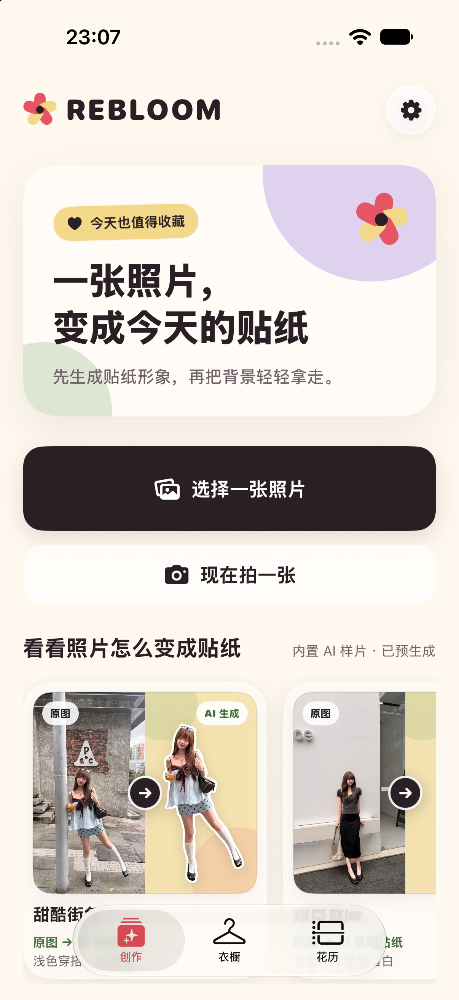
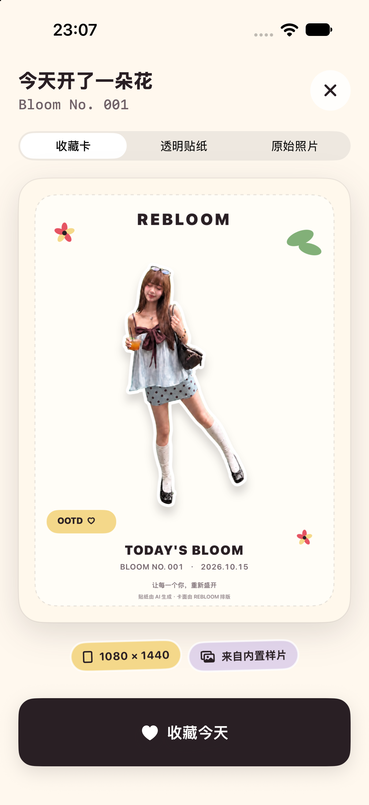
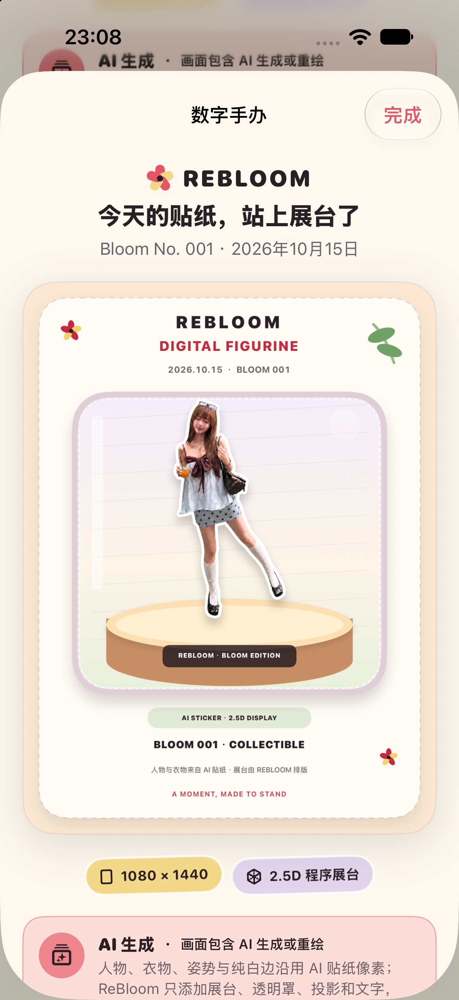

# ReBloom

**English** · [简体中文](README.zh-CN.md)

### Let every version of you bloom again.

Turn an outfit of the day into an AI sticker, a keepsake, and a memory worth revisiting. Let your wardrobe grow naturally along the way.

## A little everyday magic

<table>
  <tr>
    <td align="center"></td>
    <td align="center"></td>
    <td align="center"></td>
  </tr>
  <tr>
    <td align="center">Start with an outfit</td>
    <td align="center">Your outfit, collected</td>
    <td align="center">Make it a keepsake</td>
  </tr>
</table>

Captured from the Chinese app running in Xcode's iOS Simulator, using bundled, pregenerated AI samples and locally composed cards. These show the working interface, not a live Apple/OpenAI generation run or evidence of identity and clothing fidelity on a physical iPhone.

ReBloom is a native iOS demo with a Chinese interface. Start with a selfie or an OOTD, collect the result in your Bloom Calendar, and turn it into a shareable card or a digital figurine display. Add clothing photos from your library or another app's share sheet to gradually build your wardrobe—without filling out a catalog first.

## From today's outfit to a growing collection

- **Make a sticker.** Choose a photo, confirm an AI image in the system Image Playground sheet, then turn that image into a transparent sticker with a white border. Three built-in AI samples let you explore the experience immediately.
- **Keep your days.** Save a favorite to the Bloom Calendar, revisit it by month or season, and share a monthly sticker Lookbook.
- **Make it yours.** Create collection cards, botanical posters, and 2.5D figurine display cards from your stickers. These layouts reuse the sticker; they do not create a 3D model.
- **Grow a wardrobe naturally.** Import product or flat-lay photos, including up to five images from another app's share sheet. Review suggestions when useful; only your confirmation establishes an outfit-to-garment relationship.
- **Revisit what you own.** Explore new combinations of previously confirmed pieces, or try a simple sticker outfit collage. The collage is a local composition, not a prediction of fit or realistic drape.
- **Keep control of your collection.** Records and media stay in local storage, with a TAR export and an explicit delete-all flow. There is no account or cloud sync.

## Run it in Xcode

The current checkout has been built with **Xcode 27**. The deployment target is **iOS 17**; individual AI features require newer system capabilities and compatible hardware.

```bash
git clone https://github.com/imxv/ReBloom.git
cd ReBloom
open ReBloom.xcodeproj
```

1. Select the **ReBloom** scheme and an installed iPhone simulator in Xcode.
2. Press **⌘R**. The app appears as **ReBloom**.
3. Tap a built-in sample on the home screen to explore stickers, collection cards, and the Bloom Calendar without configuring a provider key.

To generate a new sticker from your own photo, use an Apple Intelligence-compatible device with Image Playground available, and configure the developer-controlled transparency proxy. See the [proxy setup](server/README.md) for local configuration. Provider keys belong on the server, never in the app.

The generated Xcode project is committed. Run `make project` only when you need to regenerate it after changing `project.yml` or adding a target. The script downloads a pinned XcodeGen into an ignored local tools directory.

### Command-line development

```bash
make build                       # Build for the default simulator
make check                       # Strict Swift formatting and static analysis
make test                        # Run the existing test suite
make legacy-provider-isolation   # Check isolation of the legacy Apple adapter
```

The default build destination is `iPhone 17 Pro, OS=latest`. Select another installed simulator in Xcode or override `DESTINATION` when using `make`. `make format` applies Swift formatting.

Use `make verified-test` when a full run needs preserved, independently checked results; artifacts go to `.artifacts/verified-tests`. It verifies test counts, required cases, and zero failures or skips, but does not isolate a shared simulator. See [test evidence](docs/test-evidence.md) and the [verification guide](docs/agent-guidance/verification.md) for the appropriate existing regression checks. `make test-tools` checks the evidence tools themselves.

## Image sources and data boundaries

The default creation flow is:

**Your photo → system Image Playground → your confirmed AI image → transparency proxy → transparent sticker → locally composed card.**

Only the confirmed AI image goes to the second-stage proxy; your original photo does not. A canceled or unavailable AI step ends honestly, without silently switching to an original-photo cutout. A built-in sample is used only when you choose it and remains labeled as a sample.

AI stickers and their derived cards retain their AI provenance. Layouts are generated locally, while garment suggestions remain provisional. ReBloom does not infer wardrobe facts from AI-redrawn clothing. Saving a collection requires both media and local records to be persisted; an unsaved draft is not a saved memory.

The app has no account, cloud sync, or public proxy deployment. Apple system generation and the configured transparency service can use network services; this is not an entirely offline or free generation pipeline. Device backup remains subject to your iOS settings. The share extension reads only images you explicitly share—it does not scrape shopping pages or resolve product links or SKUs.

## Demo status

ReBloom is a local product demo, not an App Store release. The UI, local collection flows, and provider contracts have implementation and regression evidence; real Apple/OpenAI output quality, identity and clothing fidelity, and the complete flow on compatible physical hardware still need validation.

The home-screen examples are three archived AI samples. Separate historical cutout fixtures and Debug-only style or pose fixtures support regression checks; they are not live provider results. Historical iOS 26.5 simulator runs lacked usable Vision inference and pose compute, so those results must not be generalized to a physical iPhone. The iPhone 11 does not support Apple Intelligence. The optional Style Garden still uses an isolated iOS 26 legacy adapter and has no replacement provider for iOS 27.

For the detailed feature inventory, device limitations, and linked verification records, see the [Chinese README](README.zh-CN.md) and [iOS demo scope](docs/ios-local-demo.md).

## Explore the project

Most implementation and verification documents are currently in Chinese.

| Start here | What it covers |
| --- | --- |
| [Product direction](docs/product-direction.md) | OOTD, a naturally growing wardrobe, and meaningful keepsakes |
| [iOS demo scope](docs/ios-local-demo.md) | Implemented behavior, acceptance criteria, and open questions |
| [Roadmap](TODO.md) | Current work and remaining validation |
| [Transparency proxy](server/README.md) | Local setup and the server-side provider boundary |
| [Sticker pipeline](docs/agent-guidance/sticker-pipeline.md) | Generation, transparency, provenance, and quality constraints |
| [Wardrobe contracts](docs/agent-guidance/wardrobe.md) | Suggestions, confirmation, image upgrades, and historical links |
| [Data and permissions](docs/agent-guidance/data-and-permissions.md) | Persistence, export, sharing, deletion, and accessibility |
| [Derived creations](docs/agent-guidance/derived-artifacts.md) | Lookbooks, posters, figurines, and outfit collages |
| [Verification guide](docs/agent-guidance/verification.md) | Existing checks and what their evidence can establish |

### Compatibility with existing installations

ReBloom was previously named Adonis. The local project directory, Xcode project, schemes, targets, and source directories now use ReBloom. The Swift app module remains `Adonis` to preserve persisted model identities; Bundle IDs, App Group, storage and export identifiers, and `ADONIS_*` configuration names also retain their existing values. Historical evidence retains the name it had when captured.
