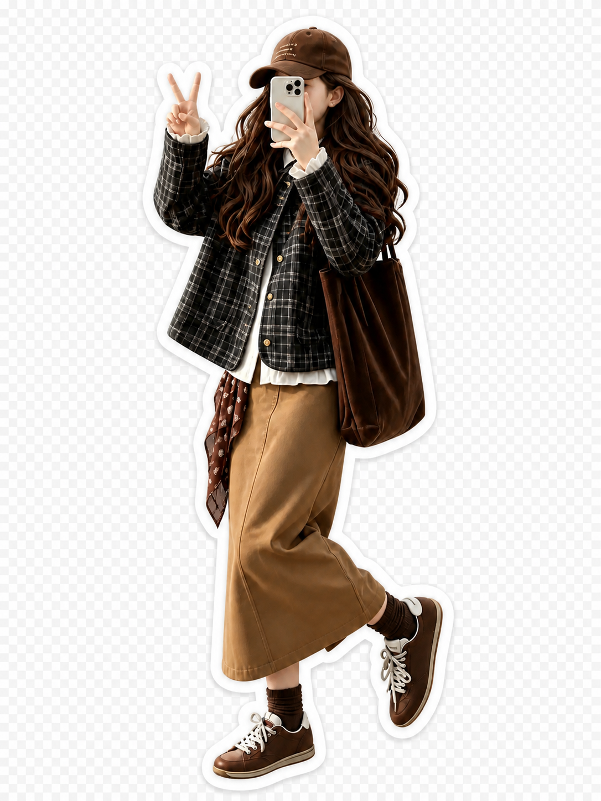
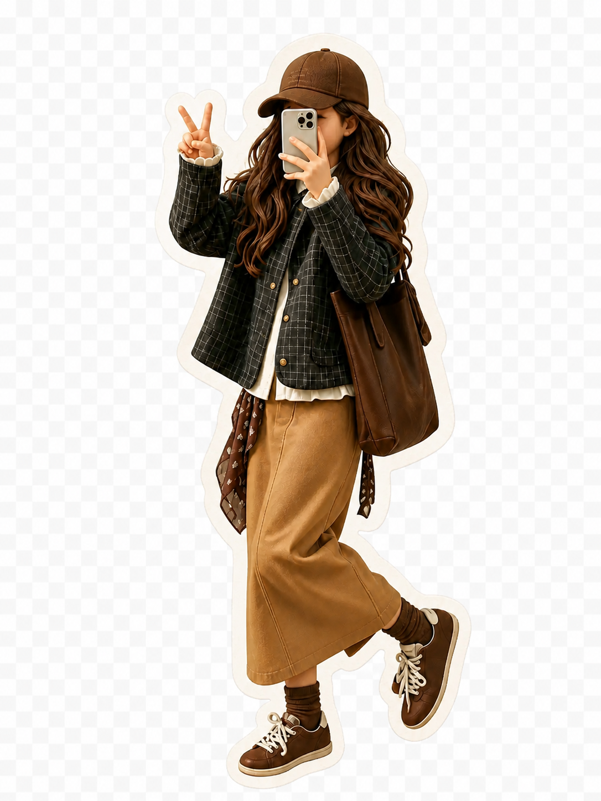
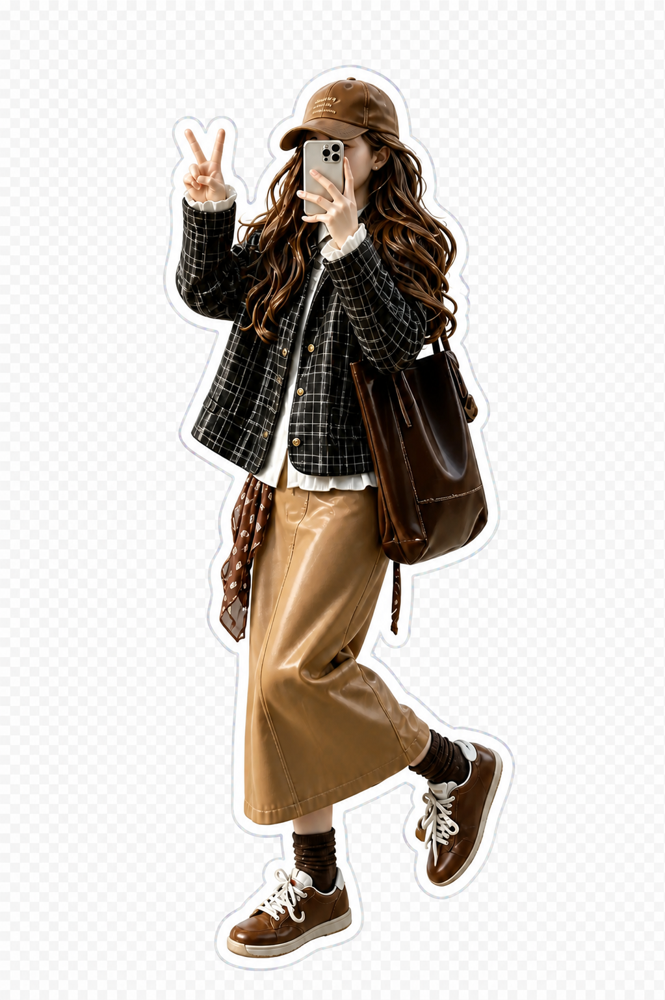
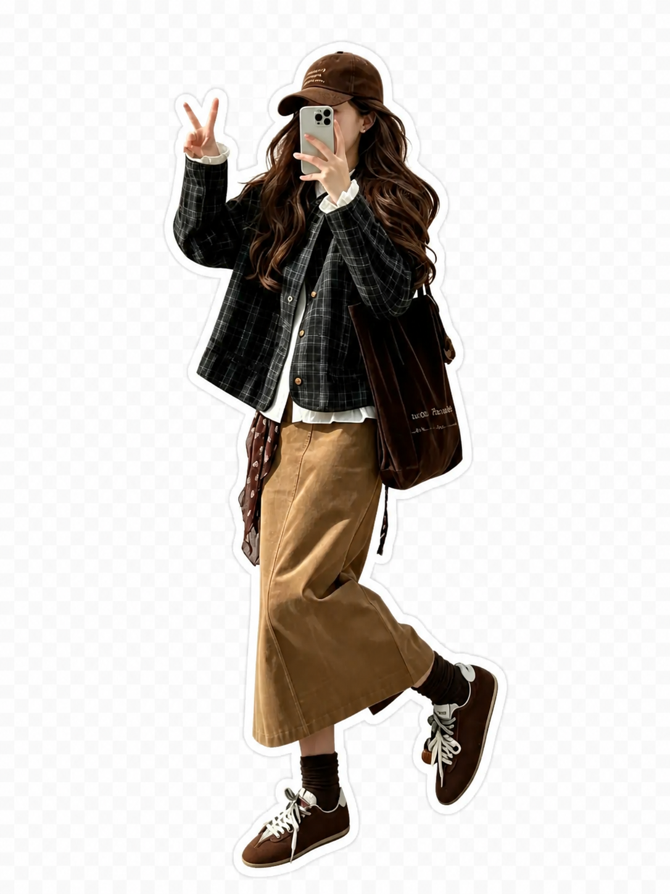

# 数字手办贴纸首轮视觉样片实验

> 日期：2026-08-29
>
> 对应任务：ADO-002、ADO-006
>
> 结论状态：完成单样本视觉探索并确认首轮默认视觉，不代表透明生成链路或 ADO-006 已通过。

## 1. 实验目的

使用同一张用户提供的接近全身 OOTD 照片，比较三种数字手办贴纸方向，并验证：

- 原始姿势和主要衣物能否保持。
- 手机遮脸关系能否保持，不擅自生成新脸。
- 不同手办材质和贴纸边缘能否产生可辨认差异。
- 生图结果是否真正包含透明通道。

源照片只作为本次生成输入使用，没有复制进项目。

## 2. 固定约束

三个版本都使用同一组主体约束：

- 保持左手比耶、右手举手机遮脸、一条腿抬起的姿势。
- 不显示或编造被手机遮住的完整脸。
- 保持棕色棒球帽、深棕色长卷发、黑色格纹外套、白色荷叶边内搭、棕色长裙、深棕色帆布包、棕色袜子、棕色系带鞋和腰间花纹布料。
- 不改变身体比例和肤色。
- 输出单人异形贴纸，不增加场景、卡片、底座、包装、文字或水印。
- 要求完整保留帽子、手指、包、裙摆和鞋，不裁切肢体。

## 3. 三个版本

### A：纯白贴纸边

目标提示：精致真人比例的树脂或乙烯基 3D 时尚手办，轻度风格化，不做大头 Q 版；使用连续、均匀的纯白异形贴纸边。

### B：奶油纸张质感

目标提示：温暖、轻玩具化的黏土与哑光乙烯基手办，保持自然比例；使用较宽的奶油色纤维纸张边缘。

### C：珠光收藏边

目标提示：限量收藏级树脂与缎面乙烯基手办，使用白色内边加极细珠光全息外边，精致但不闪耀过度。

## 4. 用户确认的默认样片

在 A、B、C 三个偏手办化版本之后，根据“人物和衣物元素被修改过多”的反馈，追加了一版更严格的原图保真处理：保留接近原照片的真实质感，只移除背景并增加连续的纯白异形贴纸边，不再主动增加明显的 3D、黏土、树脂或珠光材质。

用户已确认该效果可作为首轮默认视觉。由此锁定两项产品选择：

- 默认保持原图质感和原有视觉元素，强风格化手办版本以后作为主动选择提供。
- 默认使用纯白贴纸边，不采用奶油纸张边或珠光收藏边。

这次确认只代表视觉方向通过。该文件仍为 1086 × 1448 的 RGB 图片，没有 Alpha 通道，预览棋盘格被烘焙在图片中，不能作为正式透明 PNG 交付。

## 5. 视觉检查

三个版本都做到：

- 保留手机遮脸，没有生成一张新的完整脸。
- 大体保留原始比耶、举手机和抬腿姿势。
- 保留帽子、长发、格纹外套、白色内搭、棕色长裙、包和棕色鞋的整体关系。
- 形成可辨认的异形贴纸轮廓。

仍存在的问题：

- 三个版本的手办感主要来自平滑材质和光泽，立体模型感还不够强。
- 腰间花纹布料、包的细节和部分衣物褶皱发生了变化。
- C 版本把长裙处理得更亮、更像皮革，衣物材质保真弱于 A 和 B。
- 原图正脸被手机遮挡，本样本无法验证完整的人脸身份一致性。
- A 和 B 的长边分别为 1448 像素，没有达到产品规格中“长边至少 1536 像素”的目标；C 的长边为 1537 像素。

首轮对比判断：

- A 最接近清楚、通用的日常贴纸，可作为基础方向。
- B 更温暖、更像实体纸贴，但数字手办感最弱。
- C 的收藏感最强，但珠光材质容易改变真实衣物质感。

后续追加样片表明，进一步降低风格化强度更符合当前需求。最终采用第 4 节中的原图质感纯白边版本，不再采用“A 主体 + C 珠光外边”作为默认方向。

## 6. 透明通道检查

首次生成明确要求真实透明背景，但三个 PNG 均为 RGB 文件：

| 版本 | 尺寸 | Alpha |
| --- | --- | --- |
| A | 1086 × 1448 | 无 |
| B | 1086 × 1448 | 无 |
| C | 1023 × 1537 | 无 |
| 已确认样片 | 1086 × 1448 | 无 |

预览中的棋盘格被烘焙进图片，不是真实透明背景。

随后对三个版本分别进行一次只移除棋盘格的定向编辑，仍然得到无 Alpha 的 RGB PNG。由此确认：

> 当前生图步骤可以生成“贴纸视觉”，但不能作为透明通道的可信来源。

正式链路必须执行独立的人像分割或图像抠图，再由程序生成白边、投影和收藏卡排版。不能仅通过提示词要求透明背景，也不能通过肉眼看到棋盘格就判定成功。

## 7. 生成耗时

- 三个初始版本并行生成约 96 秒。
- 三个透明背景修复版本并行生成约 132 秒。

这些数据只来自一次运行，不能作为正式性能结论。透明修复没有成功，因此不应把第二次生成纳入未来正常链路。

## 8. 后续实施结果与下一步

本次实验之后，项目已完成独立 Apple Vision 人像分割与 Core Image 灰度蒙版合成，生成真实 Alpha、纯白边和固定收藏卡；四张授权样片的可重复结果及测试证据见 [iOS 本地 Demo 验证记录](../verification/2026-08-29-ios-local-demo.md)。首次实现曾错误使用读取 Alpha 的合成滤镜，导致整张背景矩形被保留；像素级目检发现后已改为按灰度蒙版合成，并增加“透明区域至少 10%”的回归门槛。

1. 在真实 iPhone 上验证实时 Vision 路径、相机与相册权限。
2. 再补充至少一张正脸可见的全身照、一张半身照和商品图，验证身份与降级规则。
3. 对坐姿、毛绒物体和复杂遮挡建立更细的主体边界评价，避免把相邻物体误并入人物。
4. 扩充固定样本并进行首轮用户测试后，再判断 ADO-006 是否完成。

后续四张授权样片已经真实执行“不透明 AI 源图 → 独立抠图”，并确认技术顺序可行、人物与穿搭保真仍不合格；完整像素和接入门槛见 [AI 不透明源图再抠图实验](2026-08-31-ai-opaque-source-matting.md)。
