# AI 不透明源图再抠图：四张授权样片实验

> 状态：两段式技术链路已用四张真实授权照片验证；当前生成结果的人物与穿搭保真未达到产品接入条件。
>
> 读者：以后选择或接入 Adonis 图片生成 provider、修改隐藏提示或调整 AI 源图抠图策略的工程 Agent。
>
> 读完后的动作：能用同一组原图、AI 不透明源图和透明贴纸判断候选 provider 是否值得进入 App，而不会把“背景干净”误当成人物与穿搭保真。
>
> 对应任务：ADO-005、ADO-006、ADO-303、ADO-Q04、ADO-Q05

## 1. 结论先行

本实验真实完成了四次以下链路：

```text
用户授权原图
  → 图片生成模型输出暖白背景、不透明、单人的贴纸源图
  → 独立 Vision 抠图
  → 带真实 Alpha 与纯白边的透明贴纸
```

四张 AI 源图均为无 Alpha 的 RGB PNG；四张第二段输出均为带 Alpha 的 PNG，长边均为 1536 像素。技术顺序成立，证明“不依赖生图模型交付透明通道”是可执行的。

但四张 AI 源图都改变了原图中的脸、姿势、衣物或配饰。第二段抠图还在浅色金属包、黑色手套和靴边出现了新的透明度问题。因此这批文件只能保留为真实实验证据，不能作为 App 内置结果、真实 provider 成功率或人物保真证明。

## 2. 实验边界

- 输入只使用项目已有的四张用户授权照片，没有从小红书或其他社交平台抓取图片。
- AI 阶段使用 Codex 内置图片生成能力。模型名称和版本没有暴露，不能把结果外推为某个公开 API 的质量。
- sample-01 首次结果缺少原图吸管并改变包袋细节，因此追加一次定向保真修正；其余三张各请求一次，总请求数为 5。
- AI 输出是不可重复的生成结果。仓库保存最终像素与哈希，用于复查本次事实，不要求重新生成得到相同字节。
- 第二段使用与本地样片相同的 macOS Vision 与 Core Image 脚本。它证明宿主机链路，不证明 iPhone 11 的实时 Vision。
- 本次没有把任何实验输出复制到 App Resources，也没有改变生产 provider。

机器可读事实保存在 [实验清单](../../assets/prototypes/digital-figurine-sticker/ai-two-stage-experiment.json)。运行：

```bash
make ai-sticker-visual-regression
```

该命令只校验原图、AI 源图和透明贴纸的文件哈希、尺寸，以及透明区域与可见主体均真实存在的 Alpha 契约；它不代替人工视觉评价，也不重新调用图片生成服务。

## 3. 固定生成契约

四张图共用以下隐藏约束：

- 原照片是身份、发型、身形、姿势、衣服、鞋包、首饰和手持物的唯一事实来源。
- 只移除背景与背景人物，并在确有遮挡时补全被遮挡区域。
- 保持单人、完整头发到鞋、3:4 纵向构图与四周留白。
- 输出暖白、无场景、无地面、无文字、无水印的不透明照片；此阶段不要求透明背景或贴纸边。
- 不主动美化、换装、改色、改材质、改身体比例或增加配饰。

逐张提示还锁定了以下难点：

| 样片 | 重点约束 |
| --- | --- |
| sample-01 | 移除前景路柱，保留蝴蝶结、波点短裙、饮料吸管、黑包、白袜、黑鞋和抬腿姿势 |
| sample-02 | 移除墙面与长椅，保留深色泡泡袖上衣、长黑裙、金属编织包与靠墙手势 |
| sample-03 | 移除店内背景和其他人物，保留手持甜点遮挡关系、胸前多层蝴蝶结和宽松波点裤 |
| sample-04 | 移除深色座椅和墙面，保留短发、双手套、上衣白色图形、交叠坐姿与长靴结构 |

## 4. 原图、AI 源图与透明贴纸

### sample-01

| 原图 | AI 不透明源图 | 第二段透明贴纸 |
| --- | --- | --- |
| 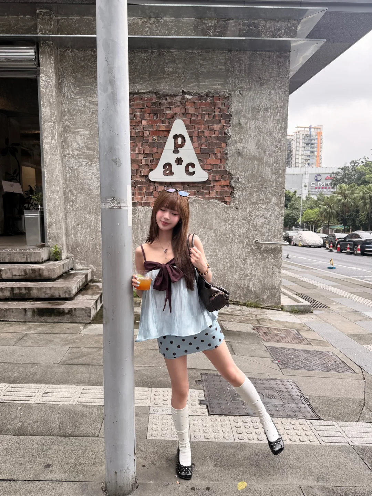 | 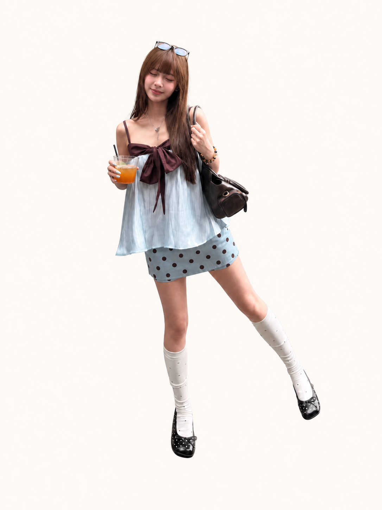 | 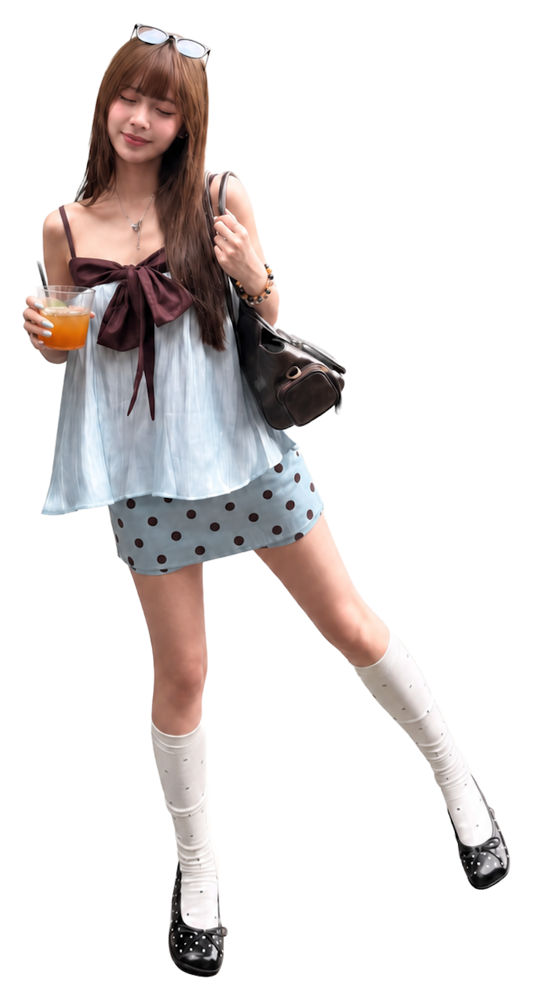 |

- AI 保真：第二次请求恢复了吸管和更多包袋结构，但脸、身体姿势、波点位置和若干配饰仍有变化。
- 抠图：主体完整，纯白边连续，没有带入街景或路柱。
- 结论：第二段合格，AI 源图仍需用户复核，不进入产品。

### sample-02

| 原图 | AI 不透明源图 | 第二段透明贴纸 |
| --- | --- | --- |
| 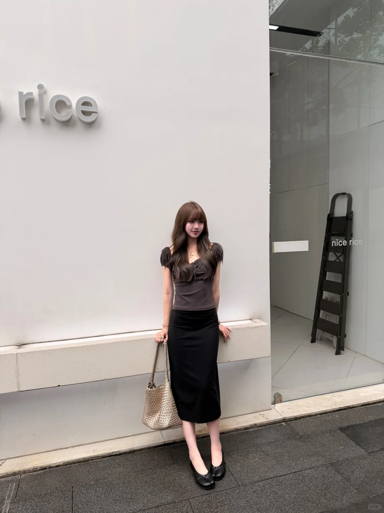 |  | 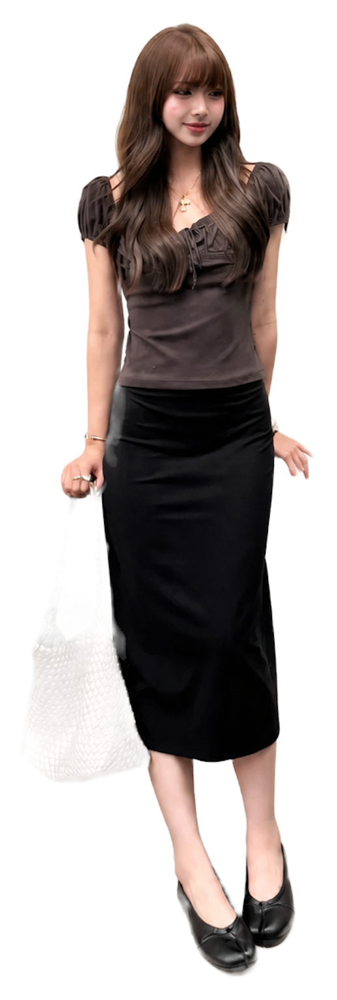 |

- AI 保真：脸、右手靠墙姿势、金属编织包形状和纹理被重绘。
- 抠图：人物轮廓干净，但浅色反光包在白底分割后明显变淡并丢失局部边缘。
- 结论：人物保真不通过，抠图建议复查，不进入产品。

### sample-03

| 原图 | AI 不透明源图 | 第二段透明贴纸 |
| --- | --- | --- |
| 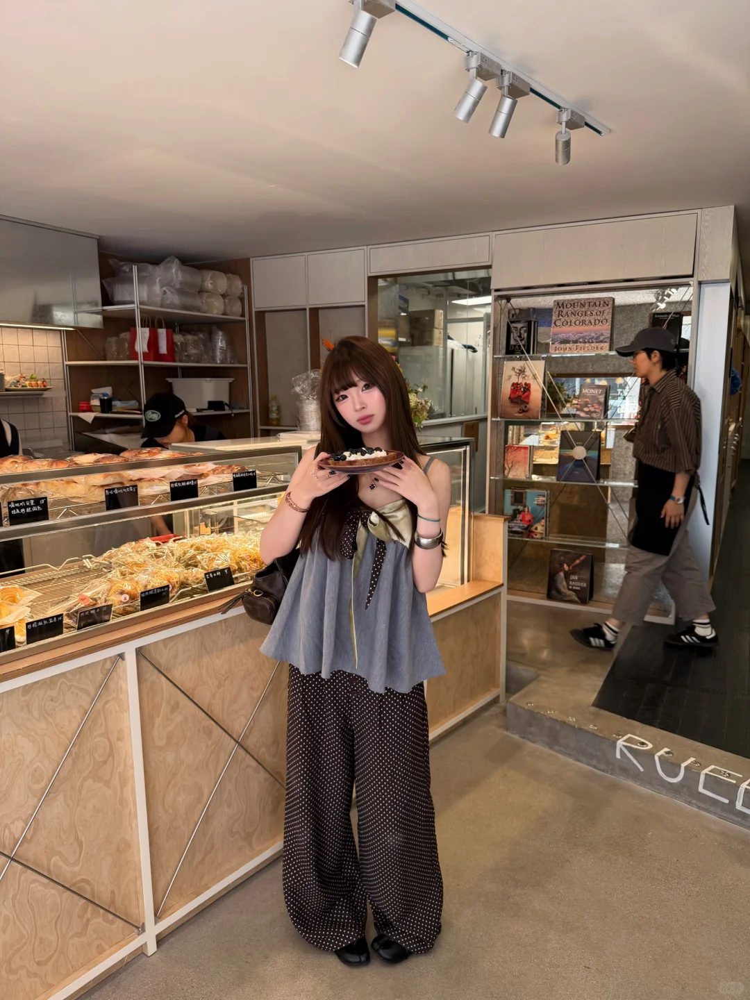 | 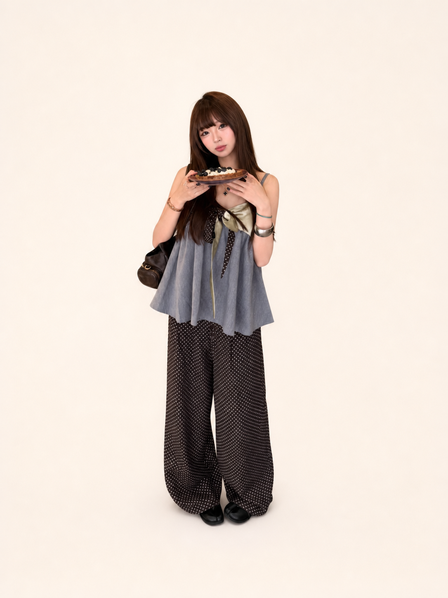 | 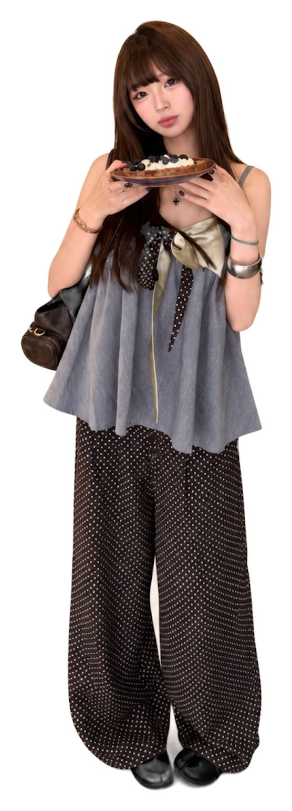 |

- AI 保真：脸、胸前蝴蝶结、甜点和包袋细节被重绘；宽腿裤与整体站姿仍保留。
- 抠图：店内背景和其他人物被排除，主体、裤腿和鞋完整，纯白边连续。
- 结论：第二段合格，AI 源图保真不通过，不进入产品。

### sample-04

| 原图 | AI 不透明源图 | 第二段透明贴纸 |
| --- | --- | --- |
| 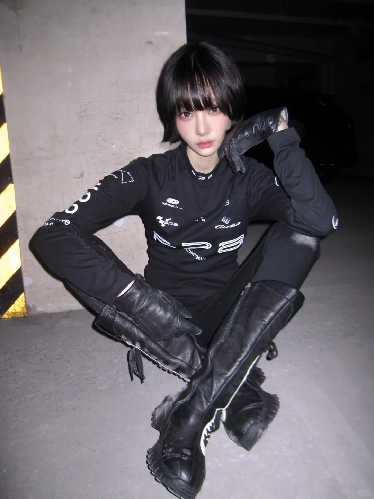 | 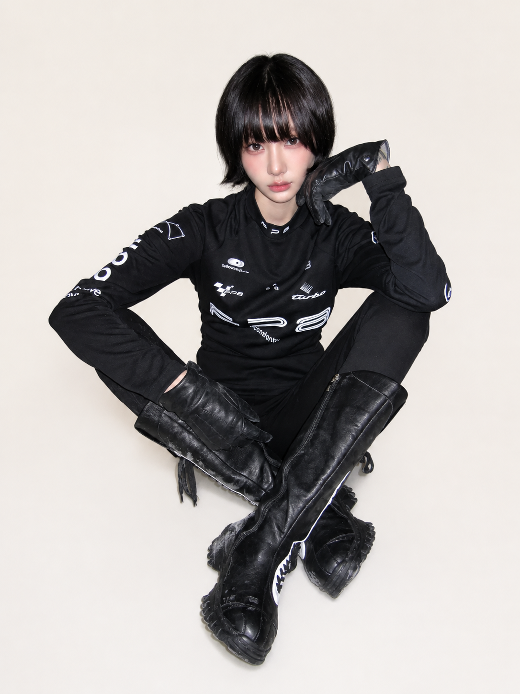 | 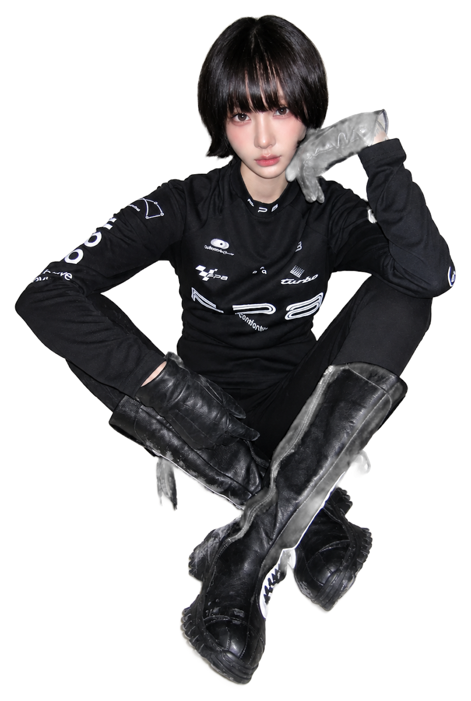 |

- AI 保真：坐姿、交叠腿和长靴关系保持最好，但脸、上衣图形、手套和靴子细节仍被重绘。
- 抠图：历史原图直抠会把浅色座椅并入主体；AI 白底解决了这类背景粘连，但黑色抬手手套和部分靴边被错误处理成灰白或半透明。
- 结论：证明 AI 预处理能解决一种背景粘连，同时暴露新的深色配饰 Alpha 问题；当前贴纸拒绝交付。

## 5. 产品接入门槛

这次实验把两个不同问题拆开：

1. **AI 源图是否像原图。** 比较用户原图与 AI 不透明源图，检查脸、发型、身形比例、姿势、衣服、鞋包、配饰和缺失/多余内容。
2. **抠图是否忠于 AI 源图。** 比较 AI 不透明源图与透明贴纸，检查主体完整、深浅色配饰、透明度、边缘、纯白边和背景残留。

只有两项都通过，才可以展示收藏卡。不能因为第二段 Alpha 正确就声称“像用户”，也不能因为 AI 背景干净就跳过第二段抠图。

在 provider 尚未用这四张固定图完成对照之前：

- 默认结果继续保留“这张还像你吗？”的可选复核。
- 不自动把 AI 结果识别成事实性 OOTD 单品。
- 不用实验输出替换内置授权样片或 Debug 夹具。
- AI 失败时不退回用户原图直抠。
- 不把本次工具输出描述成 Apple `ImageCreator`、真实 iPhone 或未来云端 provider 的质量。

## 6. 下一次 provider 评估方式

接入候选 provider 后，使用同一批四张原图：

1. 保存每张原图、最终请求、原始响应、AI 不透明源图、透明贴纸、耗时、错误与费用事实。
2. 不只重试失败图，也保留首次结果；重试必须单独计数。
3. 逐张完成 App 已有的人物与穿搭复核，并单独评价第二段抠图。
4. 将候选输出保存为新的版本文件，不覆盖本实验。
5. 运行 `make ai-sticker-visual-regression` 与 `make ai-sticker-regression`。
6. 在目标 iPhone 上完成真实上传、取消、弱网、超时、保存与删除回归后，再决定是否替换 provider。

当前最重要的未决事实不是“能不能生成白底人像”，而是候选 provider 能否在低心智负担下持续保留人物身份与穿搭细节。
