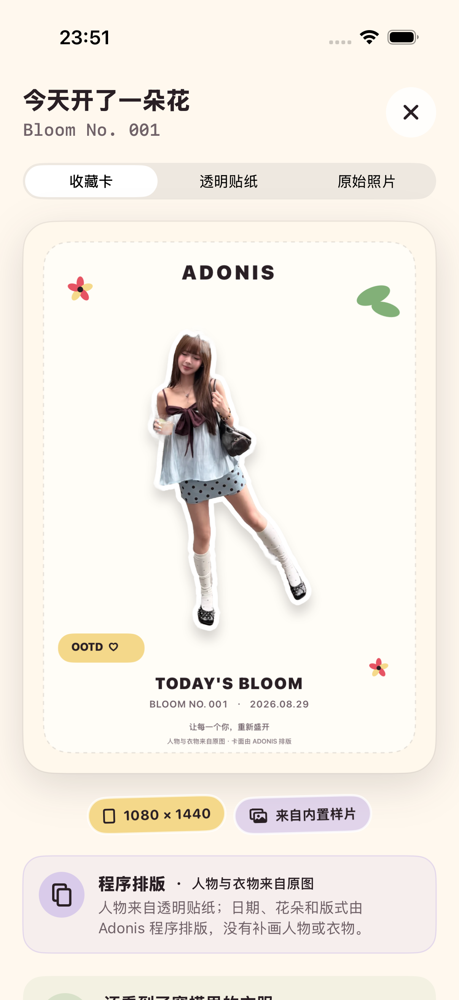
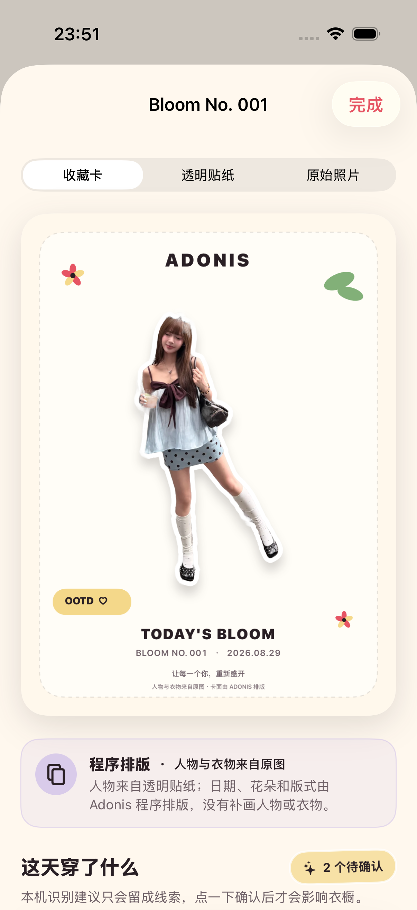
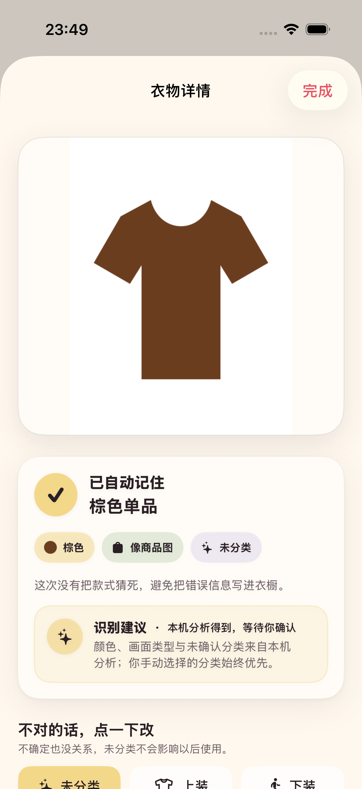

# 2026-08-29 生成内容来源标识验证记录

> 结论：Adonis 已在不增加上传前问题的前提下，统一区分原始图片、原图处理、程序排版和识别建议，并为未来 AI 补全与 AI 生成保留独立类型。当前本地 Demo 没有 AI 生成像素，不会把抠图、白边、排版或本机识别描述成 AI 生成。

## 来源类型契约

`VisualContentProvenance` 提供六个稳定、可编码的类型：

| 代码值 | 用户名称 | 约束 |
| --- | --- | --- |
| `user_provided` | 原始图片 | 用户选择、拍摄或主动分享，Adonis 没有改动画面内容 |
| `derived_from_original` | 原图处理 | 只做背景移除、裁切、透明通道与纯白边，不重绘主体 |
| `programmatic_composition` | 程序排版 | 人物与衣物来自透明贴纸，日期、花朵和版式由程序添加 |
| `recognition_suggestion` | 识别建议 | 本机分析得到，确认前只是一条建议 |
| `ai_filled` | AI 补全 | 未来用于标记 AI 补充的缺失、遮挡或画面外区域 |
| `ai_generated` | AI 生成 | 未来用于标记 AI 新生成或重绘的内容 |

只有后两类的 `containsAIGeneratedPixels` 为 `true`；只有识别建议的 `requiresUserConfirmation` 为 `true`。未来接入试穿、风格化或第三方模型时，不得复用“原图处理”逃避 AI 内容说明。

## 低心智负担交互

- 上传前仍只有统一图片入口，不要求用户选择生成方式、模型或来源类型。
- 结果默认直接展示收藏卡；同一个三段切换提供“收藏卡 / 透明贴纸 / 原始照片”。切换后，格式标签、来源说明和系统分享对象同步变化。
- 结果说明放在图片和两个轻量标签之后，不抢占首个结果；原有“收藏今天 / 分享 / 再做一张”三个动作不变。
- 花历详情使用同一三段切换和同一来源说明，避免首次结果与历史解释不一致。
- 衣橱颜色、画面类型和未确认分类显示为“识别建议”，并明确人工分类始终优先。
- OOTD 上身与下身线索也显式写为“本机识别建议”，确认前不影响衣橱。

## 分享卡与透明贴纸

1080 × 1440 收藏卡底部增加“人物与衣物来自原图 · 卡面由 ADONIS 排版”，使图片离开 App 后仍保留最小来源说明。声明使用次级字号，不遮挡人物、日期、Bloom 编号和品牌主标题。

透明贴纸本体继续保持无水印。它的透明通道、裁切和纯白异形边属于原图处理；在 App 结果与历史中解释，不把文字烘焙到用户可能继续创作的 PNG 上。

## 个人数据导出

标准 TAR 的 `manifest.json` 新增 `visualAssets`。每个条目包含：

- 图片路径与业务角色；
- 所属记录 ID；
- 机器可读来源类型和用户说明；
- 是否包含 AI 生成像素；
- 是否等待用户确认。

导出测试固定创建 1 条 OOTD、1 件衣物、1 条线索、1 张用户收藏的花影海报和 1 张待导入图片，共验证 7 个视觉资产条目：原图、贴纸、收藏卡、花影海报、衣橱图片、线索预览与共享收件箱图片。测试同时断言当前七项都不含 AI 生成像素，线索预览需要用户确认；花影海报另按 `creativeWorks` 导出配方、版本、来源 OOTD 和本机耗时。

## 自动验证

- 来源契约与个人数据导出的 7 个专项单元测试通过，0 失败；结果包为 `.derivedData/Logs/Test/Test-Adonis-2026.08.29_23-43-07-+0800.xcresult`。
- 结果、历史和衣橱的 2 个专项 UI 流程测试通过，0 失败；结果包为 `.derivedData/Logs/Test/Test-Adonis-2026.08.29_23-43-54-+0800.xcresult`。
- 最新完整执行 `make check`，严格 `swift-format` 与通用 iOS 设备静态分析通过；执行 `make test`，58 个单元测试与 15 个 UI 流程测试共 73 项全部通过、0 失败。结果包为 `.derivedData/Logs/Test/Test-Adonis-2026.08.30_04-05-02-+0800.xcresult`。
- 最终 XCTest 生成的 TAR 已从结果包导出，再由 macOS `tar -tf`、`tar -xOf` 与 `jq` 独立读取。归档包含清单、5 个媒体文件和 1 张待导入图片；`visualAssets` 实际为 6 项，当前各项 `containsAIGeneratedPixels` 均为 `false`，只有 `garment_observation_preview` 的 `requiresUserConfirmation` 为 `true`。

## 界面证据

以下截图来自 iPhone 17 Pro、iOS 26.5 模拟器的 UI 测试附件，不是设计稿。

三张原图均为 1206 × 2622。逐图检查结果：三段切换没有截断；收藏卡人物、衣物、主标题、日期和 Bloom 编号未被新增说明遮挡；来源说明在结果之后且主要按钮仍可滚动到达；衣橱识别说明没有遮挡一键分类入口。

文件 SHA-256：

- `content-provenance-result-2026-08-29.png`：`dc623294ac6e2590aa567875224f27cbeb770197744a8e94d22c1a6867ce9b8a`
- `content-provenance-history-2026-08-29.png`：`9afc12f5ead047fe978dcdd14937cc370c10393d36c6fbbdf9e1c81a2a641f35`
- `content-provenance-recognition-2026-08-29.png`：`643c0554f1694bceae4a40461bd9d24c65c8f12dfbff1486af163bcf3131f9d4`

## 尚未证明

- 当前没有接入 AI 补全、虚拟试穿或风格生成供应商，因此后两类只完成数据与界面契约，尚无真实供应商输出可验证。
- 收藏卡来源声明是否足够被首轮用户理解，仍需无讲解测试。
- 动态字体、VoiceOver 和真实 iPhone 分享到不同目标的体验归入 ADO-Q07，尚未完成。
