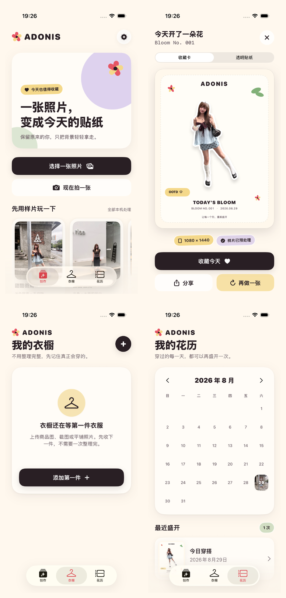

# 2026-08-29 iOS 本地 Demo 验证记录

> 结论：模拟器核心闭环通过，通用 iOS 真机构建通过；真实 iPhone 运行待设备连接。

## 验证范围

本轮验证覆盖创作首页、统一图片入口的商品图自动入库与失败后延迟询问、四张授权样片、真实透明贴纸、结构质量降级、90 秒用户等待边界与基础贴纸降级、相机拒绝与系统限制的本地恢复界面、1080 × 1440 收藏卡、本地保存、花历回看、1080 × 1440 月度贴纸 Lookbook 与系统分享、1080 × 1440 静态 2.5D 数字手办收藏卡、已收藏记录进程终止后重新启动恢复、衣橱导入、其他 App 图片分享、OOTD 临时衣物线索、单品补商品图、用户确认式历史回填、个人数据导出与彻底删除、文件持久化和通用 iOS 静态分析。它不把编译通过等同于真机可用，也不把模拟器进程恢复或可注入权限状态等同于真实设备与真实系统流程。

## 自动证据

- Xcode：26.6，Build 17F113。
- 视觉截图：独立创建的 iPhone 17 Pro，iOS 26.5，设备名 `Adonis Test`。
- 最终完整测试：命名为 `iPhone 17 Pro` 的 iOS 26.5 模拟器，当前 197 个测试全部通过；包含 163 个单元测试与 34 个 UI 流程测试，`xcresulttool` 独立汇总一致，结果包为 `.derivedData/Logs/Test/Test-Adonis-2026.08.30_23-17-36-+0800.xcresult`。
- 通用 iOS 设备构建：`xcodebuild ... -destination 'generic/platform=iOS' ... build CODE_SIGNING_ALLOWED=NO`，退出码 0。
- 静态分析：`xcodebuild ... -destination 'generic/platform=iOS' ... analyze CODE_SIGNING_ALLOWED=NO`，退出码 0。
- 完整测试计划：197 个测试通过，0 失败、0 跳过；贴纸主链路、统一图片入口、原始蒙版、源像素保真与成品结构三道质量闸门、固定样片失败路由、90 秒超时退出与迟到结果隔离、基础贴纸收藏和花历持久化、月度贴纸 Lookbook 与系统分享、数字手办卡原贴纸像素契约与结果/历史入口、已收藏记录进程终止与重新启动恢复、相机权限状态与拒绝/限制恢复界面、最大辅助字号、增强对比度、处理取消、前后台恢复、衣橱轻量导入、系统分享扩展、超大像素图片拒绝、OOTD 线索确认、单品补图、历史穿着回填、生成内容来源标识、个人数据导出与彻底删除、生成性能诊断链路均已覆盖。
- UI 主链路：样片 → 收藏卡 → 一次点击生成 2.5D 数字手办卡 → 收藏今天 → 返回创作 → 花历出现记录 → 从历史再次打开手办卡，通过。
- 数字手办链路：结果与已收藏历史均无需配置即可生成 1080 × 1440 静态展台卡，预览明确来源和非真实 3D 边界，结果页可打开真实 iOS 系统分享面板。专项结果包为 `.derivedData/Logs/Test/Test-Adonis-2026.08.30_05-37-52-+0800.xcresult`，像素、界面与边界见 [数字手办收藏卡验证记录](2026-08-30-digital-figurine-card.md)。
- 月度画册链路：空花历不显示入口 → 收藏真实 OOTD → 花历出现一次点击入口 → 生成月度贴纸画册 → 打开真实 iOS 系统分享面板，通过。专项结果包为 `.derivedData/Logs/Test/Test-Adonis-2026.08.30_05-12-25-+0800.xcresult`，界面、来源与能力边界见 [月度贴纸 Lookbook 验证记录](2026-08-30-monthly-lookbook.md)。
- 冷启动链路：样片 → 收藏今天 → 终止 App 进程 → 使用同一隔离磁盘库重新启动 → 花历严格恢复 1 条记录 → 收藏卡与来源说明再次打开，通过。专项结果包为 `.derivedData/Logs/Test/Test-Adonis-2026.08.30_04-44-07-+0800.xcresult`，界面与边界见 [已收藏 OOTD 冷启动持久化验证记录](2026-08-30-cold-launch-persistence.md)。
- 文件链路：PNG 写入、读取、删除与清空均限制在注入的媒体目录内；分享扩展与主 App 的 App Group 收件箱成功跨进程交接；标准 TAR 已由 macOS `tar` 独立读取；全部删除覆盖 SwiftData、媒体、App Group 与临时归档，通过。
- 收藏卡：固定为 1080 × 1440，所有像素 Alpha 为 255，通过。
- 四张贴纸：具有 Alpha 通道、透明像素占比超过 10%、可见主体存在、长边至少 1536 像素，通过。
- 固定样片专项：四组仓库哈希与 macOS Vision 字节级重生成通过；27 个像素、原始蒙版、源像素保真、质量路由、收藏卡和 Vision 边界测试通过，结果包为 `.derivedData/Logs/Test/Test-Adonis-2026.08.30_23-17-11-+0800.xcresult`。

## 像素检查结论

第一次 Core Image 合成错误地使用了读取 Alpha 的蒙版滤镜，而 Vision 输出是灰度蒙版。结果虽然有少量透明 padding，却仍保留完整照片背景。自动 Alpha 检查不足以发现这个问题，逐图目检后已改为灰度蒙版合成，并增加最大连通区域裁剪与透明面积门槛。

当前四张结果分别覆盖浅色穿搭、深色穿搭、复杂店内背景和坐姿深色边缘。前三张人物与主要配饰边界可用；坐姿样片仍会把紧邻人物的浅色软垫并入主体，已作为已知困难样本保留，不能描述为完全解决。

四张原图、输出哈希、像素结构、覆盖标签、逐图缺陷和更新纪律现已固化为可重复门禁，详见 [固定样片回归基线验证记录](2026-08-30-sample-regression-baseline.md)。该门禁用于发现静默退化，不把固定结果描述成所有图片均可稳定处理。

第 4 张困难样片现在被明确标记为 C 级大块背景粘连：它仍保留在四张像素基线中，但从普通入口隐藏，测试专用入口会显示可理解的拒绝提示，并且不会出现结果页、收藏按钮或花历记录。前三张不显示多余提示。实现边界与真实 UI 证据见 [贴纸低质量降级验证记录](2026-08-30-sticker-quality-degradation.md)。

本机生成达到 90 秒后会强制退出用户等待。没有合格中间产物时提供同图重试或换图；贴纸已通过结构检查且收藏卡已完成时，直接交付基础贴纸并明确不包含衣物线索。迟到结果不会覆盖页面或补写成功终态；底层 Vision 是否立即释放仍待真机观测。实现边界与真实 UI 证据见 [生成超时与基础贴纸降级验证记录](2026-08-30-generation-timeout-fallback.md)。

## 界面检查

下图按“创作首页 / 结果收藏卡 / 衣橱空态 / 花历记录”排列，来自 UI 测试运行时的 iPhone 17 Pro 截图，而不是设计稿。

检查结果：中文标题、主要动作、卡片尺寸标签和底部导航均可见；结果页不要求用户选择模型或填写资料；花历日期已固定为中文。系统 iOS 26 浮动 Tab Bar 会覆盖滚动区域底部的一小部分内容，但内容可以继续滚动，不阻断操作。

## 模拟器 Vision 限制

当前 iOS 26.5 模拟器中，以下请求均无法创建推理上下文：人像分割、人物实例蒙版、注意力显著性、物体显著性、人体框和人脸框。强制 CPU、本地签名和全新模拟器实例均未改变结果。

因此当前采用可审计降级：

1. 真机代码保留实时 Apple Vision 路径，并已通过通用设备编译。
2. 四张样片通过 `scripts/generate_sample_stickers.swift` 在 macOS 主机上运行同类 Vision 与 Core Image 链路，派生透明结果随项目打包。
3. 模拟器对用户自选照片给出明确中文错误，不输出伪造蒙版。

## 尚未完成

- 真实 iPhone 当前处于离线状态，尚未验证相册、相机、实时 Vision、真实第三方购物 App 分享、App 终止/整机重启持久化和删除；系统分享面板、分享扩展与已收藏记录的 App 进程终止后恢复已在模拟器完成回归。
- 还没有首轮测试用户，因此“值得保存或分享”仍是产品假设，不是已验证结论。
- 固定样本尚缺半身、多人、透明材质、蓬松头发和商品图。
- 当前统一入口会把高置信度干净商品图自动收进衣橱，但真实类别建议尚未在 iPhone 授权商品图集上验证；它不等于身份级单品识别，也没有实现商品链接解析或写实虚拟试穿。专项证据见 [统一图片入口路由验证记录](2026-08-30-unified-image-input-routing.md)与 [购物应用图片分享验证记录](2026-08-29-shopping-app-image-share.md)。
- 当前 OOTD 只产生待确认的上身与下身画面线索；类别与颜色候选不是同款识别，且不会自动关联。专项证据见 [OOTD 衣物线索与确认验证记录](2026-08-29-ootd-garment-observations.md)。
- 当前历史回填也只展示最多 3 条画面相似候选，并要求用户明确确认；它已完成交互闭环，但尚未证明身份级同款识别。专项证据见 [衣橱历史穿着回填验证记录](2026-08-29-wardrobe-history-backfill.md)。
- 本地导出、系统分享、彻底删除与安全复查已经在模拟器完成；文件保护属性和系统设备备份行为仍需真实 iPhone 验证。专项证据见 [本地数据导出与删除验证记录](2026-08-29-local-data-controls.md)。
- 当前结果、历史、衣橱识别和导出清单已按实际来源区分，并明确当前没有 AI 生成像素；未来 AI 补全和 AI 生成仍需真实供应商输出验证。专项证据见 [生成内容来源标识验证记录](2026-08-29-content-provenance.md)。
- 最大辅助字号、增强对比度、关键语义和一次前后台往返已在模拟器完成；相机拒绝与系统限制的注入状态恢复界面也已通过。实际 VoiceOver 朗读、真实系统授权弹窗、设置往返、相册权限与真机辅助功能仍待验证。专项证据见 [无障碍与前后台恢复验证记录](2026-08-30-accessibility-and-lifecycle.md)与 [相机权限恢复验证记录](2026-08-30-camera-permission-recovery.md)。
- 90 秒用户等待边界和基础贴纸降级已在模拟器缩时触发并通过迟到结果隔离回归；真实 iPhone 上连续实时 Vision、资源释放与权限读取超时仍待验证。专项证据见 [生成超时与基础贴纸降级验证记录](2026-08-30-generation-timeout-fallback.md)。
