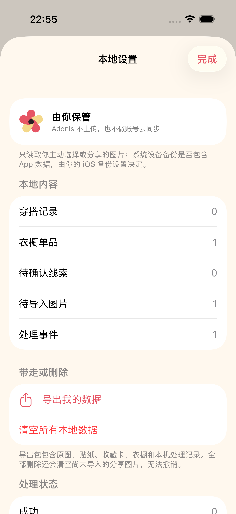
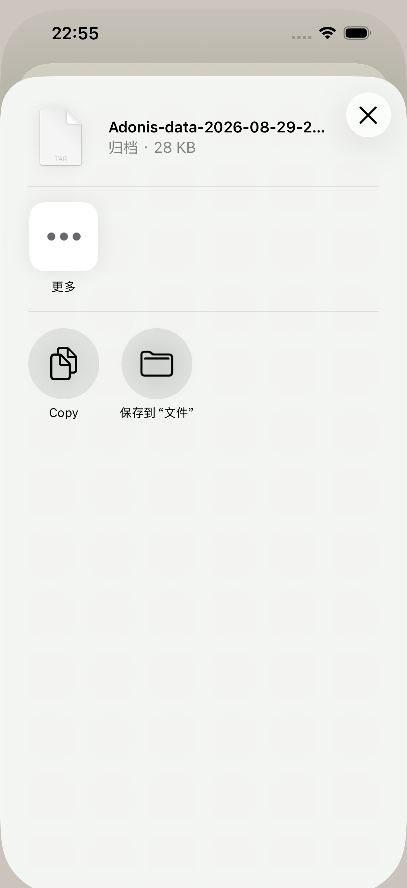
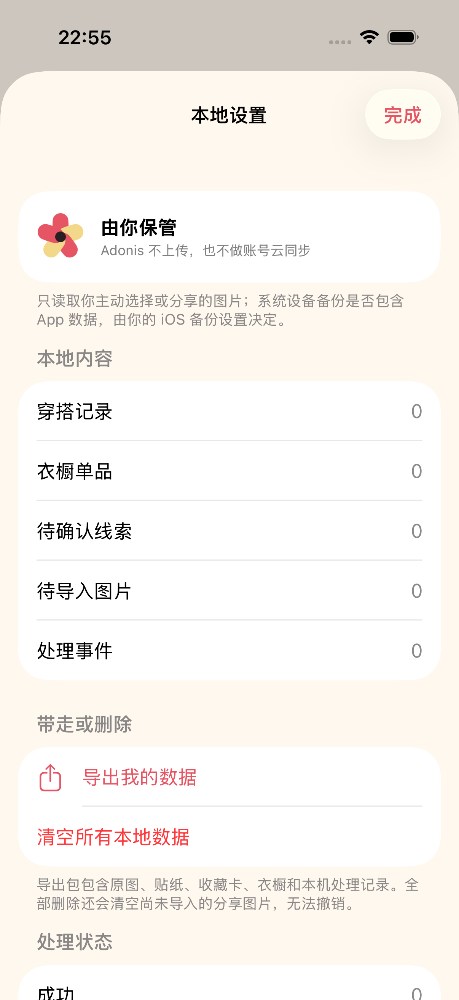

# 2026-08-29 本地数据导出与删除验证记录

> 结论：Adonis 已提供不新增一级导航的本地数据控制入口。用户可以先查看本机内容数量，再生成标准 TAR 副本交给 iOS 系统分享面板，或经二次确认清空 SwiftData、媒体文件、App Group 待导入图片和临时导出包。
>
> 2026-08-31 更新：当前清单已升级为 `adonis-personal-data-v9`。v8 增加 AI 不透明贴纸源、动态贴纸/卡片/派生作品来源、AI 生成阶段和 provider 执行元数据；v9 增加可选人物/穿搭复核。下文标明 v7 与 v8 的条目、数量和结果包是升级前的历史验证证据；现行增量契约见 [AI 贴纸先生成后抠图验证记录](2026-08-31-ai-sticker-first-pipeline.md)与 [AI 贴纸人物与穿搭复核验证记录](2026-08-31-ai-sticker-fidelity-review.md)。

## 用户入口与低负担原则

- 入口沿用创作页右上角的“本地设置”，不增加新的 Tab、账号页或隐私教程。
- 页面先用一句话说明 Adonis 自己不会上传图片，也不做账号云同步；只在用户主动选择、拍摄或分享时读取图片。
- 页面展示穿搭记录、衣橱单品、待确认线索、待导入图片和处理事件的本机数量。
- “导出我的数据”和“清空所有本地数据”都需要用户明确触发；清空还需要第二次破坏性确认。
- iOS 的系统设备备份由用户的系统设置控制，不能等同于 Adonis 的账号云同步。Apple 也明确说明 App 容器中的 `Documents` 与 `Application Support` 通常属于系统备份范围；排除标记只是系统参考，不保证数据绝不会出现在备份或恢复设备中。见 [Using the file system effectively](https://developer.apple.com/documentation/foundation/using-the-file-system-effectively?changes=_2) 与 [Optimizing Your App’s Data for iCloud Backup](https://developer.apple.com/documentation/foundation/optimizing-your-app-s-data-for-icloud-backup?changes=__5)。

## 导出范围与格式

导出结果是未压缩的标准 TAR，文件名形如 `Adonis-data-2026-08-29-223810.tar`。它包含：

| 路径 | 内容 |
| --- | --- |
| `manifest.json` | 格式版本、导出时间、App 版本和所有本地业务记录 |
| `media/` | OOTD 原图、可选 AI 不透明贴纸源、透明贴纸、分享收藏卡、衣橱图片和衣物线索预览 |
| `shared-inbox/` | 用户已分享给 Adonis、但尚未成功导入衣橱的图片 |

`manifest.json` 使用明确的图片角色字段，而不是把二进制图片塞进 Base64：

- `originalPhotoPath`
- `aiStickerSourcePath`
- `derivedStickerPath`
- `derivedShareCardPath`
- `sourceImagePath`
- `derivedPreviewPath`

当前清单格式为 `adonis-personal-data-v9`。它包含 `visualAssets` 数组，为每个图片路径记录 `role`、`provenance`、`ownerID`、面向用户的 `disclosure`、`containsAIGeneratedPixels` 和 `requiresUserConfirmation`。OOTD 原图、商品图与待导入图片标为 `user_provided`；默认 AI 不透明贴纸源、透明贴纸、收藏卡及使用该贴纸的派生作品标为 `ai_generated`；历史直抠样片仍可标为 `derived_from_original`，衣物线索预览标为 `recognition_suggestion`。透明贴纸与收藏卡还保存结构质量字段；每条 OOTD 的 `generationCompletionMode` 区分完整结果与基础贴纸降级，并保存 AI provider 执行元数据；可选人物/穿搭复核另保存结论、固定问题、时间与版本。`creativeWorks` 保存来源 OOTD、配方、版本、图片路径、实际来源、是否含 AI 像素、耗时，以及 provider、请求、网络、费用和质量口径；系统未暴露的外部请求数显式写为 JSON `null`。`processingEvents.generationPerformance` 另行保存贴纸生成总耗时、AI 生成和本机处理阶段、中断位置、重试与执行元数据。它们都不嵌入图片内容或内部概念。衣橱单品和可信 OOTD 线索继续导出本机派生的视觉签名，它们不是商品身份或自动关联事实。详细规则见 [生成内容来源标识验证记录](2026-08-29-content-provenance.md)、[AI 贴纸先生成后抠图验证记录](2026-08-31-ai-sticker-first-pipeline.md)与 [AI 贴纸人物与穿搭复核验证记录](2026-08-31-ai-sticker-fidelity-review.md)。

清单同时写明 `storage = local_app_storage`、`adonisAutomaticNetworkUpload = false` 和 `systemBackupControlledByIOS = true`。这表示 Adonis 本身没有自动网络上传；用户在下一步系统分享面板选择的 App 或位置仍可能接收该副本。

归档按 64 KB 分块读取媒体，不把所有原图一次性编码进内存。临时 TAR 使用 iOS 文件保护；分享面板关闭时会删除，下一次进入本地设置时也会清理上次异常退出留下的 TAR。删除函数只接受导出目录直属的 `.tar`，不会跨目录清理。

当前导出用于用户查看和带走数据，尚未实现“导入此归档恢复 Adonis”。

## 全部删除语义

“全部删除”覆盖五类 SwiftData 记录：

1. `OutfitRecord`
2. `WardrobeItem`
3. `GarmentObservation`
4. `AppEvent`
5. `CreativeWork`

数据库提交成功后，还会清空：

- App 沙盒中的 `AdonisMedia` 图片目录；
- App Group 中的 `SharedWardrobeInbox` 待导入图片；
- 临时目录中的 `AdonisExports` TAR。

如果数据库事务失败，会回滚并保留文件；如果数据库已经删除但某个文件目录暂时清理失败，界面会明确说明“记录已经删除，但有少量本地文件没清理干净”，并要求用户再次执行，而不是显示虚假的成功状态。

## 安全复查

本轮按本地、无账号 Demo 的威胁边界进行 STRIDE 式复查。修复了以下问题：

- 原“清空所有数据”没有覆盖 App Group 待导入图片；现在与数据库、媒体和临时导出一起删除。
- 媒体、共享图片与临时 TAR 原先没有统一声明文件保护；现在文件使用 `completeFileProtectionUnlessOpen`，目录使用 `completeUntilFirstUserAuthentication`。
- 分享收件箱原先只有单图 40 MB 和单次 5 张限制；现在另有最多 50 张、合计 250 MB 的本机队列上限，防止异常分享持续占满空间。
- 仅限制压缩文件大小仍可能让畸形超大图片在完整解码时占用过多内存；现在先读取 ImageIO 元数据，拒绝最长边超过 16384 像素或总像素超过 6000 万的图片，并用单元测试验证拒绝发生在入箱前。
- 分享扩展错误日志原先把底层错误文字标记为公开；现在按私密字段记录，仍不记录图片内容或内容指纹。
- “只在这台设备上”的绝对文案没有区分 App 自己的网络行为与 iOS 系统备份；现在改为准确说明。
- TAR 名称与内部路径都来自应用生成的文件名；归档路径限制为 100 字节，删除临时归档时再次校验直属目录与 `.tar` 扩展。

复查后没有未解决的高风险或中风险。仍需注意：文件保护强度与系统备份行为必须在真实 iPhone 和实际备份设置下复测；分享队列容量检查是同一设备上的尽力防护，不是面向不受信任远程攻击者的并发配额系统。

## 自动验证

- 历史 v7 导出单元测试创建 1 条 OOTD、1 件衣物、1 条线索、1 条事件、花影海报与永生花园共 7 个媒体文件，以及 1 张待导入图片，并验证每个角色路径、二进制内容与执行元数据。
- 测试产出的 TAR 已从 XCTest 结果包导出，再由 macOS 自带 `tar -tf`、`tar -xOf ... manifest.json` 与 `jq` 独立读取。实际条目为 `manifest.json`、7 个 `media/` 文件和 1 个 `shared-inbox/` 文件；清单包含 8 个视觉资产，其中 7 个不含 AI 生成像素，只有永生花园标为 AI 生成。不是只用项目自己的解析器自证。
- 删除单元测试验证五类模型计数归零、媒体目录为空、共享收件箱为空、陈旧临时 TAR 消失。
- UI 测试分别覆盖：查看非零数据计数并打开带 TAR 的系统分享面板；二次确认删除后看到成功反馈，并验证衣橱与待导入图片计数从 1 变成 0。
- `make check` 的严格 `swift-format` 与通用 iOS 真机静态分析通过。
- 历史 v7 完整结果：127 个单元测试与 28 个 UI 流程测试，共 155 项通过、0 失败、0 跳过；`xcresulttool` 独立汇总一致，结果包为 `.derivedData/Logs/Test/Test-Adonis-2026.08.30_11-55-11-+0800.xcresult`。完整测试范围也记录在 [iOS 本地 Demo 验证记录](2026-08-29-ios-local-demo.md)。
- v8 增量测试验证 AI 源媒体、动态来源和 provider 元数据进入可读 TAR；最终全量回归 214 项通过，结果包为 `.derivedData/Logs/Test/Test-Adonis-2026.08.31_02-46-41-+0800.xcresult`。

## 界面证据

以下截图来自 iPhone 17 Pro、iOS 26.5 模拟器的 UI 测试附件，不是设计稿。

三张原图均为 1206 × 2622。逐图检查结果：本地说明、五类数量、导出与破坏性删除动作均完整可见；系统分享面板显示 TAR 文件与保存入口；删除后五类数量均为 0，没有遮挡、重叠或错误页残留。

文件 SHA-256：

- `local-data-controls-2026-08-29.png`：`33da93499b5d8c696d3cbc38d0daeca2a1af2d3fcdc65932aa3eedd586da3f2d`
- `local-data-export-share-2026-08-29.png`：`8b51a2d414d41a2921926507777c0c2721fe7a355ffdc7b98992f3406e37bd2d`
- `local-data-cleared-2026-08-29.png`：`d39d54fd8207b72b5b21a9370df9135bd047b7a69ca3fac02c63bb6ac8722d9f`

## 尚未证明

- 尚未在真实 iPhone 上验证文件保护属性、相机/照片权限、分享目标、前后台切换、App 终止和设备重启后的行为。已收藏 OOTD 在模拟器 App 进程终止后恢复已有独立证据，但不替代这些真机检查，详见 [冷启动持久化验证记录](2026-08-30-cold-launch-persistence.md)。
- 尚未执行真实 iCloud 或电脑整机备份与恢复实验；当前只准确声明由 iOS 设置控制。
- 尚未实现导出归档的恢复导入、选择性删除、账号数据请求或跨设备迁移。
- 当前没有服务端，因此也没有服务端副本可删；未来加入账号或 AI 供应商时，必须重新定义远端留存、删除回执、训练用途和跨设备策略。
