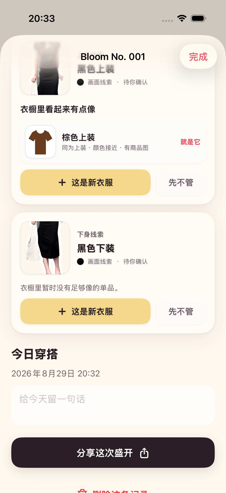
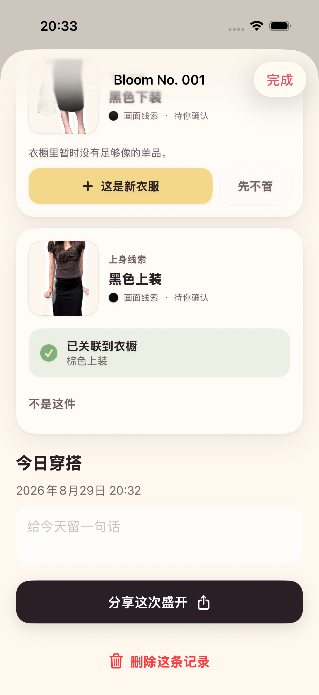

# 2026-08-29 OOTD 衣物线索与确认验证记录

> 结论：保存 OOTD 时，Adonis 会在本机留下上身与下身的临时画面线索，并最多给出 3 个衣橱候选；候选不会自动关联，只有用户明确点击后才改变衣橱关系。

## 读者与行动

本文面向继续开发 OOTD、衣橱匹配或历史回填的工程师与 AI。读完后应能复用当前数据状态与交互，同时清楚区分“画面线索”“可能候选”和“同一件衣物事实”。

## 用户流程

1. 用户照常生成贴纸收藏卡，不需要先建立衣橱。
2. App 从透明人物贴纸中尽力截取上身和下身区域；没有足够画面信息时不创建线索。
3. 用户选择“收藏今天”后，线索才随 OOTD 一起保存。此时衣橱单品数量不变。
4. 用户以后打开这条花历记录，可以看到每条线索和最多 3 个本地衣橱候选。
5. 用户可以点击“就是它”“这是新衣服”或“先不管”，不需要填写表单。
6. 已关联的候选可以通过“不是这件”撤销；被排除的单品不会立即再次出现为这条线索的候选。

## 数据事实与状态

`GarmentObservation` 是从某次 OOTD 得到的临时观察，不是 `WardrobeItem`。它保存画面裁片、位置、建议类别、主色、状态、排除过的候选和处理版本，并随所属 `OutfitRecord` 级联删除。

| 用户动作 | 线索状态 | 是否新建衣橱单品 | 可撤销方式 |
| --- | --- | --- | --- |
| 暂未处理 | `pending` | 否 | 继续选择即可 |
| 点击候选“就是它” | `linkedExisting` | 否 | 点击“不是这件” |
| 点击“这是新衣服” | `createdNew` | 是，复制独立预览文件 | 在衣橱中继续编辑或删除 |
| 点击“先不管” | `dismissed` | 否 | 点击“再看看” |

只有“这是新衣服”会创建新的 `WardrobeItem`。仅生成 OOTD、保存 OOTD、出现候选或点击已有候选都不会增加衣橱单品。

## 本地观察与候选规则

当前观察器只处理已经抠出透明通道的人物贴纸：

- 先找到可见人物边界，再按相对位置读取上身和下身两个区域。
- 排除透明边缘附近的纯白贴纸边和可能的皮肤像素。
- 从剩余像素得到基础主色、内部置信度和透明裁片。
- 画面覆盖不足或信号低于门槛时保持空白，不强行产生线索。

这不是服饰实例分割。它不能可靠区分连衣裙、外套叠穿、包、鞋或配饰，也不能证明裁片中的颜色一定来自目标衣服。

本记录对应的初版候选排序只使用本机已有元数据：类别、RGB 颜色接近程度、图片来源质量与观察置信度。列表最多展示 3 个候选，并排除用户已经否定的单品。当前没有商品 SKU 或其他身份级证据，因此绝不自动关联，也不能把候选描述成“识别出了同一件”。

2026-08-30 后续版本加入了本机颜色、明暗与纹理视觉签名，只用于改善同一候选列表的排序，并继续要求用户确认；弱证据显示为“画面线索有限”。实现、当前 v6 导出和未证明边界见 [衣橱视觉线索排序验证记录](2026-08-30-wardrobe-visual-matching.md)。

## 验证证据

最终执行 `make check`，严格格式检查与通用 iOS 设备静态分析通过；执行 `make test`，18 个单元测试与 4 个 UI 流程测试共 22 项全部通过，0 失败。

自动回归覆盖：

- 合成透明人物能够产生棕色上身与蓝色下身线索；空白透明图不产生线索。
- 相同类别和颜色的单品优先，已否定与明显无关的单品被排除，候选数不超过 3。
- 线索状态、关联 UUID 与排除记录能够跨 SwiftData 上下文持久化。
- 删除 OOTD 会级联删除所属线索。
- UI 流程验证“衣橱已有 1 件 → 保存 OOTD 后仍为 1 件 → 关联已有候选 → 否定候选 → 明确创建新衣服 → 衣橱变为 2 件”。

下图来自 iPhone 17 Pro 模拟器的真实 UI 测试，不是设计稿：

## 尚未证明

- 尚未用获得授权的“商品图 + 同款 OOTD + 干扰衣物”固定对照集评估召回率和误匹配率。
- 当前上身与下身是位置启发式，不理解姿势、遮挡、叠穿、连衣裙和手持物。
- 颜色接近或类别相同不等于同一件衣服；当前没有身份级自动关联能力。
- 模拟器样片使用预处理贴纸；真实 iPhone 的实时分割、观察质量和重启持久化仍待设备回归。
- 用户是否愿意在花历详情中确认衣物，仍需首轮无讲解测试验证。

下一步先完成 ADO-007 的授权对照集与人工标注，量化当前本机视觉签名，再决定服饰分割、商品 SKU 或多视角素材中哪些信号足以支持真正的同款匹配。没有证据前继续保持人工确认。

## 后续补充

用户明确点击“这是新衣服”后的可选商品图升级已经另行实现与验证。该能力只更新刚刚确认的同一件单品，不扩大为自动历史同款识别；详见 [OOTD 单品补商品图验证记录](2026-08-29-ootd-product-image-upgrade.md)。

用户后来从商品图或平铺图建档时，衣物详情也已经可以反向提示最多 3 条尚未处理的历史 OOTD，并只在用户明确确认后回填；详见 [衣橱历史穿着回填验证记录](2026-08-29-wardrobe-history-backfill.md)。这仍不改变本文关于身份级同款识别和自动关联尚未证明的结论。
