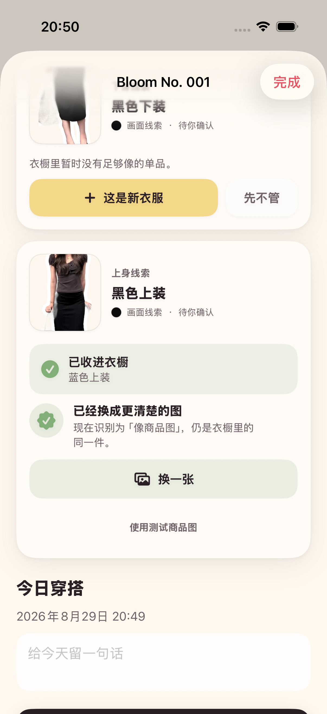

# 2026-08-29 OOTD 单品补商品图验证记录

> 结论：用户从 OOTD 明确创建新衣服后，可以补一张更清楚的商品图或平铺图。Adonis 会原地升级同一个衣物实体，不重复建档，也不会用新的图片建议覆盖人工信息。

## 读者与行动

本文面向继续开发衣橱补图、图片替换、重复合并或历史回填的工程师与 AI。读完后应能修改这条链路，同时保持衣物身份、文件事务和用户控制权不被破坏。

## 用户流程

1. 用户在 OOTD 线索中明确点击“这是新衣服”。
2. 单品立即进入衣橱，用户不需要先上传商品图或填写资料。
3. 界面轻量提示“有商品图的话，补一下会更准”，同时明确现在没有也可以跳过。
4. 用户选择商品图后，Adonis 在本机分析图片并更新原单品。
5. 成功态说明当前图片类型，并明确“仍是衣橱里的同一件”。用户以后也可在衣物详情换图。

补图不是建档前的必填步骤，也不是新的一级任务。它只出现在用户已经确认衣服之后，属于自然的可选下一步。

## 不可破坏的数据规则

- 衣物 UUID、创建时间和最初建档来源保持不变。
- 当前图片来源、主色、图片尺寸、内容指纹和图片分析版本随新图更新。
- 已确认分类不被图片分类建议覆盖；只有原分类仍为“未分类”且新建议达到采用门槛时，才可自动采用。
- 只刷新系统自动生成的颜色名称。用户自己填写的名称和备注始终保留。
- OOTD 画面线索的内部置信度不能冒充商品图类别置信度。
- 若新图的内容指纹已经属于另一件衣服，当前阶段拒绝自动更新。没有明确用户操作时，不合并两个衣物实体。

这些规则把“更清楚的素材”与“同一件衣服的事实”分开：商品图可以改善后续识别或创作输入，但不能凭一张图擅自改写用户已经确认的事实。

## 文件与数据库事务

补图按以下顺序执行：

1. 先保存用户刚刚做出的名称、备注或分类修改。
2. 分析新图并检查当前图片与其他衣物的重复指纹。
3. 用独立文件名写入新图片。
4. 更新并保存原衣物实体。
5. 只有数据库保存成功后，才删除旧图片。

若分析、图片写入或数据库保存失败，新文件会被清理，旧图与原单品继续可用。这样用户不会因为一次补图失败而失去已经保存的 OOTD 单品。

## 验证证据

最终执行 `make check`，严格格式检查与通用 iOS 设备静态分析通过；执行 `make test`，21 个单元测试与 4 个 UI 流程测试共 25 项全部通过，0 失败。

专项单元测试覆盖：

- OOTD 单品补蓝色商品图后仍只有一个实体，原 UUID 与创建时间不变，旧文件在保存成功后删除。
- 自动名称从“棕色上装”刷新为“蓝色上装”，但人工名称、备注和已确认分类不会被冲突建议覆盖。
- 已属于另一单品的重复商品图会被明确拒绝，两个单品和各自文件都保持不变。

UI 自动化覆盖完整路径：“衣橱已有 1 件 → 保存 OOTD 后仍为 1 件 → 明确新建后为 2 件 → 补商品图成功 → 返回衣橱后仍为 2 件”，并检查新名称与商品图来源说明。

下图来自 iPhone 17 Pro 模拟器的真实 UI 测试，不是设计稿。底部“使用测试商品图”只在自动化启动参数下出现，生产界面不显示：

## 尚未证明

- 这条能力只升级用户已经明确创建或正在查看的单品，尚不能让一个全新商品图自动找到其他历史 OOTD。
- 尚未用授权的“商品图 + 同款 OOTD + 相似干扰衣物”对照集证明身份级匹配精度。
- 当前内容指纹只能识别完全相同的输入数据，不能识别裁剪、压缩、调色或不同角度的同一张商品图。
- 模拟器不提供 Vision 类别建议；真实 iPhone 上的类别建议与持久化仍待设备回归。
- 用户是否理解并愿意在这个时机补图，仍需无讲解测试。

因此 ADO-208“回填历史穿着关系”继续保持未完成。下一步应先建立授权对照集，再决定是否加入感知哈希、视觉向量、商品 SKU 或用户确认式合并。
