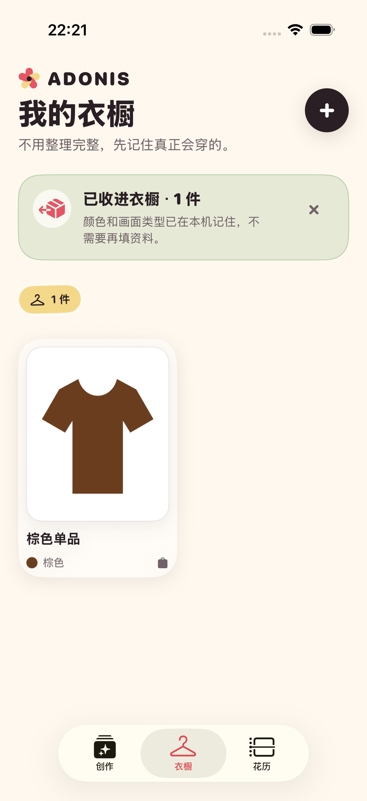

# 2026-08-29 购物应用图片分享验证记录

> 结论：其他 App 的具体图片附件可以经过 iOS 系统分享面板、Adonis 分享扩展和 App Group 收件箱，在主 App 下次活跃时自动进入衣橱；商品页面抓取和商品链接解析尚未实现。

## 用户闭环

1. 用户在购物、相册或其他 App 中选择一张或多张商品图、商品截图或平铺图。
2. 用户打开系统分享面板并选择 Adonis。
3. 分享扩展在本机校验并暂存最多 5 张图片，成功后自动关闭。
4. 用户回到 Adonis；App 自动切到衣橱，进行已有的本机颜色、画面类型与类别分析。
5. 成功提示只说明新增、复用或失败数量，不要求用户填写品牌、价格、链接或分类。

## 明确边界

- 只接收用户主动分享的图片附件，不读取网页正文，不跟随 URL，不抓取购物页面，也不声称获得商品 SKU。
- 一次最多处理 5 张；单张必须是 ImageIO 可读取、宽高均至少 64 像素、不超过 40 MB、最长边不超过 16384 像素且总像素不超过 6000 万的图片。
- 尚未导入的共享收件箱最多保留 50 张、合计 250 MB；超过后扩展会提示先打开 Adonis 处理已有图片。
- 图片与处理都留在设备上；当前没有网络请求、远程日志或第三方 SDK。
- 完全相同的图片通过现有内容指纹复用同一衣物，不重复建档。
- 收件箱采用至少一次交付：成功入库或确认重复后才删除文件；分析或持久化失败时保留原文件，用户可以重试。
- 当前模拟器证据证明了系统分享面板、Adonis 扩展和主 App 之间的跨 App Group 数据链路，不等于所有真实购物 App 都提供相同附件类型，也不代替真实 iPhone 回归。

## 实现约束

- 主 App 与 `AdonisShareExtension` 都声明 `group.studio.adonis.localdemo` App Group。
- 扩展的激活规则仅声明图片附件，最大数量为 5；扩展通过 `NSExtensionContext` 取得附件，并用 `NSItemProvider` 尝试数据、文件、旧式 item、`UIImage` 与预览表示。
- 共享收件箱文件使用自有扩展名、原子写入和 `completeFileProtectionUnlessOpen`，避免主 App 观察到半写入文件。
- 共享目录使用 `completeUntilFirstUserAuthentication` 文件保护；“清空所有本地数据”会连同尚未导入的共享图片一起删除。
- 主 App 在首次显示和场景重新活跃时排空收件箱；导入服务先执行图片分析，再以 SwiftData 与沙盒 PNG 事务持久化。
- 调试事件只记录来源、处理版本、耗时与错误文字，不记录图片内容或内容指纹；分享扩展底层错误文字按私密日志字段处理。

共享收件箱的导出、彻底删除与安全复查见 [本地数据导出与删除验证记录](2026-08-29-local-data-controls.md)。

Apple 的扩展文档规定分享扩展从 `NSExtensionContext` 的输入项中读取附件，并在完成后结束请求；附件由 `NSItemProvider` 提供。App Group 则为同一开发者团队的 App 与扩展提供共享容器。这些平台约束分别见 [App Extension Programming Guide: Share](https://developer.apple.com/library/archive/documentation/General/Conceptual/ExtensibilityPG/Share.html)、[NSItemProvider](https://developer.apple.com/documentation/foundation/nsitemprovider?changes=_7) 与 [FileManager App Group container](https://developer.apple.com/documentation/foundation/filemanager/containerurl(forsecurityapplicationgroupidentifier:))。

## 自动验证

最终完整回归命令：

```bash
make check
make test
```

- 严格 `swift-format` 与通用 iOS 设备静态分析通过。
- 当前完整基线为 42 个单元测试与 9 个 UI 流程测试，共 51 项通过、0 失败；结果包为 `.derivedData/Logs/Test/Test-Adonis-2026.08.30_00-16-27-+0800.xcresult`。
- 收件箱单元测试覆盖有效图片按时间排序、显式移除、不可读、过小与超大像素图片拒绝入箱。
- 协调器单元测试覆盖两份相同图片只创建 1 件衣物，以及失败文件保留并记录可重试事件。
- 第一条分享 UI 测试直接在共享容器放入图片，证明主 App 活跃后自动导入、切换衣橱并显示一件单品。
- 第二条分享 UI 测试打开真实 iOS 系统分享面板，选择 `Adonis` 扩展，再验证共享图片自动进入主 App 衣橱。针对润色后提示文字的复测结果包为 `.derivedData/Logs/Test/Test-Adonis-2026.08.29_22-14-20-+0800.xcresult`，2 项通过，0 失败。

生成工程后，构建产物中的扩展 `Info.plist` 保留 `NSExtensionActivationSupportsImageWithMaxCount = 5`；主 App 与扩展的模拟器签名 entitlement 都包含同一个 App Group。

## 界面证据

以下截图来自 iPhone 17 Pro、iOS 26.5 模拟器的 UI 测试附件，不是设计稿。两张原图均为 1206 × 2622。




逐图检查结果：成功提示保持一行；图片数量、衣物卡片、关闭按钮与底部导航均可见，没有裁切、重叠或错误页残留。

文件 SHA-256：

- `shopping-share-auto-import-2026-08-29.png`：`7bf3c94e14746b32f874c7b1c5097288b980f53f3ed3a3a02993fc78e2493c51`
- `shopping-share-extension-result-2026-08-29.png`：`da70c688bcfe1b6768df80e24d3e3f76d356c539b2de37e263c8bffea73763ff`

## 尚未证明

- 未在已连接的真实 iPhone 上运行，也未逐个验证淘宝、小红书、得物等第三方 App 实际提供的附件表示。
- 未读取或解析商品链接、商品页面、订单、品牌、价格、颜色变体或 SKU。
- 未证明当前轻量图片特征能识别具体同款；它只完成图片导入、基础分析与完全相同文件去重。
- 未实现账号、跨设备同步、云端备份或从另一个设备继续导入。
