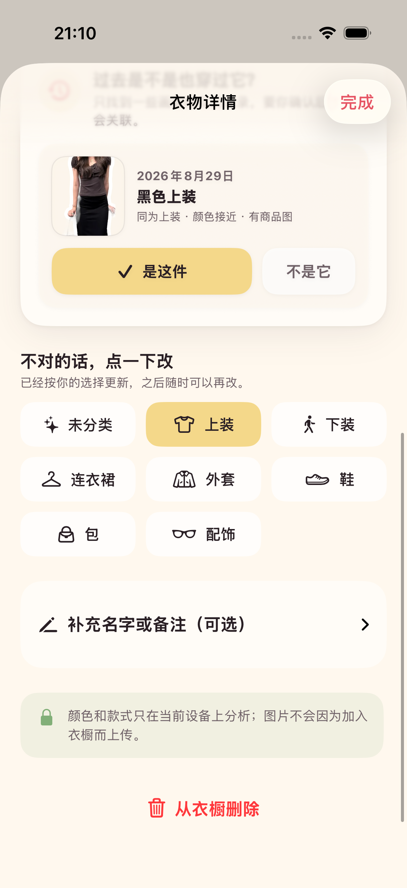
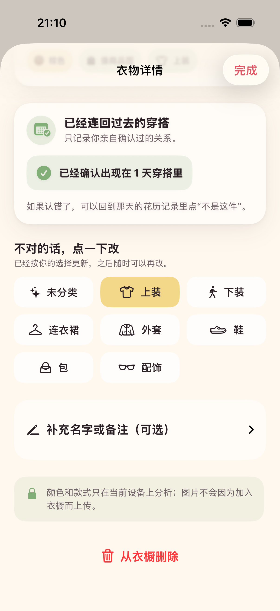

# 2026-08-29 衣橱历史穿着回填验证记录

> 结论：用户后来加入商品图或平铺图后，Adonis 可以在衣物详情中提示最多 3 条画面相似的旧 OOTD 线索；系统不会自动建立关系，只有用户明确点击“是这件”后才回填穿着历史。

## 读者与行动

本文面向继续开发衣橱匹配、历史回填、候选排除或自动关联的工程师与 AI。读完后应能维护这条链路，同时保持“画面相似候选”和“同一件衣服事实”之间的边界。

## 用户流程

1. 用户先照常保存 OOTD，不需要提前建立衣橱。
2. 用户以后上传一张商品图、截图或平铺图，形成更清楚的衣物实体。
3. 若本机找到尚未处理的相似 OOTD 画面线索，衣物详情才出现“过去是不是也穿过它？”卡片。
4. 每次最多展示 3 条候选，用户只需选择“是这件”或“不是它”。
5. 点击“是这件”后，原 OOTD 线索关联到当前衣物，衣橱不会新增单品；详情按自然日显示已确认的穿着天数。
6. 点击“不是它”后，这条线索不会再向当前衣物重复提问，但仍可匹配其他衣物。
7. 如果确认错了，用户可以回到对应花历记录点击“不是这件”撤销。

候选卡不是强制任务：没有候选时完全隐藏；已有确认关系且没有新候选时，只显示一张安静的汇总卡。

## 候选与状态规则

本记录对应的初版历史回填复用类别、RGB 颜色接近程度、图片来源质量和 OOTD 观察置信度。2026-08-30 后续版本在双方都有有效素材时增加本机颜色、明暗与纹理视觉签名；签名仍只影响排序，没有商品 SKU 或身份级同款证据。详见 [衣橱视觉线索排序验证记录](2026-08-30-wardrobe-visual-matching.md)。

进入候选的线索必须同时满足：

- 已经属于一条保存过的 OOTD。
- 状态仍为 `pending`。
- 尚未关联任何衣物。
- 用户没有针对当前衣物点击过“不是它”。

`dismissed`、`linkedExisting`、`createdNew` 和已经排除当前衣物的线索不会再次出现。候选按分数降序排列，同分时优先较新的 OOTD，最多取 3 条。

| 用户动作 | 线索结果 | 是否新增衣物 | 是否会再向当前衣物提问 |
| --- | --- | --- | --- |
| 尚未选择 | 保持 `pending` | 否 | 会 |
| 点击“是这件” | 变为 `linkedExisting`，写入当前衣物 UUID | 否 | 不会 |
| 点击“不是它” | 保持 `pending`，记录排除的衣物 UUID | 否 | 不会 |
| 在花历撤销确认 | 回到 `pending`，并排除原衣物 UUID | 否 | 不会 |

这套状态只记录用户明确做出的决定。候选出现、视觉线索较强或拥有商品图都不能触发自动关联。

## 保存与可观测性

确认或排除前，先保存用户在衣物详情里尚未提交的名称、备注或分类修改；随后再写入关系状态。关系保存失败时回滚到前一次成功保存，不留下半完成状态。

本地事件继续复用“关联已有单品”和“排除候选单品”，并通过 `source=wardrobe_history` 与处理版本 `wardrobe-history-backfill-v1` 区分历史回填入口。事件不记录图片内容、候选分数或图片指纹。

## 验证证据

最终执行 `make check`，严格格式检查与通用 iOS 设备静态分析通过；执行 `make test`，24 个单元测试与 5 个 UI 流程测试共 29 项全部通过，0 失败。最终结果包为 `.derivedData/Logs/Test/Test-Adonis-2026.08.29_21-16-39-+0800.xcresult`。

专项单元测试覆盖：

- 只返回未处理、未关联且未排除当前衣物的线索，并保持最多 3 条与稳定排序。
- 类别和颜色都明显无关的线索不会进入候选。
- “确认 → 撤销并排除”的关系、状态和 UUID 能跨 SwiftData 上下文持久化。

UI 自动化按真实时间顺序覆盖完整路径：“先保存 OOTD，衣橱仍为 0 件 → 后来加入商品图并纠正类别 → 衣物详情出现历史候选 → 点击‘是这件’ → 汇总为 1 天 → 花历中的上身线索显示已关联”。专项结果包为 `.derivedData/Logs/Test/Test-Adonis-2026.08.29_21-10-14-+0800.xcresult`。

下图来自 iPhone 17 Pro 模拟器的真实 UI 测试，不是设计稿：

## 尚未证明

- 当前能力没有证明商品图与 OOTD 是同一款，只证明用户可以低负担地确认系统提出的少量候选。
- 尚未用授权的“商品图 + 同款 OOTD + 相似干扰衣物”对照集评估召回率、误候选率和排除后的长期效果。
- 当前候选仍依赖位置启发式得到的上身与下身裁片，不理解叠穿、遮挡、连衣裙、包、鞋和配饰。
- 模拟器使用预处理贴纸；真实 iPhone 的实时 Vision 观察质量、重启持久化和长历史性能仍待设备回归。
- 用户是否会理解并愿意在衣物详情中处理这张卡，仍需无讲解测试。

因此 ADO-208 的“用户明确确认式历史回填”已经完成；ADO-205 的身份级候选匹配与任何自动关联仍保持未完成。本机视觉排序工程切片已经补齐，但下一步仍是完成授权对照集，而不是提高文案确信程度。
