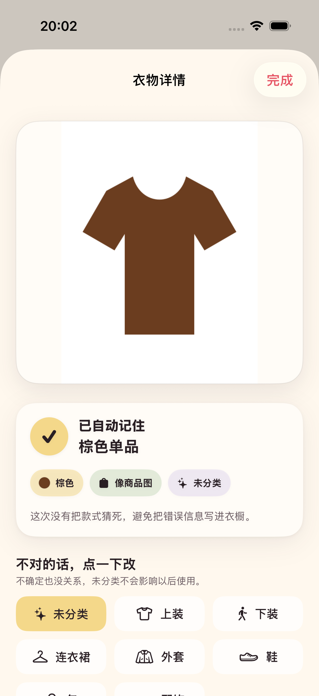
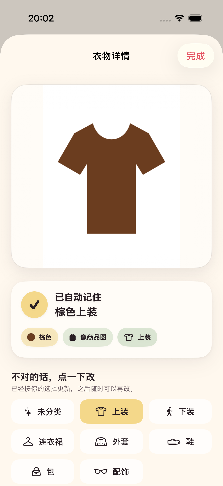

# 2026-08-29 衣橱轻量导入验证记录

> 结论：商品图、截图和实拍图现在可以一键加入本地衣橱；白底画面提示与主色由确定性的本机像素分析得出，类别只在高置信度时自动采用，无法确定时保持未分类。

## 读者与行动

本文面向下一位继续开发衣橱的工程师或 AI。读完后应能扩展衣物分析或匹配能力，同时保留“低置信度不污染衣橱”和“不把表单压力交给用户”两条边界。

## 用户流程

1. 用户在衣橱选择一张商品图、截图或平铺照片。
2. App 在本机读取图片、分析主色和背景，并尽力判断衣物类别。
3. 图片立即保存为衣物实体，不要求用户先填写名称、品牌或备注。
4. 结果页展示系统已经记住的颜色、画面类型提示和类别。
5. 类别不对时，用户点一次正确分类即可；名称随自动分类同步更新。
6. 同一份图片数据再次导入时打开已有单品，不重复创建记录。

## 可以依赖的事实

- 图片尺寸、内容指纹、白底背景比例和主色来自本机确定性处理，不依赖网络或生成模型。
- 白底商品图判断使用边缘白色比例与整体白色比例；它表示“画面像干净商品图”，不表示商品来源已经验证。
- 主色会在白底图片中排除接近纯白的背景，再从剩余像素中选择占比最高的量化色组。
- iPhone 上会额外尝试系统通用图像分类，并把常见服饰标签映射为衣橱分类。
- 只有类别置信度达到内部门槛时才自动写入；其他情况保持“未分类”，但不阻断收藏。
- 模拟器跳过系统图像分类，因为当前运行时无法创建 Vision 推理上下文；主色、白底判断和内容指纹仍可运行。

界面不展示置信度、模型名称或分析版本。用户只看到系统记住的结果和可撤销的分类选择。

## 数据与追踪

衣物实体与一次 OOTD、贴纸及分享卡仍然是不同的数据对象。每件衣服可以保存：

- 实际分类与原始类别建议。
- 主色名称及色值。
- 商品图/截图或实拍/平铺来源判断。
- 图片尺寸、内容指纹和分析版本。

本地事件现在记录输入来源和处理版本。创作链路区分相册、相机和内置样片；衣橱链路区分相册与测试样片。事件不记录图片内容或内容指纹。

## 自动验证

最终完整测试计划执行 `make test`：10 个单元测试与 3 个 UI 流程测试全部通过，0 失败。它同时重跑原有贴纸、收藏卡、媒体存储和花历链路，没有只验证新增衣橱代码。

新增回归覆盖：

- 白底商品图被判断为商品图并提取棕色主色。
- 满画幅实拍降级为实拍/平铺，不凭空创建类别。
- 通用分类标签选择最高可信的服饰类别。
- 低于门槛的类别建议保持未分类。
- 无效图片数据返回可理解错误。
- 本地事件能够保存输入来源和处理版本。
- UI 流程完成“测试商品图 → 棕色单品 → 点一下改为上装 → 棕色上装留在衣橱”。

下图来自 iPhone 17 Pro 模拟器上的真实 UI 测试，不是设计稿：

## 尚未证明

- 尚未使用真实商家商品图、购物截图和平铺照片建立固定对照集，因此不能宣称来源判断或类别识别已经可靠。
- 当前主色是基础色名，不理解撞色、印花、渐变、透明材质或“衣服主体色与装饰色”的语义差异。
- 内容指纹只能识别完全相同的图片数据，不能判断两张不同角度照片是否属于同一件衣服。
- 本轮衣橱导入验证当时尚未包含 OOTD 衣物发现。后续版本已经加入临时画面线索和人工确认候选，但仍没有可靠同款匹配或自动关联；见 [OOTD 衣物线索与确认验证记录](2026-08-29-ootd-garment-observations.md)。
- 真机上的系统通用分类仍需连接 iPhone 验证；模拟器通过不代表真机类别质量已经验证。

下一步应先用获得授权的真实商品图、截图和同款 OOTD 组成对照组，再决定是否需要专用服饰识别模型。不能仅依据通用分类器输出勾选衣物匹配任务。
