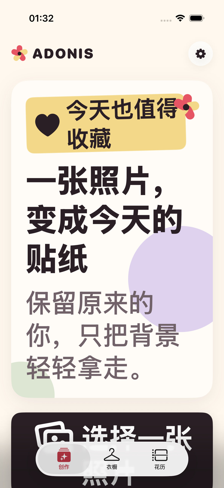
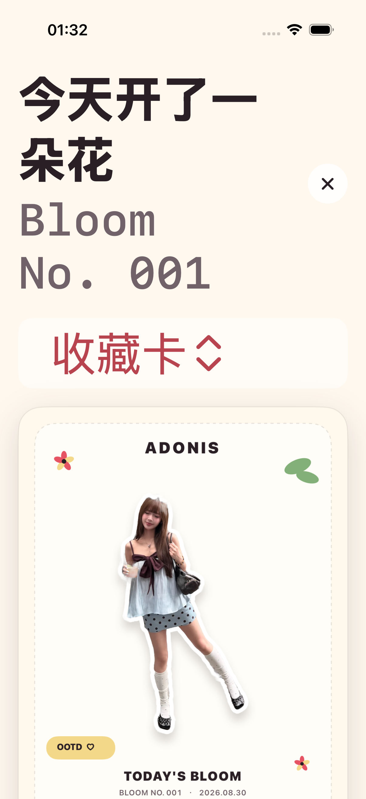
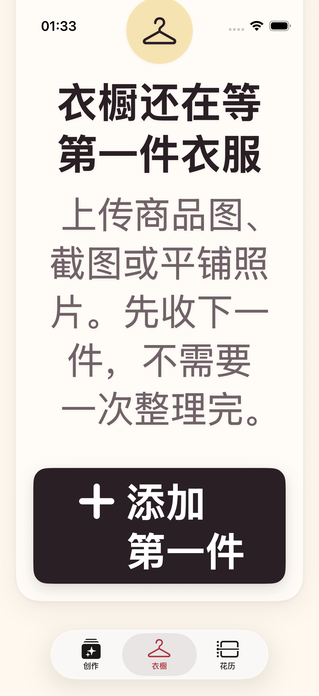

# 2026-08-30 无障碍与前后台恢复验证

> 结论：Adonis 已完成 ADO-Q07 的无障碍与生命周期本地纵向切片。最大辅助字号、增强对比度、关键操作可达、处理取消和前后台结果恢复均在 iPhone 17 Pro 模拟器通过；相机拒绝与系统限制的注入状态另有专项回归。真实 VoiceOver、真实系统权限流程与真实 iPhone 仍未验证，因此 ADO-Q07 保持未完成。

## 1. 用户体验契约

- 用户把系统字体调到最大辅助字号时，标题、说明、标签和主要动作可以换行，不通过固定高度裁掉文字。
- 横向空间不足时，标签、结果操作、衣物候选和设置事件会改为纵向排列；衣橱网格改为单列。
- 结果页与花历详情在辅助字号下使用菜单切换收藏卡、透明贴纸和原始照片，普通字号仍保留分段控件。
- 所有关键按钮至少保留 44 点触控高度。处理中浮层继续把“取消”暴露为独立按钮，不会被合并到整块说明里。
- 装饰花朵、锁和空态图标不重复朗读；预览图、状态更新、关闭、月份切换和记录卡提供表达用途的语义标签。
- 系统启用“减弱动态效果”时，按压缩放和旋转花朵停止，浮层只做透明度过渡。
- App 从结果页进入后台再回前台后，未收藏的当前结果仍在；用户可继续收藏并进入衣橱。

## 2. Dynamic Type 与密集界面边界

创作首页的 Hero、说明和主要按钮改为内容驱动高度；样片说明允许多行。结果操作、衣物确认、历史回填和本地事件使用可复用的辅助字号自适应布局。衣橱空态与主要动作可滚动到达。

花历的日期网格属于高密度二维信息。为避免最大辅助字号把单个日期挤出 7 列结构，画面中的日期数字最高使用 `xxxLarge`，但每一天仍保留完整 VoiceOver 日期标签；页面标题、月份导航、记录标题和操作继续响应最大辅助字号。这是当前唯一有意设置的视觉字号上限。

## 3. 对比度契约

新增的 `AccessibilityContractTests` 使用 SwiftUI 颜色解析后的 sRGB 值计算 WCAG 相对亮度，并要求正文色在 `canvas` 与 `paper` 两种主要底色上都达到 4.5:1。

| 文字颜色 | `canvas` | `paper` |
| --- | ---: | ---: |
| `ink` | 15.13:1 | 15.60:1 |
| `secondaryInk` | 5.48:1 | 5.64:1 |
| `pomegranateInk` | 6.57:1 | 6.77:1 |
| `leafInk` | 5.43:1 | 5.60:1 |

原来的石榴红和嫩叶绿继续用于较大的装饰与底色；小文字和表达状态的图标改用更深的 `pomegranateInk` 与 `leafInk`。

## 4. 自动验证

专项命令：

```bash
make accessibility-regression
```

脚本会保存模拟器原设置，临时启用最大辅助字号 `accessibility-extra-extra-extra-large` 和增强对比度，确认设置已经生效后运行：

- 1 个颜色对比度契约测试。
- 1 个创作 → 结果 → 进入后台 → 回前台 → 收藏 → 衣橱核心 UI 流程。
- 1 个处理中浮层“取消”按钮可见、可点击并能返回首页的 UI 流程。

测试结束或失败时都会恢复原字号与对比度。最终专项结果为 3 项通过、0 失败，结果包为 `.derivedData/Logs/Test/Test-Adonis-2026.08.30_04-26-23-+0800.xcresult`。脚本结束后重新读取模拟器设置，字号为 `large`、增强对比度为 `disabled`，与进入专项前一致。

处理中取消测试使用 `-ui-testing-hold-generation` 启动参数提供最长 15 秒的测试专用窗口；正式 App 不包含这段等待，不改变实际生成速度。

完整门禁：

- `make check`：严格 `swift-format` 与通用 iOS 设备静态分析通过。
- `make sample-regression`：四张授权样片哈希与字节级重生成通过，11 个图片专项测试通过。
- `make permission-regression`：5 个权限服务测试与 2 个相机恢复 UI 流程，共 7 项通过、0 失败。
- `make test`：63 个单元测试与 17 个 UI 流程测试，共 80 项通过、0 失败。
- `xcresulttool` 独立汇总为 80 通过、0 失败、0 跳过。
- 完整结果包：`.derivedData/Logs/Test/Test-Adonis-2026.08.30_04-28-01-+0800.xcresult`。

## 5. 视觉证据

三张证据均来自专项回归中的 iPhone 17 Pro、iOS 26.5 模拟器，设置为最大辅助字号与增强对比度。原始尺寸均为 1206 × 2622，并已逐张目检。

### 创作首页



Hero 标签、主标题和说明完整显示；底部操作位于可滚动区域，没有固定高度截断。

### 结果页与后台恢复



标题、Bloom 编号、关闭按钮、模式菜单和收藏卡均可读。截图后测试将 App 送入后台再激活，继续使用同一结果完成收藏。

### 衣橱空态



空态说明和“添加第一件”主要动作完整可见。iOS 26 浮动 Tab Bar 会覆盖当前视口边缘，但滚动内容与操作仍可到达。

证据哈希：

| 文件 | SHA-256 |
| --- | --- |
| `accessibility-large-text-create-2026-08-30.png` | `b4de1779728a22dd6ffc36f49734993b83e710d0d457b0169fc073d7bc843fce` |
| `accessibility-large-text-result-2026-08-30.png` | `1bc7459a8a504a4d2c4b7851189d430a61ff20af4f2e0ea98648928d2d379eca` |
| `accessibility-large-text-wardrobe-2026-08-30.png` | `e9b9be4ff50bff1b6dd2a41203a358a45c4ea396b83aea178e328a4b371a50b1` |

## 6. 尚未证明

- 没有打开 VoiceOver 完成人工朗读顺序、转子、焦点移动和手势回归；现有自动测试只证明关键语义元素存在并可操作。
- 没有在真实 iPhone 上验证最大字号、增强对比度、减弱动态效果、前后台恢复、重启或内存压力后的状态。
- 相机拒绝与系统限制的可注入状态、用户文案和恢复动作已通过专项 UI 回归；没有验证真实系统授权弹窗、授权后拍摄、从设置恢复权限、相册拒绝或有限照片权限。详见 [相机权限恢复验证记录](2026-08-30-camera-permission-recovery.md)。
- 当前 Demo 没有网络请求或供应商，因此弱网、断网、重试与联网超时在本阶段不适用；接入网络能力后必须重新验证。
- 没有覆盖所有语言、横屏、iPad、Switch Control、Voice Control、粗体文本和不同色觉设置。

因此这份记录可以作为后续布局、文案、颜色、动效、无障碍语义与生命周期修改的本地回归契约，但不能把 ADO-Q07 或 ADO-108 标记完成。
