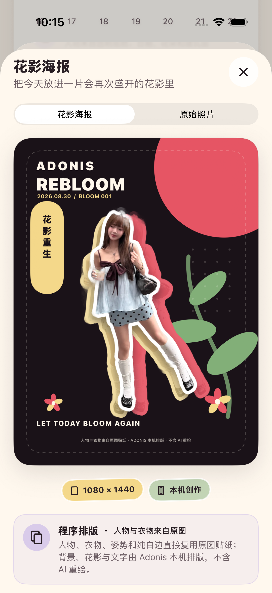
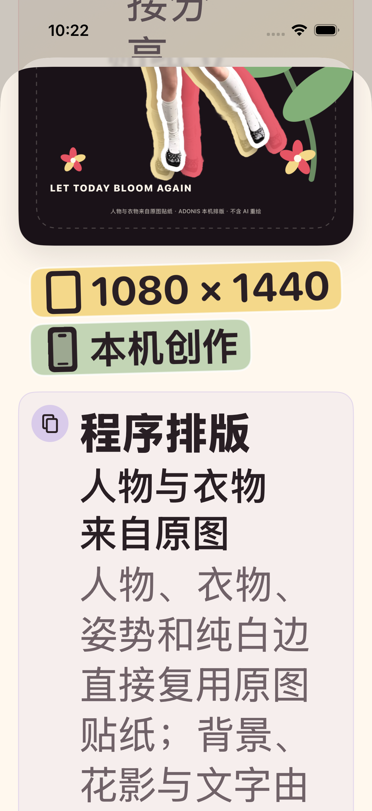

# 2026-08-30 花影海报创作验证

> 结论：Adonis 已完成 M3 的第一个本机创作探针“花影海报”。用户从现有贴纸结果一次点击即可得到 1080 × 1440 海报，在原始照片与海报之间对照，明确收藏后可分享，并在 App 终止重启后从原 OOTD 回看。人物、衣物、姿势和纯白边直接复用透明贴纸；当前成品属于程序排版，不含 AI 重绘，也不是试穿效果或真实拍摄的新照片。

## 1. 用户体验契约

- 入口只在已有合格贴纸的结果页出现，不要求新增上传、建档或问卷。
- 用户看到“花影海报”和“一键排版，人物和衣服保持原样”，不需要理解 Prompt、Skill、模型、工作流、采样参数或供应商。
- 点击后直接显示成品，默认不再提供模板、参数和预设选择。
- 结果页允许在“花影海报 / 原始照片”之间切换，方便用户自己判断人物与衣物是否仍然可信。
- 来源说明在结果之后出现，不增加上传前心智负担；同时明确它只是风格海报，不是试穿图或真实新照片。
- 用户可以直接打开 iOS 系统分享面板。只有明确点击“收藏这张作品”才持久化海报；若当天 OOTD 尚未收藏，收藏作品会先保留它的原始来源记录。
- 收藏后，主结果页同步显示“今天已经收藏”。App 被真实终止并重新启动后，花历中的原 OOTD 会出现“收藏的创作”，可重新打开同一张海报、对照原始照片并分享。

## 2. 像素与版式边界

处理版本为 `botanical-poster-v1`，成品固定为 1080 × 1440、不透明 PNG。

| 画面元素 | 实际来源 | 允许的变化 |
| --- | --- | --- |
| 主人物、衣物、配饰、姿势与纯白边 | 已生成的透明贴纸，即原图处理结果 | 不重绘、不换装、不补画；按比例缩放并直接合成 |
| 石榴红与黄油色人物影子 | 同一贴纸透明通道的单色复制 | 只作为主贴纸背后的平面装饰，不替换主人物 |
| 深色背景、石榴色圆形、叶片、花朵、点阵和虚线框 | UIKit 程序绘制 | 可按固定配方排版 |
| 日期与 Bloom 编号 | 原 OOTD 本地元数据 | 只参与文字排版 |
| 品牌标题与来源页脚 | 固定本地文案 | 不读取或生成用户内容 |

图片页脚固定为“人物与衣物来自原图贴纸 · ADONIS 本机排版 · 不含 AI 重绘”。UI 中同样显示“程序排版”来源卡，并逐项说明保留和改变的部分。

渲染契约验证成品尺寸与所有像素不透明，并在受控透明贴纸上同时检查：原贴纸颜色仍有足够像素保留，石榴红、嫩叶绿与黄油色达到足够面积。真实授权样片的模拟器截图另经目检，人物五官、衣物、包、袜鞋、姿势和白边没有被新内容覆盖或重绘。这个证据证明当前程序直接保留输入贴纸，不代表上游分割已对任意照片实现语义级保真。

## 3. 收藏、删除与个人数据

用户收藏的作品使用独立 SwiftData 模型 `CreativeWork`，不与原始 OOTD 或衣橱单品混为同一对象。每条作品保存：

- 唯一 ID 与创建时间；
- 来源 OOTD 关系；
- `botanical_poster` 配方与 `botanical-poster-v1` 版本；
- PNG 文件名；
- `programmatic_composition` 来源类型；
- 本机排版耗时。

收藏事务先写入 PNG，再插入模型并保存关系；SwiftData 保存失败时会回滚模型并移除刚写入的图片。相同草稿 ID 重试不会新增第二条作品。

删除一条 OOTD 时，作品模型随关系级联删除，海报 PNG 与原图、贴纸、收藏卡和线索图一起清理。“清空所有本地数据”也显式覆盖 `CreativeWork` 模型与全部媒体；设置页会单独显示本机创作作品数量。

个人数据格式当前为 `adonis-personal-data-v7`（v6 首次引入作品结构，v7 增加执行元数据）：

- `creativeWorks` 保存来源 OOTD、配方、版本、图片路径、来源类型、是否含 AI 像素和处理耗时；
- `visualAssets` 把海报登记为 `creative_work` 与 `programmatic_composition`；
- 海报 PNG 以独立媒体文件进入标准 TAR，不嵌入 Base64；
- 当前 v7 混合来源导出共验证 8 个视觉资产：花影海报自身仍明确为不含 AI 生成像素；只有另一配方“永生花园”标为 AI 生成。

## 4. 可观测性与成本事实

本机事件新增“生成花影海报 / 收藏创作作品 / 打开创作作品分享”三种类型。事件使用同一条不含用户内容的详情：

```text
recipe=botanical_poster;provenance=programmatic_composition;ai_pixels=false;external_requests=0;external_cost=not_applicable
```

事件另保存本机处理耗时、输入来源和处理版本，不记录图片、文件路径、OOTD ID、作品 ID 或用户文字。当前 0 次外部请求与费用不适用是事实，不是供应商成本估算。

## 5. 自动验证

专项命令：

```bash
make creative-regression
```

专项覆盖：

- 配方名称、版本、保留/改变边界与普通用户文案中不出现 Prompt、Skill、模型或工作流；
- 1080 × 1440、不透明输出、原贴纸像素与 Adonis 强色板；
- 来源页脚、无 AI 像素、0 次外部请求与费用不适用；
- 作品模型重新抓取后仍保留配方、来源、耗时和原 OOTD；
- PNG 与 SwiftData 关系的收藏事务、相同草稿重复收藏幂等性，以及删除来源 OOTD 后的关系级联；
- v7 标准 TAR 中的作品结构、执行元数据、视觉资产与媒体文件；
- 完整清空同时删除作品模型与图片；
- 普通字号真实 UI 中的一键生成、原图对照、收藏、系统分享、进程终止重启和花历历史回看。

TDD 先分别观察到配方、渲染器、来源字段、持久化模型、导出与 UI 入口不存在时的预期失败，再逐项转绿。花影海报首次专项为 10 个单元测试与 1 个 UI 流程，共 11 项通过、0 失败、0 跳过；结果包为 `.derivedData/Logs/Test/Test-Adonis-2026.08.30_10-37-16-+0800.xcresult`。加入 v7 混合来源与系统创作后，当前 `make creative-regression` 为 18 个单元测试与 5 个 UI 流程，共 23 项通过、0 失败、0 跳过；结果包为 `.derivedData/Logs/Test/Test-Adonis-2026.08.30_11-51-28-+0800.xcresult`。

最大辅助字号 `accessibility-extra-extra-extra-large` 与增强对比度下，同一 UI 流程使用菜单替代横向分段控件，完成入口、生成、原图对照、来源说明、收藏、系统分享、终止重启和历史回看。连同颜色契约、既有核心/再次盛开/取消流程及永生花园流程，共 6 项通过、0 失败、0 跳过；结果包为 `.derivedData/Logs/Test/Test-Adonis-2026.08.30_11-21-51-+0800.xcresult`。脚本结束后已重新读取模拟器设置，辅助字号为 `large`、增强对比度为 `disabled`。

完整工程门禁同样通过：`make check` 完成严格 Swift 格式检查与通用 iOS 静态分析；`make test` 完成 127 个单元测试与 28 个真实模拟器 UI 流程，共 155 项通过、0 失败、0 跳过，`xcresulttool` 独立汇总一致，结果包为 `.derivedData/Logs/Test/Test-Adonis-2026.08.30_11-55-11-+0800.xcresult`。`Release`、`generic/platform=iOS`、`CODE_SIGNING_ALLOWED=NO` 构建成功，主 App 与分享扩展均为 arm64 产物；这只证明无签名真机架构可编译链接。

另外将 Debug 模拟器产物重新安装后，不带 UI 测试参数正常启动 `studio.adonis.localdemo`，启动命令返回进程 ID，随后由宿主进程列表确认 App 仍存活。该检查证明新增 `CreativeWork` 模型可以进入普通模拟器持久化容器启动路径，不等同于真实 iPhone 安装，也没有单独构造历史生产数据库来证明跨版本迁移。

## 6. 真实界面证据

下图来自普通字号专项在 iPhone 17 Pro、iOS 26.5 模拟器中的跨进程历史回看，不是设计稿。原始尺寸为 1206 × 2622；已目检完整海报、原图对照入口、尺寸、本机创作标签和来源说明。



SHA-256：`05bf1e47881b34132b8c410651942d759a5a256f69027b9ca5c40ecbda82adb3`。

最大字号附件是在页面滚动到来源说明后截取，用于证明长文案和来源卡仍可达，不作为整张海报的视觉展示：



SHA-256：`cdfb6afb05f2ed6919ab3f6f2a899f987a8c1646863a2c0a18ccf2fbbae70563`。

## 7. 尚未证明

- 花影海报自身仍不调用 AI，不会生成新画风像素、补全遮挡、换装或虚拟试穿。App 另有可选 Apple 系统创作“永生花园”，但它不是花影海报处理链的一部分。
- 当前只有一个固定本机排版配方与一个尚未用真实 Apple 输出验证的系统插画配方，仍未完成 ADO-304 所要求的多种、经固定样本验证的 AI 强风格创作。
- 本机耗时来自模拟器与固定样片，不是 iPhone 性能预算或远程供应商 SLA；没有真实联网重试、费用、配额、供应商不可用或弱网降级证据。
- 像素契约与一张真实授权样片目检不能替代更大固定样本集、人物/衣物语义保真评估或真实用户判断。
- 没有在真实 iPhone、VoiceOver 朗读与手势、横屏、不同屏幕尺寸或真实社交平台目的地上验证。
- 没有证明首批女性用户会觉得海报好玩、愿意收藏或发布，也没有证明它带来分享获客或长期回访。

因此，这份记录可以作为“低心智创作入口 + 程序排版配方 + 可追溯作品资产”的实现契约，但不能作为 AI 风格生成、试穿质量、真机体验或产品价值已经成立的证据。ADO-304 至 ADO-307 继续保持未完成。
