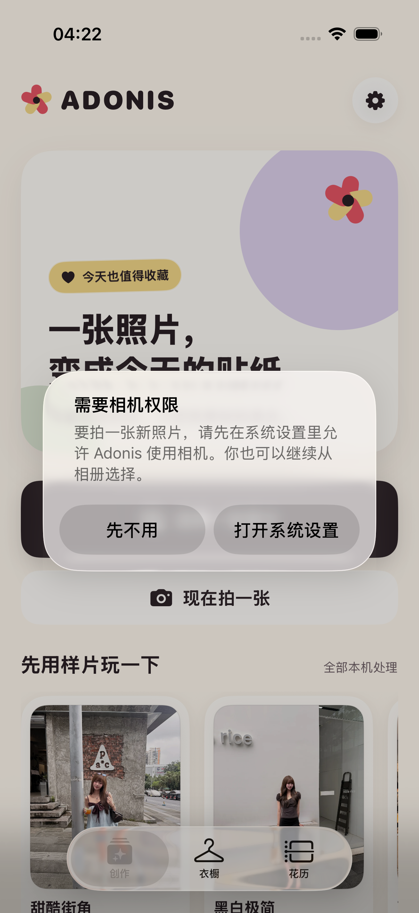
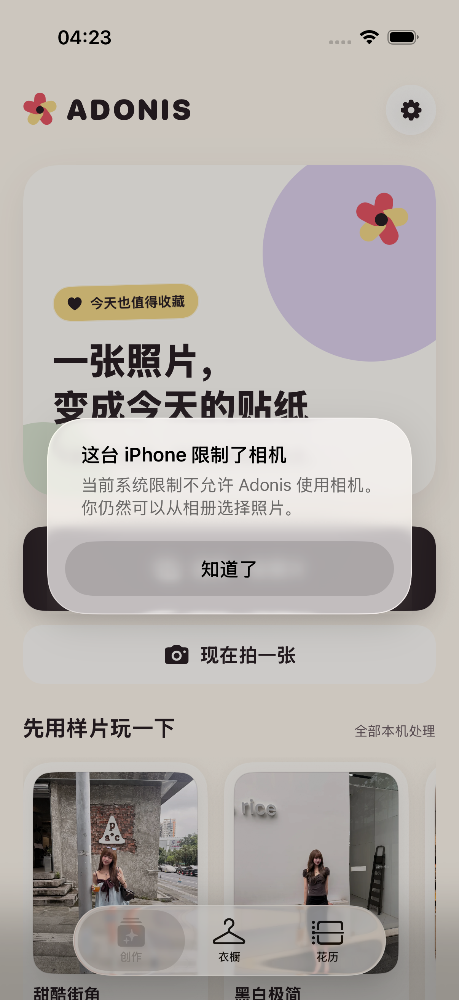

# 2026-08-30 相机权限恢复验证

> 结论：Adonis 现在只在用户点击“现在拍一张”后处理相机权限。已允许时直接打开相机；首次使用时交给系统询问；已拒绝时提供系统设置入口；受系统限制或设备没有相机时保留相册与样片退路。5 个服务测试与 2 个注入状态 UI 流程已在 iPhone 17 Pro 模拟器通过，但真实系统授权弹窗、设置往返、实际拍摄和真实 iPhone 仍未验证。

## 1. 适用读者与可执行动作

本文面向后续修改相机入口、权限判断、权限文案、系统设置恢复或相机弹窗状态的工程师与 Agent。改动前应先确认下表中的低心智负担契约，改动后运行：

```bash
make permission-regression
```

## 2. 低心智负担用户契约

首页不预先展示权限说明，也不在启动时索取相机权限。只有用户明确点击“现在拍一张”时，App 才判断当前状态。

| 当前状态 | 用户看到什么 | 下一步 |
| --- | --- | --- |
| 已允许 | 系统相机 | 拍照后进入既有本机贴纸流程 |
| 首次使用 | iOS 系统授权弹窗 | 允许后打开相机；拒绝后显示可恢复说明 |
| 已拒绝 | “需要相机权限” | 可打开 Adonis 的系统设置，也可“先不用”并从相册选择 |
| 受系统限制 | “这台 iPhone 限制了相机” | 不承诺设置可解除，继续从相册选择 |
| 设备没有可用相机 | “这里暂时不能拍照” | 从相册选择或使用四张授权样片 |

点击期间按钮会暂时禁用，避免并发发起两次权限请求。相机、权限说明和恢复入口都不要求用户理解模型、Skill 或工作流。

## 3. Apple 系统边界

实现先用 [`AVCaptureDevice.authorizationStatus(for:)`](https://developer.apple.com/documentation/avfoundation/avcapturedevice) 读取视频采集权限；只有状态为 `notDetermined` 时才调用 [`AVCaptureDevice.requestAccess(for:)`](https://developer.apple.com/documentation/avfoundation/avcam-building-a-camera-app) 触发系统询问。已拒绝状态不会重复弹系统授权框，而是通过 SwiftUI `openURL` 打开 [`UIApplication.openSettingsURLString`](https://developer.apple.com/documentation/uikit/uiapplication/opensettingsurlstring)。

项目继续声明 `NSCameraUsageDescription`：“Adonis 使用相机拍摄你想制作成贴纸的照片。”设备可用性仍由 `UIImagePickerController.isSourceTypeAvailable(.camera)` 判断，拍摄界面沿用现有 `UIImagePickerController` 包装。

## 4. 状态与实现边界

`CameraAccessService` 把设备可用性、权限读取和异步授权请求封装成可注入依赖，并只返回四种页面动作：打开相机、设备不可用、权限被拒绝、受系统限制。`CreateView` 使用单一 `CameraSheet?` 和单一 `CameraAccessAlert?` 驱动展示，避免多个布尔值产生互相冲突的弹窗状态。

Debug UI 测试可注入“已拒绝”与“受系统限制”，只用于稳定验证界面，不会进入发布行为。正式路径始终读取真实系统状态。

## 5. 自动验证

`make permission-regression` 覆盖：

- 设备不可用时不请求权限；
- 已允许时直接打开且不重复询问；
- 首次使用只请求一次，允许与拒绝分别进入正确结果；
- 已拒绝与受系统限制保持不同状态；
- 已拒绝弹窗包含“打开系统设置 / 先不用”，且不打开相机；
- 受限制弹窗只提供“知道了”，不展示无效的设置捷径，且不打开相机。

开发过程先得到缺少 `CameraAccessService` 的编译失败，再补实现使 5 个服务测试通过。最终权限专项为 5 个单元测试与 2 个 UI 流程，共 7 项通过、0 失败、0 跳过；`xcresulttool` 独立汇总一致，结果包为 `.derivedData/Logs/Test/Test-Adonis-2026.08.30_04-25-50-+0800.xcresult`。

完整门禁为 63 个单元测试与 17 个 UI 流程，共 80 项通过、0 失败、0 跳过；`xcresulttool` 独立汇总一致，结果包为 `.derivedData/Logs/Test/Test-Adonis-2026.08.30_04-28-01-+0800.xcresult`。`make accessibility-regression` 的 3 项专项、`make check` 的严格格式检查与通用 iOS 静态分析也分别通过；辅助字号与增强对比度在专项退出后恢复为 `large` 与 `disabled`。

## 6. 界面证据

两张截图来自 iPhone 17 Pro、iOS 26.5 模拟器的 UI 测试附件，原始尺寸均为 1206 × 2622，并已逐张目检。

### 已拒绝



权限原因、相册退路和两个动作完整可见；页面没有打开相机。

### 受系统限制



文案保留相册退路，并有意不展示“打开系统设置”，避免承诺用户能够解除家长控制、设备管理或其他系统限制。

证据 SHA-256：

| 文件 | SHA-256 |
| --- | --- |
| `camera-permission-denied-2026-08-30.png` | `1663dbf8c213782424ce65047dfac6e5b7f2b82e2a0ad5229ac1b362fc7052cf` |
| `camera-permission-restricted-2026-08-30.png` | `c5a29e0182bed507b4df363ad6fcb3857a92c279505a1bf779879a104c1ba27b` |

## 7. 尚未证明

- 没有在真实 iPhone 上触发首次系统授权弹窗、点击允许并完成实际拍摄。
- 没有在真实 iPhone 上拒绝权限、打开系统设置、修改权限并返回 Adonis 验证恢复。
- 注入的 `restricted` 状态只证明页面分支；尚未通过屏幕使用时间、MDM 或其他真实系统限制复现。
- 没有用 VoiceOver 人工检查系统授权框、权限恢复弹窗和设置往返的焦点顺序。
- 相册使用系统照片选择器，仍需在真实设备上覆盖用户取消、受限资源、损坏资源和系统交接失败。

因此这份记录可以作为相机权限状态与恢复界面的本地回归契约，但不能把 ADO-Q07 标记完成。
