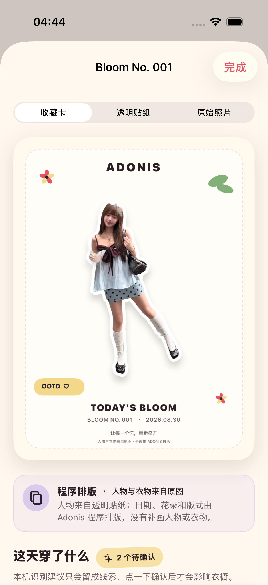

# 2026-08-30 已收藏 OOTD 冷启动持久化验证

> 结论：在 iPhone 17 Pro、iOS 26.5 模拟器中，用户用授权样片完成收藏后，测试会真实终止 Adonis 进程并重新启动。重启后的花历只出现原来那 1 条 `Bloom No. 001`，收藏卡图片与“程序排版 · 人物与衣物来自原图”的来源说明均可再次打开。该结果证明模拟器中的已收藏记录可以跨 App 进程恢复，不等同于真实 iPhone、整机重启、升级迁移或未收藏草稿恢复。

## 1. 适用读者与可执行动作

本文面向后续修改 SwiftData 模型容器、数据库位置、媒体文件位置、收藏事务或启动恢复行为的工程师与 Agent。改动前应先确认下面的保存边界，改动后运行：

```bash
make persistence-regression
```

## 2. 用户数据边界

| 用户状态 | 当前恢复承诺 | 原因 |
| --- | --- | --- |
| 已看到结果，但没有点“收藏今天” | 不承诺跨进程恢复 | 当前 `GenerationDraft` 只保存在页面内存中，不应让用户误以为已经保存 |
| 已点“收藏今天”且页面显示“今天已经收藏” | 应在下次启动后出现在花历 | 成功提示只在媒体写入和 SwiftData 保存完成后出现 |
| 保存中发生错误 | 不显示收藏成功 | 已写入的媒体会回滚，避免留下半条可见记录 |
| 用户主动删除记录或清空本地数据 | 不再恢复 | SwiftData 记录与关联媒体都应被删除 |

这条契约不增加恢复询问、草稿管理或启动提示，用户仍只需在喜欢结果时点一次“收藏今天”。

## 3. 存储与测试隔离

正式 App 继续使用 SwiftData 的默认本地磁盘配置；原图、透明贴纸和收藏卡保存在 App 沙盒的 `AdonisMedia` 目录。收藏流程先写入三个视觉资产与衣物线索预览，再保存 SwiftData 记录；任一步失败都会撤销记录并删除本轮已写文件。

为了让 UI 测试可以验证真实进程边界，同时不污染其他测试，启动策略分为三种：

- 正式启动：使用默认本地磁盘库。
- 普通单元测试与 UI 测试：继续使用一次性内存库。
- 冷启动专项：仅在 Debug UI 测试同时带有 `-ui-testing-persistent-store <UUID>` 时，使用临时目录中的独立 SwiftData 文件；终止前后复用同一 UUID。

参数只接受标准 UUID，数据库路径由程序在专用测试目录中拼接，不能通过参数指定任意文件路径。Release 构建固定返回正式存储模式，不接受测试磁盘入口。

## 4. 自动验证

开发过程先运行同一条冷启动 UI 流程得到 RED：首次收藏成功，但第二次启动仍使用新的内存库，花历记录数为 0。失败结果包为 `.derivedData/Logs/Test/Test-Adonis-2026.08.30_04-38-14-+0800.xcresult`。

实现隔离磁盘库后，`make persistence-regression` 覆盖：

- 正式启动、普通单元测试与普通 UI 测试选择正确的存储模式；
- 持久化参数必须同时包含 `-ui-testing` 与合法 UUID；
- 非法路径字符串不会成为数据库路径；
- 测试数据库稳定落在 UUID 隔离目录；
- 收藏后真实调用 `XCUIApplication.terminate()`，使用相同参数重新 `launch()`；
- 重启后的花历记录数严格为 1；
- 可以再次打开收藏卡，并看到原有的程序排版来源说明。

最终专项为 4 个单元测试与 1 个 UI 流程，共 5 项通过、0 失败、0 跳过；`xcresulttool` 独立汇总一致，结果包为 `.derivedData/Logs/Test/Test-Adonis-2026.08.30_04-44-07-+0800.xcresult`。

完整门禁为 67 个单元测试与 18 个 UI 流程，共 85 项通过、0 失败、0 跳过；`xcresulttool` 独立汇总一致，结果包为 `.derivedData/Logs/Test/Test-Adonis-2026.08.30_04-45-49-+0800.xcresult`。`make check` 的严格格式检查与通用 iOS 静态分析通过；`Release` 通用 iOS 构建也通过，覆盖了测试入口被 `#if DEBUG` 关闭的编译分支。最大辅助字号与增强对比度专项 3 项通过，结果包为 `.derivedData/Logs/Test/Test-Adonis-2026.08.30_04-52-07-+0800.xcresult`，退出后模拟器设置恢复为 `large` 与 `disabled`。

## 5. 界面证据

截图来自最终持久化专项的 iPhone 17 Pro、iOS 26.5 模拟器附件，原始尺寸为 1206 × 2622，并已目检。



画面显示重新打开的 `Bloom No. 001`。收藏卡人物、纯白贴纸边、日期与版式完整，来源说明明确为程序排版且人物与衣物来自原图；页面没有空白媒体或错误状态。花历只有 1 条记录由同一 UI 流程中的数量断言证明。

文件 SHA-256：`54cc120c1efd0bb66852086d5f111dfd14a1681801587f22bd7fc6616268502a`。

## 6. 尚未证明

- 没有在真实 iPhone 上终止并重启 App，也没有执行关机再开机后的恢复回归。
- 测试使用独立的临时磁盘 URL，证明了同一 SwiftData 磁盘机制与沙盒媒体可跨进程读取，但没有替代正式默认数据库路径的真机检查。
- 没有验证系统因内存压力强杀、写入过程中崩溃、磁盘空间不足或文件保护尚未解锁时的行为。
- 没有验证数据库模型迁移、App 升级、卸载重装、iCloud 或电脑整机备份与恢复。
- 未收藏的结果草稿不会跨进程保存；这属于当前有意的产品边界，不应在没有新产品决策时暗中改成永久草稿箱。

因此，本记录可以作为已收藏 OOTD 的模拟器进程级恢复契约，但 ADO-108 与 ADO-Q07 仍需真实 iPhone 证据。
