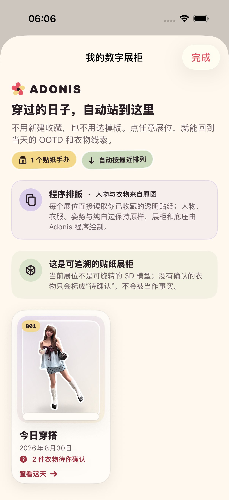

# 2026-08-30 数字展柜验证

> 结论：Adonis 已完成 ADO-405 的第一版本机纵向切片。用户收藏 OOTD 后，花历会零配置出现“我的数字展柜”；每个展位直接陈列原透明贴纸，并可追溯到日期、Bloom 编号、OOTD 和真实衣橱关系。它不生成或保存第二份手办资产，不会把待确认关系伪装成事实，也不是可旋转的 3D 模型。

## 1. 用户体验契约

- 空花历不展示展柜入口，不给第一次使用增加空功能或建柜任务。
- 第一条 OOTD 收藏成功后，花历自动出现展柜入口；用户不需要再次上传、命名展柜、选择模板或整理卡片。
- 展位按日期从近到远排列；同一时间使用较大的 Bloom 编号优先，最后以记录 ID 保证稳定顺序。
- 每个展位同时展示原透明贴纸、Bloom 编号、OOTD 标题、日期和衣物关系摘要。
- 点击展位直接进入对应 OOTD 详情，可继续查看收藏卡、透明贴纸、原图和衣物线索，也可制作已有的 2.5D 手办收藏卡。
- 删除最后一条 OOTD 后，正在打开的展柜立即显示空态，不留下已经失效的展位。

## 2. 图片与 3D 能力边界

| 展柜部分 | 来源 | 是否新增永久资产 |
| --- | --- | --- |
| 人物、衣物、配饰、姿势、纯白贴纸边 | 已收藏透明贴纸直接读取 | 否 |
| 展位背板、玻璃感、底座、阴影与编号 | SwiftUI 程序排版 | 否 |
| 日期、OOTD 标题与 Bloom 编号 | 已收藏 `OutfitRecord` | 否 |
| 衣物关系摘要 | 已确认的本地关系与当前衣橱实体 | 否 |
| 3D 网格、旋转、AR 与照片外补全 | 不生成 | 不适用 |

界面固定说明“这是可追溯的贴纸展柜”，并明确当前不是可旋转 3D。处理版本为 `digital-cabinet-v1`。展柜没有网络请求、供应商模型或生成式 AI 像素。

## 3. 衣橱关系真实性

- 只有状态为 `linkedExisting` 或 `createdNew`、保存了衣物 ID 且对应 `WardrobeItem` 当前仍存在时，展位才显示为“已确认”。
- 同一衣物被多个身体区域重复引用时只展示一次，并按上身、下身顺序稳定排列。
- `pending` 显示“待你确认”；`dismissed` 保持“已暂放”；没有任何线索时显示“这天还没有衣物线索”。
- 已确认关系指向的衣物后来被删除时，展位显示“关联衣物已从衣橱移除”，不会偷偷匹配另一件相似衣物。
- 展柜只摘要现有事实，具体候选、确认、排除和撤销仍在对应 OOTD 详情中完成。

## 4. 本地可观测性

用户打开展柜时记录 `digitalCabinetOpened`，处理版本为 `digital-cabinet-v1`。事件只记录类型、版本和时间，不包含图片、文件路径、OOTD 标题、衣物名称或其他用户内容。

## 5. 自动验证

专项命令：

```bash
make cabinet-regression
```

专项覆盖 6 个目录契约与 1 个真实 UI 流程：

- 空集合与最近优先的稳定排序。
- 只解析明确确认且仍存在的衣橱实体。
- 上身/下身顺序、重复衣物去重、待确认、已暂放、无线索与已删除关系文案。
- 空花历不出现入口，收藏后无需设置自动出现。
- 展柜来源与 3D 边界可见，展位包含日期、Bloom、OOTD 与衣物摘要。
- 展位可进入真实历史详情；删除唯一记录后立即进入空态。

TDD 与专项结果：

- RED：目录类型尚不存在时按预期编译失败，同时发现并修正测试夹具使用了不存在的分类名；结果包为 `.derivedData/Logs/Test/Test-Adonis-2026.08.30_05-59-32-+0800.xcresult`。
- 目录契约转绿：6 项通过、0 失败；结果包为 `.derivedData/Logs/Test/Test-Adonis-2026.08.30_06-00-52-+0800.xcresult`。
- 首轮专项：6 个目录测试与 1 个 UI 流程，共 7 项通过、0 失败；结果包为 `.derivedData/Logs/Test/Test-Adonis-2026.08.30_06-04-23-+0800.xcresult`。
- 动态空态补强：完整 UI 流程通过，删除唯一记录后展位数量为 0；结果包为 `.derivedData/Logs/Test/Test-Adonis-2026.08.30_06-06-20-+0800.xcresult`。
- 最大辅助字号与增强对比度：1 个颜色契约与 2 个 UI 流程，共 3 项通过、0 失败；展柜入口、边界说明、单列展位和关闭按钮均可滚动触达。结果包为 `.derivedData/Logs/Test/Test-Adonis-2026.08.30_06-07-14-+0800.xcresult`，脚本退出后字号恢复为 `large`、增强对比度恢复为 `disabled`。
- 最终专项回归：6 个目录测试与 1 个真实 UI 流程，共 7 项通过、0 失败；结果包为 `.derivedData/Logs/Test/Test-Adonis-2026.08.30_06-11-26-+0800.xcresult`。

完整门禁：

- `make check` 通过，包括严格 Swift 格式检查与 iOS 静态分析。
- `make test` 通过；81 个单元测试与 21 个 UI 流程，共 102 项通过、0 失败、0 跳过。独立 `xcresulttool` 摘要确认结果为 `Passed`，设备为 iPhone 17 Pro、iOS 26.5 模拟器；结果包为 `.derivedData/Logs/Test/Test-Adonis-2026.08.30_06-12-36-+0800.xcresult`。
- `Release`、`generic/platform=iOS`、`CODE_SIGNING_ALLOWED=NO` 构建通过；主 App 与分享扩展均进入 Release 产物。该结果证明可编译，但不代替真实设备签名、安装与权限验证。

## 6. 视觉证据

下图来自 iPhone 17 Pro、iOS 26.5 模拟器的专项 UI 流程，不是设计稿。原始尺寸为 1206 × 2622；已目检原贴纸人物、纯白边、展位层级、日期、Bloom 编号、OOTD 标题和“2 件衣物待你确认”状态均完整可见。



SHA-256：`6230ca70c703845b87daeef9206e58eb92489bb1f810ee49cfda1a96f2c7e2b0`

## 7. 尚未证明

- 当前只证明静态贴纸展柜，不包含 3D 网格、旋转、AR、视频、实体打印或照片外补全。
- 自动测试只用一条授权样片证明单展位路径；大量收藏、跨年、极长标题和多种已确认衣物组合仍需继续做视觉回归。
- 当前排序是时间列表，不包含按季节、风格、地点或衣物筛选，也不证明用户需要这些复杂整理能力。
- 没有在真实 iPhone 上验证 VoiceOver 朗读顺序、不同屏幕尺寸、内存、长列表滚动或真实用户的长期回访价值。
- 没有证明数字展柜会提升保存、分享或回访；仍需邀请首批目标用户进行无讲解测试。

因此 ADO-405 的第一版工程切片可以标记完成；真实 3D、复杂展柜管理和长期用户价值继续留在后续验证中。
