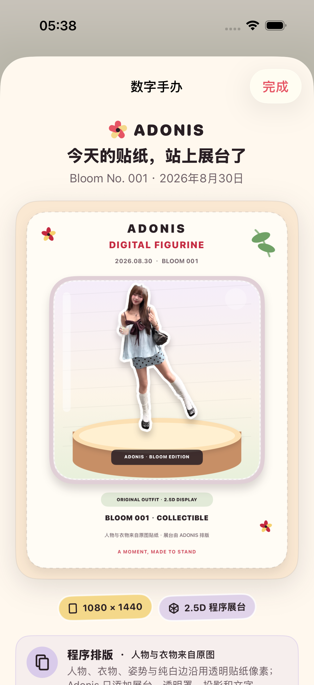

# 2026-08-30 数字手办收藏卡验证

> 结论：Adonis 已完成 ADO-404 的第一版本机纵向切片。用户可从刚生成的结果或花历中的已收藏 OOTD，一次点击得到 1080 × 1440 的静态 2.5D 手办展台收藏卡并打开 iOS 系统分享；人物、衣物、姿势和纯白贴纸边直接沿用原图贴纸像素，展台、透明罩、投影和文字由程序绘制。它不是 AI 重绘、可旋转 3D 模型、AR 资产或实体打印文件。

## 1. 用户体验契约

- 入口位于生成结果和已收藏 OOTD 详情中，不增加新的主导航、上传步骤、Prompt、模型、风格或模板选择。
- 用户点击“把这张贴纸立起来”后直接看到成品，不需要再次选择图片或填写资料。
- 预览固定说明人物和衣服保持原样，并明确当前只是 2.5D 展台卡，不会补出原照片里看不见的身体或衣物。
- 成品可以打开 iOS 系统分享面板；Adonis 不替用户选择分享目的地。
- 手办卡按需生成，不额外保存为一份永久资产；花历再次打开时由已保存的透明贴纸重新排版。
- 透明贴纸缺失或无法渲染时显示可理解的本地错误，原 OOTD 与已有图片不受影响。

## 2. 像素来源与能力边界

| 成品部分 | 来源 | 内容类型 |
| --- | --- | --- |
| 人物、脸、身体、衣物、配饰、姿势 | 已有透明贴纸直接合成 | 原图处理像素 |
| 纯白贴纸边 | 已有透明贴纸直接合成 | 原图处理像素 |
| 展台、透明罩、投影、花朵、日期与 Bloom 编号 | UIKit 本机绘制 | 程序排版 |
| 看不见的身体或衣物 | 不生成 | 不适用 |
| 3D 网格、旋转、AR 与实体打印数据 | 不生成 | 不适用 |

输出页脚固定为“人物与衣物来自原图贴纸 · 展台由 ADONIS 排版”，处理版本为 `digital-figurine-card-v1`。当前实现不调用网络、供应商模型或生成式 AI，因此不能描述成 AI 手办或真实 3D。

## 3. 本地可观测性

本机只记录两个不含图片内容的产品事件：

- `digitalFigurineCardCreated`：程序成功生成手办收藏卡。
- `digitalFigurineCardShareOpened`：用户打开手办卡的系统分享面板。

事件只包含可用时的输入来源、处理版本和时间，不记录图片、文件路径、提示词或分享目的地。

## 4. 自动验证

专项命令：

```bash
make figurine-regression
```

专项覆盖：

- 空贴纸不会生成空展台。
- 输出严格为 1080 × 1440 且所有像素不透明。
- 已知颜色的源贴纸像素会直接出现在成品中，防止实现静默替换为生成式重绘。
- 来源页脚、内容类型、处理版本和本地事件名称保持稳定。
- 结果页可一次点击打开手办卡并进入真实 iOS 系统分享面板。
- 已收藏记录可以重新读取透明贴纸并打开同一类手办卡。

TDD 与缺陷证据：

- RED：渲染器尚不存在时测试按预期失败，结果包为 `.derivedData/Logs/Test/Test-Adonis-2026.08.30_05-29-44-+0800.xcresult`。
- 首次像素契约通过：4 项通过，结果包为 `.derivedData/Logs/Test/Test-Adonis-2026.08.30_05-32-08-+0800.xcresult`。
- 第一轮 UI 回归发现底层页面与弹层复用了来源说明和“完成”语义，结果包为 `.derivedData/Logs/Test/Test-Adonis-2026.08.30_05-35-42-+0800.xcresult`；随后为弹层补充独立语义标识。
- 最终专项：4 个渲染测试与 2 个 UI 流程，共 6 项通过、0 失败，结果包为 `.derivedData/Logs/Test/Test-Adonis-2026.08.30_05-37-52-+0800.xcresult`。
- 最大辅助字号与增强对比度专项：1 个颜色契约与 2 个 UI 流程，共 3 项通过、0 失败，结果包为 `.derivedData/Logs/Test/Test-Adonis-2026.08.30_05-40-14-+0800.xcresult`。测试后独立读取模拟器设置，字号恢复为 `large`、增强对比度恢复为 `disabled`。

完整门禁：

- `make check`：严格 `swift-format`、Xcode 工程重生成与通用 iOS 设备静态分析通过。
- `make test`：75 个单元测试与 20 个 UI 流程，共 95 项通过、0 失败。
- `xcresulttool` 独立汇总为 95 通过、0 失败、0 跳过；设备为 iPhone 17 Pro、iOS 26.5。
- 完整结果包：`.derivedData/Logs/Test/Test-Adonis-2026.08.30_05-46-58-+0800.xcresult`。
- Release 通用 iOS 设备构建：主 App 与分享扩展在 `Release` 配置、关闭代码签名时构建成功。

## 5. 视觉证据

下图来自 iPhone 17 Pro、iOS 26.5 模拟器的专项 UI 回归，不是设计稿。原始尺寸为 1206 × 2622，并已目检人物、衣物、姿势、纯白边、展台与来源文案。



SHA-256：`6001324045f34eeb86c2e13e2cd7a5cad702934d0b702f1a7ed902c852fc1f47`

## 6. 尚未证明

- 当前只证明静态 2.5D 展台卡，不包含轻微视差、动画、旋转视频、3D 网格、AR 摆放或实体打印。
- 视觉证据只展示一张授权样片；固定样本中的其他姿势和复杂边缘仍应继续回归。
- 模拟器系统分享面板已打开，但没有验证微信、小红书、Instagram 等具体目的地的真实发布结果。
- 没有在真实 iPhone 上验证渲染性能、内存、分享、VoiceOver 或不同屏幕尺寸。
- 尚无首轮用户证据证明这张卡真的比普通贴纸收藏卡更值得保存、分享或长期回看。

因此 ADO-404 的第一版工程切片可以标记完成；更强的手办材质、动态展示、真实 3D 与用户价值验证仍是后续工作。
