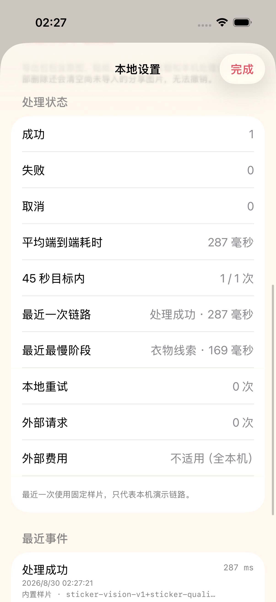
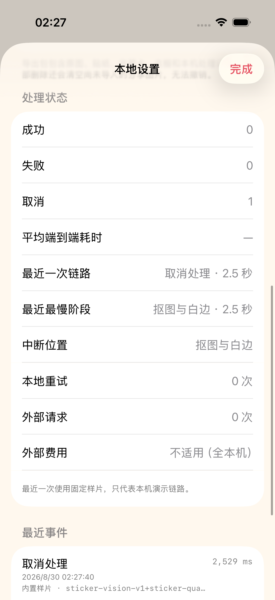

# 2026-08-30 生成性能与预算验证

> 结论：ADO-Q05 的本地生成链路切片已经实现。Adonis 现在按同一口径记录成功、失败和取消的端到端耗时，并保留五个阶段、45 秒目标、中断位置、重试与外部请求；用户只在低频的“本地设置”中看到摘要。当前没有联网供应商，因此外部请求和重试真实值为 0、外部费用为“不适用”。真实供应商成本、联网重试、真机实时 Vision 时延和硬超时尚未证明，所以 ADO-Q05 保持未完成。

## 1. 计时口径

计时使用单调递增的 `ContinuousClock`，不受系统时间调整影响。相册链路从照片选择器交回项目并开始读取数据时计时，包含数据传输和图片解码；相机链路从系统相机交回图片后计时，不把用户取景与按快门的时间算作处理；内置样片从生成任务开始计时。

终点是以下任一状态：

- 收藏卡、结构检查和衣物线索全部完成，可以展示结果；
- 读取、抠图、检查或后处理失败；
- 用户点击“取消”，迟到结果随后会被当前生成 ID 隔离。

总耗时包含阶段切换和少量调度开销，因此不要求五段相加与总耗时逐毫秒完全相等。

| 阶段 | 记录范围 | 特殊边界 |
| --- | --- | --- |
| `inputLoading` | 相册数据读取与 `UIImage` 解码 | 相机回调和内置样片没有这一段 |
| `subjectExtraction` | Vision 主体分割、透明裁切与纯白贴纸边 | 内置样片复用预处理贴纸，仍标记 `usesPreparedSample = true`，不能代表实时 Vision |
| `qualityAssessment` | 透明度、主体连通与白边结构检查 | 只判断结构事实，不代表人物或衣物语义保真 |
| `shareCardComposition` | 1080 × 1440 收藏卡程序排版 | 不包含 AI 生成像素 |
| `garmentObservation` | 上身与下身临时衣物线索 | 结果仍是待确认的识别建议 |

当前性能契约版本为 `generation-performance-v1`，第一张最终结果的测量目标为 45,000 毫秒。这个目标来自产品规格，但当前代码没有把 45 秒或 90 秒实现成强制超时；不能把 cooperative cancellation、测试等待或设置页文案描述成硬超时。

## 2. 终态、持久化与隐私

- `GenerationPerformanceRecorder` 串行记录阶段，首次生成终态后冻结；后续迟到调用不能改写已保存的结果。
- 成功保存完整阶段；失败和取消把正在进行的阶段按已消耗时间收口，并保存 `interruptedStage`。
- `AppEvent` 使用可查询的可选字段保存性能版本、目标、五段耗时、重试、外部请求、样片标记和中断阶段。旧事件没有这些字段时仍可读取，不伪造历史性能。
- 结构化性能总耗时是事件 `durationMilliseconds` 的权威来源，避免调用方同时传入两个不同数字。
- 事件落库不再使用静默的 `try?`。失败时只写入事件类型、错误域和错误码到本机系统日志，不记录图片、文件路径、提示词或用户内容。
- 个人数据导出升级为 `adonis-personal-data-v3`。`processingEvents.generationPerformance` 保存版本、总耗时、目标、预算状态、阶段字典、最慢与中断阶段、重试、外部请求和样片标记。

从测试附件导出的 TAR 已使用系统 `tar` 独立读取。实际 `manifest.json` 包含：

```json
{
  "formatVersion": "adonis-personal-data-v3",
  "performance": {
    "version": "generation-performance-v1",
    "totalMilliseconds": 680,
    "targetMilliseconds": 45000,
    "budgetStatus": "withinTarget",
    "stageMilliseconds": {
      "subjectExtraction": 500,
      "qualityAssessment": 180
    },
    "retryCount": 0,
    "externalRequestCount": 0,
    "usesPreparedSample": false
  }
}
```

这是固定测试数据，不是用户照片的实际性能记录。

## 3. 用户入口

日常创作流程没有增加选择或技术术语。“本地设置 → 处理状态”展示：

- 成功、失败和取消次数；
- 成功结果的平均端到端耗时，以及多少次落在 45 秒目标内；
- 最近一次终态、耗时、最慢阶段和可用时的中断位置；
- 本地重试、外部请求和外部费用状态；
- 最近一次使用内置样片时，明确提示它只代表本机演示链路。

升级前的旧成功事件只有局部处理耗时，没有 `generation-performance-v1` 结构，因此仍可在事件列表中查看，但不参与新的平均端到端耗时或 45 秒目标统计。

当前没有外部调用，因此界面显示“外部请求 0 次”和“外部费用 不适用（全本机）”。这不是零价格供应商，也不是未来成本预测。

## 4. 专项自动验证

专项命令：

```bash
make performance-regression
```

它覆盖：

- 成功事件的结构化落库和总耗时唯一来源；
- 失败事件的部分阶段、中断位置以及 0 次外部请求与重试；
- 可控时钟下的阶段顺序、目标内与超目标结果、负值保护和终态冻结；
- `adonis-personal-data-v3` TAR 中可由系统工具读取的性能结构；
- 内置样片完成后设置页显示 45 秒目标、最近终态、最慢阶段和本机费用边界；
- 用户取消后设置页显示“取消处理”和“抠图与白边”中断位置。

最终专项结果为 8 个单元测试与 2 个 UI 流程测试，共 10 项通过、0 失败、0 跳过。`xcresulttool` 独立汇总一致；结果包为 `.derivedData/Logs/Test/Test-Adonis-2026.08.30_03-03-36-+0800.xcresult`。

最终完整门禁为 53 个单元测试与 13 个 UI 流程测试，共 66 项通过、0 失败、0 跳过；结果包为 `.derivedData/Logs/Test/Test-Adonis-2026.08.30_02-56-37-+0800.xcresult`。

## 5. 界面证据

两张截图均来自 iPhone 17 Pro、iOS 26.5 模拟器的性能专项 UI 测试附件，原始尺寸为 1206 × 2622，并已逐张目检。

### 成功与 45 秒目标



这次内置样片端到端为 287 毫秒，最慢阶段为“衣物线索”169 毫秒，目标计数为 1 / 1；重试和外部请求均为 0，外部费用明确为全本机不适用。画面没有截断、重叠或错误状态。这只是一次测试快照，不是稳定基准或 SLA。

### 取消与部分阶段



测试专用等待让取消按钮保持可操作；点击后记录 2.5 秒，并把最慢和中断阶段都保存为“抠图与白边”。成功与失败计数没有被误增，最近事件为“取消处理”。正式 App 不包含这段等待。

证据 SHA-256：

| 文件 | SHA-256 |
| --- | --- |
| `performance-budget-success-2026-08-30.png` | `ab254de0b23355515ea7b573e3859782996212da003c689caa58d2a41119848a` |
| `performance-budget-cancelled-2026-08-30.png` | `98a68bd29eab0ee00d0b6f4f3e3233df0582c48ce915d8983506dcadc12c26a3` |

## 6. 尚未证明

- 内置样片跳过实时 Vision，因此 287 毫秒不能代表用户相册照片或真实 iPhone 的完整抠图速度。
- iOS 模拟器当前不能执行受测 Vision 推理；尚未获得真实 iPhone 上不同分辨率、温度、低电量和内存压力下的 P50、P95 或 P99。
- 当前没有云端模型、第三方供应商、鉴权、网络请求或计价，所以没有可记录的供应商延迟、单次价格、重试、限流、幂等和失败成本。
- 45 秒只是测量目标。底层 Vision 工作在用户取消后不保证立即停止，当前只隔离迟到结果；90 秒硬超时与基础贴纸降级仍属于 ADO-Q04。
- App 进程在处理中被系统直接终止时，只会留下已经持久化的“开始处理”事件，无法在进程死亡后补写终态。
- 尚未建立持续的性能基线趋势、内存峰值、能耗与热状态门禁。

因此这份记录可以作为后续计时、预算、处理事件、设置诊断与导出字段的本地回归契约，但不能据此勾选 ADO-Q05、ADO-Q04、ADO-108 或真实供应商验证。
