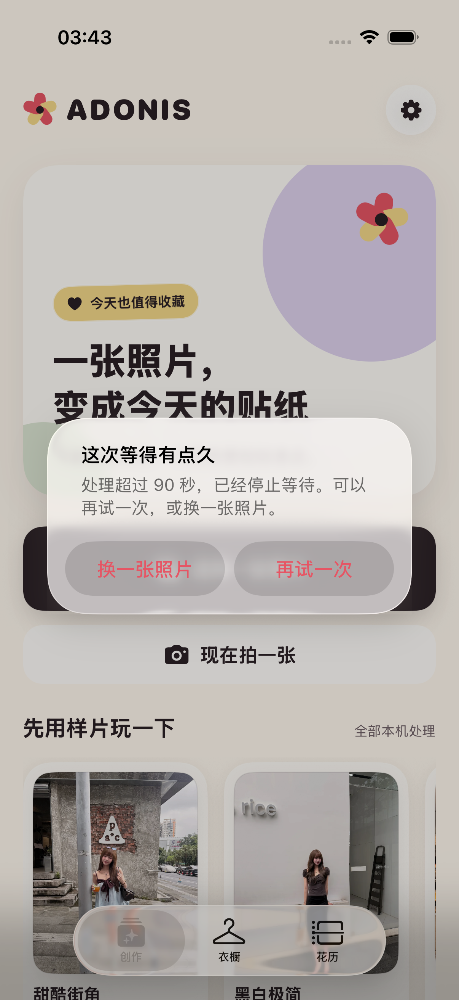
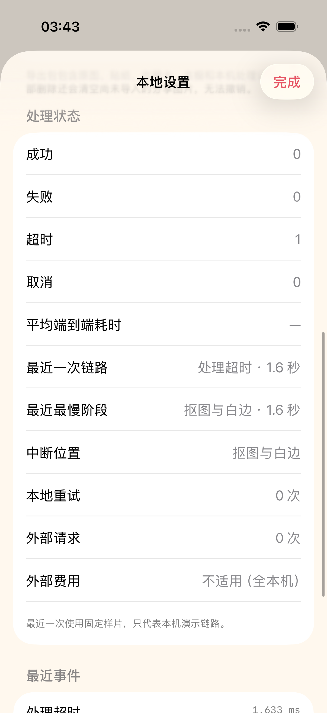
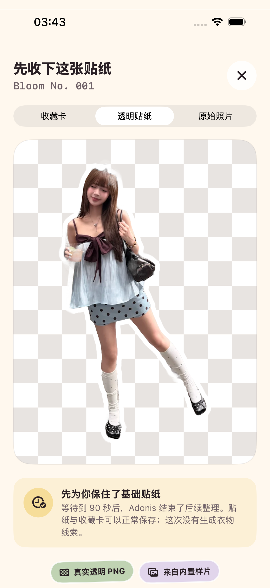
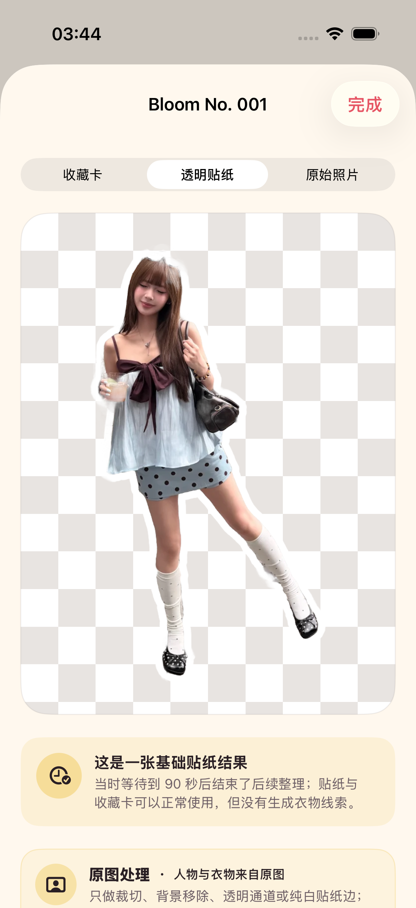

# 2026-08-30 生成超时与基础贴纸降级验证

> 当前结论（2026-08-31 更新）：默认人物链路现在包含 Apple AI 生成和后续本机抠图，但仍保持 90 秒用户等待上限。到期时，没有合格中间产物就重试或换图；只有本次 AI 生成链路中已经通过结构检查并完成排版的贴纸与收藏卡可以交付。不得改用用户原图直抠。迟到结果仍不能覆盖当前页面或补写成功终态。下文原图处理截图是 2026-08-30 的历史直抠样片证据，不代表当前主链路来源；现行契约见 [AI 贴纸先生成后抠图验证记录](2026-08-31-ai-sticker-first-pipeline.md)。

## 1. 适用读者与可执行动作

本文面向后续修改生成流程、计时、重试、质量检查、收藏卡、衣物线索或终态事件的工程师与 Agent。读完后应能判断一次改动是否保持超时契约，并用 `make performance-regression` 重新验证。

## 2. 用户体验契约

超时处理不增加上传前选项，也不向用户展示模型、Skill、工作流、阈值或错误码。

| 90 秒时的状态 | 用户看到什么 | 下一步 |
| --- | --- | --- |
| 尚无合格贴纸 | “这次等得有点久”，处理中浮层消失 | “再试一次”复用同一输入，或“换一张照片” |
| 贴纸已通过结构检查且收藏卡已完成 | “先收下这张贴纸”，默认展示透明贴纸 | 可收藏贴纸与收藏卡，或重新创作 |
| 已在 90 秒内完整完成 | 正常结果 | 不显示超时提示 |
| 用户主动取消 | 返回创作首页 | 不显示超时提示，也不保留重试输入 |

相册图片还在系统读取阶段时，也会保留该相册项用于一次无额外选择的重试。相机、内置样片和已经解码的相册图片复用当前内存中的输入；这些重试素材不会跨 App 重启持久化。

## 3. 降级成立条件

基础贴纸降级只能在以下事实全部成立后启用：

1. 主体提取已经产生透明贴纸。
2. 结构质量检查没有拒绝该贴纸。
3. 1080 × 1440 收藏卡已经完成程序排版。

衣物线索尚未完成不影响这两个视觉资产的交付。降级结果明确说明“这次没有生成衣物线索”，并在收藏后的花历详情中保留同一说明。没有通过质量检查的图片不能借超时路径绕过拒绝门槛。

## 4. 终态与迟到结果隔离

每次生成都有独立 ID 和一次性截止任务。成功、失败、主动取消或重新开始都会撤销旧截止任务；重新挂载截止任务时，已取消的旧任务即使不响应 cooperative cancellation，也不能触发新一轮回调。

超时回调按以下顺序执行：

1. 冻结当前性能轨迹。
2. 清除活动生成 ID、输入来源和性能记录器。
3. 关闭处理中浮层并记录“处理超时”。
4. 根据是否存在合格中间产物进入重试弹窗或基础贴纸结果。

后续异步阶段在写入页面、事件或结果前都校验活动生成 ID，因此迟到结果会被丢弃。这里的“硬超时”指用户等待边界和结果隔离已经强制成立，不代表 Apple Vision 或未来供应商请求的底层计算一定在该时刻物理停止。接入可取消的网络供应商后，仍应同时取消真实请求。

## 5. 持久化、事件与导出

- 正常结果保存为 `complete`；超时交付的基础贴纸保存为 `basic_sticker_fallback`。
- 花历重新打开记录时继续默认展示透明贴纸和降级说明。
- 本地事件使用独立终态“处理超时”，并保存同一口径的中断性能轨迹。
- 事件细节只记录 `deadline_ms=90000` 和 `fallback=unavailable` 或 `fallback=basic_sticker`，不包含图片、路径或用户内容。
- 本地设置分别显示成功、失败、超时与取消次数；最近一次链路可以显示超时及其中断阶段。
- 个人数据导出格式当前为 `adonis-personal-data-v9`，每条 OOTD 通过 `generationCompletionMode` 保留完整结果或同一 AI 链路中的基础贴纸降级事实，并保留 AI 源、动态来源、执行元数据与可选人物/穿搭复核。

## 6. 专项自动验证

专项命令：

```bash
make performance-regression
```

它覆盖：

- 90 秒生产常量和稳定用户文案；
- 截止任务只触发一次，重新挂载后拒绝已取消的迟到任务；
- 基础贴纸状态写入 SwiftData 与个人数据导出；
- 无可用中间产物时退出等待、提供重试与换图，并拒绝迟到结果覆盖；
- 有合格中间产物时交付基础贴纸，不伪造衣物线索；
- 收藏后花历继续显示降级说明；
- 既有成功、失败、主动取消、45 秒目标和外部费用边界。

最终专项结果为 13 个单元测试与 4 个 UI 流程测试，共 17 项通过、0 失败、0 跳过；`xcresulttool` 独立汇总一致。结果包为 `.derivedData/Logs/Test/Test-Adonis-2026.08.30_04-03-20-+0800.xcresult`。

当前完整门禁为 127 个单元测试与 28 个 UI 流程测试，共 155 项通过、0 失败、0 跳过；结果包为 `.derivedData/Logs/Test/Test-Adonis-2026.08.30_11-55-11-+0800.xcresult`。`make sample-regression`、`make accessibility-regression` 与 `make check` 也分别通过。

## 7. 界面证据

四张截图来自 iPhone 17 Pro、iOS 26.5 模拟器的 UI 测试附件，原始尺寸均为 1206 × 2622，并已逐张目检。

### 没有合格中间产物



弹窗使用普通语言，两个恢复动作均可见；处理中浮层已经退出。



设置页将这次结果计为“超时”，没有误增成功或失败；测试等待为 1.5 秒，但界面和生产契约仍明确记录 90 秒。等待旧任务返回后，页面没有被迟到结果带回结果页。

### 已有合格贴纸与收藏卡



这张历史截图默认展示当时的直抠透明贴纸，说明后续整理在 90 秒结束，并明确没有衣物线索；它当时标为原图处理。当前 AI 主链路的超时交付必须继承 AI 生成来源。



收藏后重新进入花历详情，降级状态、透明贴纸默认模式与来源说明都仍然存在。

证据 SHA-256：

| 文件 | SHA-256 |
| --- | --- |
| `generation-timeout-alert-2026-08-30.png` | `deee92539cb15134d45dc831d8df0f3179d6d01d0574df1fdf42559a2c63983f` |
| `generation-timeout-status-2026-08-30.png` | `ed10f3188249bffc556a382ae2ec6c9eac82aa57037ee1ec0a3b861a15f4d159` |
| `generation-timeout-fallback-result-2026-08-30.png` | `253ac3c5cb19e4c6d33d5c124c030e45bb4d2dafe747fe42c037f31f66d1b74a` |
| `generation-timeout-fallback-history-2026-08-30.png` | `b4a3f198329b4a2392677b8de6d0137a700410278d1ba279cf6e669d11074a10` |

## 8. 尚未证明

- 没有在真实 iPhone 上让实时 Vision 连续运行到 90 秒，也没有测量超时后的 CPU、内存或能耗释放速度。
- 底层 Vision 当前不保证立即停止；已证明的是用户不再等待、迟到结果被隔离且不会写入错误终态。
- 当前没有云端模型或第三方供应商，因此还没有验证弱网、断网、限流、鉴权失效、服务器超时、真实请求取消、幂等或供应商不可用降级。
- 基础贴纸条件只证明 Alpha、主体连通、白边和收藏卡完成等结构事实，不证明身份、衣物图案或身体比例的语义保真。
- 相册读取阶段的同图重试已实现，但系统相册权限拒绝和损坏资源仍需在真实权限流程中验证。

因此，本记录可以作为本机 90 秒等待边界、迟到结果隔离和基础贴纸降级的当前契约。ADO-Q04 仍需在真实供应商接入后补齐联网不可用与重试验证，ADO-Q07 仍需真实 iPhone、权限和弱网证据。
