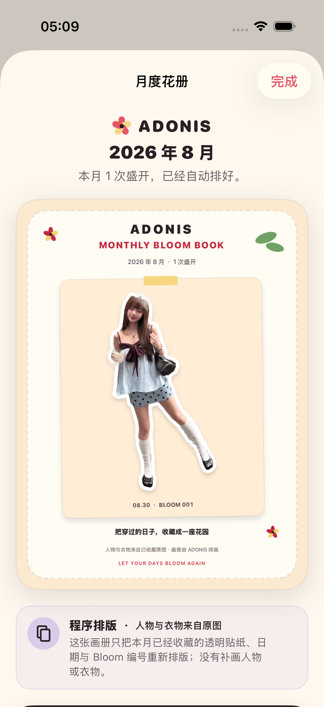

# 2026-08-30 月度贴纸 Lookbook 验证

> 结论：在 iPhone 17 Pro、iOS 26.5 模拟器中，花历空月份不会出现画册入口；收藏一条 OOTD 后，“本月贴纸画册”自动出现，点击即可得到 1080 × 1440 的不透明静态画册并打开系统分享。人物与衣物像素来自已收藏透明贴纸，日期、Bloom 编号、花朵和版式由 Adonis 在本机程序绘制。画册不会再次补画人物或衣物，但只要任一输入贴纸由 AI 生成，成品就继续标为 AI 来源。

## 1. 适用读者与可执行动作

本文面向后续修改花历月份筛选、月度画册选片、排版、来源标识、预览或分享流程的工程师与 Agent。改动前应确认下面的产品边界，改动后运行：

```bash
make lookbook-regression
```

如果同时修改通用布局、文案、动态字号或无障碍语义，还要运行 `make accessibility-regression`。

## 2. 用户契约

| 场景 | 当前行为 |
| --- | --- |
| 当前可见月份没有收藏 | 不显示 Lookbook 入口，不制造空任务 |
| 当前可见月份有收藏 | 显示一次点击入口，不要求 Prompt、模型、风格或模板选择 |
| 当月记录不超过 6 条 | 按日期从新到旧全部排入画册 |
| 当月记录超过 6 条 | 标明整月盛开总数，只展示最近 6 条 |
| 某条已收藏贴纸无法读取 | 不输出缺人的残缺画册；保留原记录并提示稍后重试 |
| 用户分享 | 交给 iOS 系统分享面板，Adonis 不自动选择平台或上传 |

画册是按需生成的分享结果，不会再保存一份永久副本。它自然依附于已有花历，不新增整理页、草稿箱或通知压力。

## 3. 内容来源

| 画面元素 | 来源类型 | 是否包含 AI 像素 |
| --- | --- | --- |
| 人物、衣物与配饰 | 已收藏 OOTD 的透明贴纸 | 继承每张贴纸的实际来源 |
| 日期与 Bloom 编号 | 本地记录元数据 | 否 |
| 画册背景、卡槽、胶带、花朵、叶片与文字 | UIKit 程序绘制 | 否 |

历史直抠输入使用“人物与衣物来自已收藏原图 · 画册由 ADONIS 排版”页脚；只要选中的贴纸包含 AI 像素，就改为“画册包含 AI 生成贴纸 · 画册由 ADONIS 排版”，预览来源卡也显示 AI 生成。两种情况都明确画册排版本身没有再次补画人物或衣物，也不能描述成动态 Lookbook。

## 4. 自动验证

开发过程先运行渲染器契约得到 RED：`MonthlyLookbookEntry` 与 `MonthlyLookbookRenderer` 尚不存在，结果包为 `.derivedData/Logs/Test/Test-Adonis-2026.08.30_05-02-43-+0800.xcresult`。

实现后的专项覆盖：

- 来源页脚必须按输入动态区分已收藏原图贴纸与 AI 生成贴纸，并说明由 Adonis 排版；
- 只选择当前可见月份，并按日期倒序最多保留 6 条；
- 空月份渲染返回空结果；
- 成品严格为 1080 × 1440，所有像素不透明；
- UI 流程先证明空花历没有入口，再收藏授权样片并证明入口自动出现；
- 预览可见并带有与输入贴纸一致的动态来源说明；
- “分享这本花册”可以打开真实 iOS 系统分享面板。

首次端到端专项为 4 个单元测试与 1 个 UI 流程，共 5 项通过、0 失败，结果包为 `.derivedData/Logs/Test/Test-Adonis-2026.08.30_05-08-41-+0800.xcresult`。修正超过 6 条时的整月计数后，最终 `make lookbook-regression` 仍为 5 项通过、0 失败，结果包为 `.derivedData/Logs/Test/Test-Adonis-2026.08.30_05-12-25-+0800.xcresult`。

最大辅助字号 `accessibility-extra-extra-extra-large` 与增强对比度下，入口、预览、来源说明和分享按钮都可滚动到并操作；连同原有颜色与取消流程共 3 项通过、0 失败，结果包为 `.derivedData/Logs/Test/Test-Adonis-2026.08.30_05-13-17-+0800.xcresult`。脚本退出后模拟器设置恢复为 `large` 与 `disabled`。

完整门禁同样通过：`make check` 完成严格格式检查和通用 iOS 设备静态分析；`make test` 完成 71 个单元测试与 19 个 UI 流程，共 90 项通过、0 失败。`xcresulttool` 独立汇总为 90 通过、0 失败、0 跳过，完整结果包为 `.derivedData/Logs/Test/Test-Adonis-2026.08.30_05-15-59-+0800.xcresult`。此外，Release 配置在 `generic/platform=iOS`、关闭签名的条件下完成主 App 与分享扩展 arm64 构建，退出码为 0。

## 5. 界面证据

截图来自上述端到端专项的 iPhone 17 Pro、iOS 26.5 模拟器附件，原始尺寸为 1206 × 2622，并已目检。



这张历史截图使用原图处理贴纸。画面中的人物、服装、包和饰品保持为收藏贴纸像素；纯白贴纸边清楚，没有被画册布局重绘。预览标题说明本月记录数，画册内含日期与 Bloom 编号，底部可见程序排版来源页脚；页面下方的来源卡再次解释没有补画人物或衣物。

文件 SHA-256：`b1b1c53de87fd2c37a047fcca6180e2a877f1c3d52eaa1587fffcaec6d3b8fda`。

## 6. 尚未证明

- 自动 UI 流程用 1 条真实收藏证明主链路；2 至 6 条和超过 6 条的版式选择由单元契约覆盖，尚未逐个数量留下设备截图。
- 没有在真实 iPhone、横屏、分屏或真实社交平台目标中完成分享。
- 没有证明首轮目标用户愿意保存或发布这张画册，也没有验证它是否带来月度回访。
- 当前是静态程序排版，不是动态 Lookbook、3D 手办展柜、第二次 AI 风格生成或“再次盛开”搭配建议；输入贴纸本身仍可能含 AI 像素。
- 画册按需生成而不持久化；个人数据导出仍只包含原始收藏记录与既有视觉资产，不包含用户没有主动保存的临时画册。

因此，本记录可以作为本机静态月度 Lookbook 的实现契约，但不能替代真实用户价值、真实设备分享或未来 AI/动态能力的验证。
