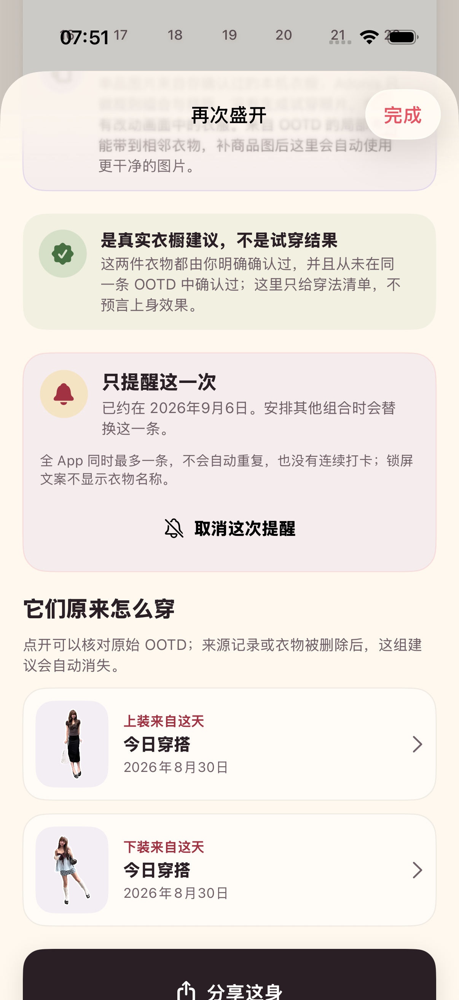
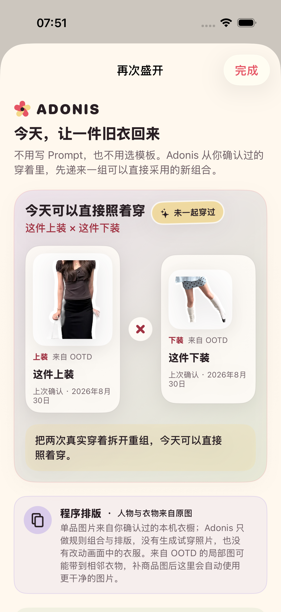

# 2026-08-30 再次盛开一次性提醒验证

> 工程结论：Adonis 已完成 ADO-406 的本地工程前置。有效“再次盛开”建议可以由用户明确安排一次 7 天提醒；它不自动索权、不重复、不制造连续打卡压力，并能在 App 侧回到可追溯建议。
>
> 产品结论：这不是 ADO-406 的真实用户验证。系统实际投递、通知点击冷启动和提醒是否带来长期回访仍需真实 iPhone 与首轮用户证明，因此 ADO-406 保持未完成。

## 1. 低压力用户契约

- 没有有效“再次盛开”建议时，不显示提醒入口。
- 浏览建议、切换组合和检查提醒状态都不会申请通知权限；只有用户点击“7 天后提醒我”才按需请求。
- 每次安排只触发一次，固定为 7 天后；不设置每日、每周重复，不增加连续打卡、完成率或补做任务。
- 全 App 同时最多一条“再次盛开”提醒。安排另一组时，旧待投递与已送达提醒会被替换。
- 安排成功后同一位置变为“取消这次提醒”，用户不需要进入设置或单独的提醒管理页。
- 权限被拒绝时，页面明确说明原搭配不会改变，并提供“打开系统设置 / 先不用”；拒绝不会创建提醒。

## 2. 通知与隐私边界

- 使用 `UNTimeIntervalNotificationTrigger`，间隔为 7 天，`repeats` 为 `false`。
- 锁屏标题为“一组真实搭配可以再次盛开”，正文只邀请用户回到 Adonis；两者都不包含衣物名、颜色、日期、图片或 OOTD 内容。
- `userInfo` 只包含固定值 `route=rebloom`。系统请求标识在本机编码上装与下装 UUID，用于恢复同一建议；标识不进入可见文案或事件详情。
- 处理版本为 `rebloom-reminder-v1`。
- 本地事件为 `rebloomReminderScheduled`、`rebloomReminderCancelled` 与 `rebloomReminderOpened`；详情只包含固定 7 天延迟、理由类型、建议数量或路由类型，不含衣物名、图片、路径、OOTD ID 或衣物 ID。

## 3. 路由、失效与删除

- App 在前台收到有效提醒时允许系统显示横幅与声音；点击有效提醒后，导航路由选择“花历”并打开被安排的同一组建议。
- 如果通知对应的衣物、来源 OOTD 或确认关系已经变化，Adonis 不寻找相似衣物代替，也不补造一组结果；页面停留在当前真实花历并说明原搭配已经变化。
- 花历根据当前有效建议同步待投递提醒，来源删除后移除已经失效的提醒。
- “清空所有本地数据”同时移除 Adonis 的所有待投递与已送达通知；清理测试使用可注入实现确认该动作确实发生。
- 路由只消费一次，避免视图刷新时重复弹出“再次盛开”。

## 4. 自动验证

专项命令：

```bash
make rebloom-reminder-regression
```

7 个通知服务契约覆盖：

- 只检查状态不请求权限。
- 7 天单次触发、私密文案、固定路由和处理版本。
- 用户明确安排时才请求未决定权限，并保证只剩一个提醒。
- 权限拒绝不创建提醒。
- 新提醒写入失败时保留原有待投递与已送达提醒，不先破坏旧安排。
- 取消、替换与有效建议同步会分别检查待投递和已送达通知，只移除对应或失效的“再次盛开”提醒，不误删无关请求。
- 路由只接受合法标识并只消费一次。

个人数据专项确认“清空所有本地数据”会调用通知清理。UI 流程从两个不同 OOTD 明确建立上装与下装后，依次验证：

1. 提醒说明在安排前可见。
2. 权限拒绝显示恢复弹窗，按钮仍保持“7 天后提醒我”。
3. 授权态安排成功，出现具体日期和“取消这次提醒”。
4. 取消后恢复未安排状态，再次安排仍成功。
5. 分享后真实终止 App 进程，重新启动并注入相同提醒路由，可打开“再次盛开”与原来源 OOTD。
6. 删除来源记录后建议立即进入空态。

TDD 与当前专项证据：

- RED：缺少提醒中心客户端与权限类型时按预期编译失败；结果包为 `.derivedData/Logs/Test/Test-Adonis-2026.08.30_07-42-24-+0800.xcresult`。
- 首轮提醒服务核心转绿：6 项通过、0 失败；结果包为 `.derivedData/Logs/Test/Test-Adonis-2026.08.30_07-44-05-+0800.xcresult`。
- 目录、提醒与数据清理相关单元测试：15 项通过、0 失败；结果包为 `.derivedData/Logs/Test/Test-Adonis-2026.08.30_07-47-16-+0800.xcresult`。
- 最终普通字号 UI 流程：1 项通过、0 失败，覆盖拒绝、安排、取消、重排、进程终止后回链和来源删除失效；结果包为 `.derivedData/Logs/Test/Test-Adonis-2026.08.30_07-54-47-+0800.xcresult`。
- 数据清理选择器修正后真实执行：1 项通过、0 失败；结果包为 `.derivedData/Logs/Test/Test-Adonis-2026.08.30_07-59-57-+0800.xcresult`。之前显示 0 项的结果不作为通过证据。
- 最大辅助字号与增强对比度：1 个颜色契约与 3 个 UI 流程，共 4 项通过、0 失败；提醒拒绝、安排、取消、重排、回链与来源删除均可滚动到达。结果包为 `.derivedData/Logs/Test/Test-Adonis-2026.08.30_08-00-17-+0800.xcresult`。
- 已送达提醒替换与失效清理的补充 RED：2 项按预期失败，暴露旧实现只读取待投递列表；结果包为 `.derivedData/Logs/Test/Test-Adonis-2026.08.30_08-24-00-+0800.xcresult`。修正后 7 个提醒服务契约全部通过，结果包为 `.derivedData/Logs/Test/Test-Adonis-2026.08.30_08-26-11-+0800.xcresult`。
- 最终专项命令真实执行 9 项：7 个提醒服务契约、1 个个人数据清理契约与 1 个完整 UI 流程全部通过，0 失败、0 跳过；结果包为 `.derivedData/Logs/Test/Test-Adonis-2026.08.30_08-26-30-+0800.xcresult`。
- 修正后的完整 `make test` 通过 126 项、0 失败、0 跳过；独立读取结果包得到 103 个单元测试与 23 个 UI 流程，结果包为 `.derivedData/Logs/Test/Test-Adonis-2026.08.30_08-28-29-+0800.xcresult`。
- `make check` 通过严格 Swift 格式检查与通用 iOS 静态分析；无障碍专项结束后，iPhone 17 Pro 模拟器已恢复普通 `large` 字号并关闭增强对比度。
- Release 配置的通用 iOS 构建通过，依赖图同时覆盖 `Adonis` 主 App 与 `AdonisShareExtension`，并完成 arm64 编译链接。命令使用 `CODE_SIGNING_ALLOWED=NO`，因此只证明真机架构可构建，不等同于签名、安装或真实 iPhone 运行通过。

## 5. 视觉证据

以下两张图来自 iPhone 17 Pro、iOS 26.5 模拟器的自动 UI 流程，不是设计稿。第一张显示一次性提醒已安排；第二张显示 App 进程终止并重新启动后，App 侧提醒路由回到同一组建议。两张原始尺寸均为 1206 × 2622。



SHA-256：`75a716dcfd72022a0ea97033a1784b67edf398446e190691ab3caf8ae2056444`



SHA-256：`06dae935e7f00259bdc871418c43678716d841de4dc7e7c46ecd841cdb45327e`

## 6. 尚未证明

- 自动 UI 流程使用可注入的授权状态与提醒路由，证明的是 App 侧交互和导航，不是 iOS 已经在 7 天后实际投递通知。
- 尚未在真实 iPhone 上验证首次系统通知授权弹窗、拒绝后设置往返、前台横幅、后台或终止态投递、锁屏真实文案、点击通知冷启动与通知中心清理。
- 尚未用真实用户验证 7 天是否合适、用户是否愿意授权、是否会打开提醒、是否会实际采用建议，以及提醒是否提高长期回访。
- 当前只有固定 7 天一次性提醒，没有智能时机、天气、场合、时区迁移、多设备同步或账号级偏好；这些都不是已交付能力。

因此，这一切片可以作为 ADO-406 的可测试工程基础，但不能勾选“验证长期提醒”。
