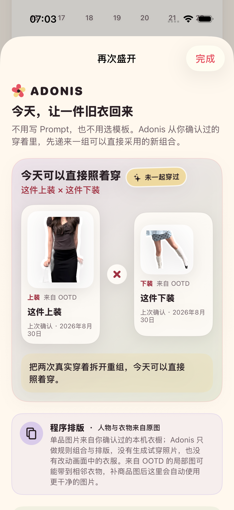

# 2026-08-30 再次盛开搭配建议验证

> 结论：Adonis 已完成 ADO-401 的第一版“再次盛开”。当本机已有来自不同真实 OOTD、由用户明确确认、且从未共同穿过的上装与下装时，花历零配置出现一组可直接照着穿的新组合；结果可回看来源、切换真实组合并分享，同时明确它不是 AI 试穿图。

## 1. 用户体验契约

- 证据不足时不显示入口，不向用户展示空功能、建档任务或教学。
- 用户不需要填写 Prompt、选择模板、模型、风格或偏好；建议从已经确认过的穿着关系自动派生。
- 一组建议必须包含一件上装与一件下装，两件衣物从未在同一条 OOTD 中共同确认。
- 第一组优先让最久未穿的单品回来，并在同一个返回单品下优先选择最近穿过的另一类单品作为熟悉底座。
- 距上次确认穿着满 30 个本地自然日时，才显示具体间隔；不足 30 天只如实描述为两次真实穿着的重组。
- 存在多组时只提供一个“换一组真实组合”动作，不增加筛选器。
- 用户可以打开两件衣物各自最近一次确认来源的真实 OOTD，也可以直接生成分享卡并调用系统分享。
- 删除任一来源 OOTD 或衣橱单品后，打开中的建议立即失效并进入空态，不残留不可追溯结果。

## 2. 事实、名称与图片边界

- 只有 `GarmentObservation.state` 为 `linkedExisting` 或 `createdNew`，且 `matchedWardrobeItemID` 仍指向现有 `WardrobeItem` 时，关系才可参与建议。
- `pending`、暂放、排除、没有衣物 ID 的线索和已删除衣橱单品全部忽略；当前没有身份级自动同款识别。
- 来自 OOTD 的局部单品图可能夹带身体或相邻衣物。页面会直接说明这一限制；补入商品图后，同一衣物和建议自动使用更新后的干净图片。
- 如果 OOTD 建档单品仍使用本机自动生成的“颜色 + 类别”名称，界面降级为“这件上装 / 这件下装”，不把可能错误的颜色识别重复成事实；用户改名后使用人工名称。
- 组合页和分享卡都只读取现有衣橱图片。Adonis 没有改变衣服像素、补全遮挡或生成穿在人身上的效果。

## 3. 组合与数据规则

每件可用衣物先聚合所有显式确认来源，并以最近一条 OOTD 作为“上次穿着”和来源回链。随后建立所有上装 × 下装组合，并排除两件衣物的来源记录集合有交集的组合。

排序依次使用：

1. 返回单品的上次穿着时间，从最早到最近。
2. 返回单品创建时间与 ID，保证并列结果稳定。
3. 熟悉底座的上次穿着时间，从最近到最早。
4. 熟悉底座创建时间和组合 ID，保证输入顺序变化时结果不抖动。

组合只在内存中按当前 `OutfitRecord` 与 `WardrobeItem` 即时派生，不新增 SwiftData 模型，也不保存第二份建议或图片资产。处理版本为 `rebloom-suggestion-v1`。

## 4. 分享卡与可观测性

- 分享卡固定为 1080 × 1440 不透明图片，同时保留上装与下装输入图片的真实像素。
- 卡面标注“真实衣橱图片 · ADONIS 本机组合建议 · 非试穿效果”，来源类型为“程序排版”。
- 打开建议记录 `rebloomOpened`，打开分享记录 `rebloomShareOpened`。
- 事件详情只包含 `reason=long_unworn/history_remix` 与 `suggestion_count`，不包含衣物名、图片、文件路径、OOTD ID 或其他用户内容。

## 5. 自动验证

专项命令：

```bash
make rebloom-regression
```

专项覆盖 7 个目录契约、3 个分享渲染契约与 1 个真实 UI 流程：

- 没有两件互补的显式确认衣物时保持为空。
- 只组合来自不同 OOTD、从未共同确认的上装与下装。
- 最久未穿单品、最近熟悉底座、稳定排序和 30 天理由边界。
- 不把未纠正的 OOTD 自动颜色名当作事实；人工名称优先。
- 删除衣物或来源记录后立即移除建议。
- 分享卡拒绝空图片，输出固定尺寸、不透明，并保留两张来源图的像素。
- 真实界面验证入口隐藏与出现、来源与非试穿说明、分享面板、来源 OOTD 回看，以及删除后动态空态。

TDD 与专项结果：

- RED：`RebloomCatalog`、分享渲染器、事件与处理版本不存在时按预期编译失败；结果包为 `.derivedData/Logs/Test/Test-Adonis-2026.08.30_06-50-40-+0800.xcresult`。
- 首轮逻辑/渲染转绿：9 项通过、0 失败；结果包为 `.derivedData/Logs/Test/Test-Adonis-2026.08.30_06-53-18-+0800.xcresult`。
- 首轮 UI 转绿：9 个单元测试与 1 个 UI 流程通过；结果包为 `.derivedData/Logs/Test/Test-Adonis-2026.08.30_06-55-29-+0800.xcresult`。
- 动态删除链路转绿：删除来源 OOTD 后建议立即进入空态；结果包为 `.derivedData/Logs/Test/Test-Adonis-2026.08.30_06-58-37-+0800.xcresult`。
- 目检发现 OOTD 局部图的自动颜色描述不可靠，因此新增“未纠正自动颜色名不得重复成事实”契约；最终专项共 11 项通过、0 失败、0 跳过，结果包为 `.derivedData/Logs/Test/Test-Adonis-2026.08.30_07-02-43-+0800.xcresult`。
- 最大辅助字号首轮暴露测试助手只会单向上滑，功能点击实际仍成功；修正为按入口所在方向滚动后，定向流程通过，结果包为 `.derivedData/Logs/Test/Test-Adonis-2026.08.30_07-15-31-+0800.xcresult`。
- 最终无障碍门禁：1 个颜色契约与 3 个 UI 流程，共 4 项通过、0 失败、0 跳过；“再次盛开”入口、分享、来源回看和删除均在最大辅助字号与增强对比度下可达。结果包为 `.derivedData/Logs/Test/Test-Adonis-2026.08.30_07-18-12-+0800.xcresult`；脚本退出后字号恢复为 `large`、增强对比度恢复为 `disabled`。
- `make check` 通过，包括严格 Swift 格式检查与通用 iOS 静态分析。
- 完整 `make test` 共 119 项通过、0 失败、0 跳过，包括 96 个单元测试与 23 个 UI 流程；使用 `xcresulttool` 独立读取后统计一致。结果包为 `.derivedData/Logs/Test/Test-Adonis-2026.08.30_07-25-40-+0800.xcresult`。
- 通用 iOS Release 构建通过：`xcodebuild -project Adonis.xcodeproj -scheme Adonis -configuration Release -destination 'generic/platform=iOS' -derivedDataPath .derivedData-release build CODE_SIGNING_ALLOWED=NO`。构建日志确认 `Adonis` 主 App 与 `AdonisShareExtension` 分享扩展均参与依赖图并完成 arm64 编译链接；这只证明可构建，不等同于真机安装或交互验证。

## 6. 视觉证据

下图来自 iPhone 17 Pro、iOS 26.5 模拟器的专项 UI 流程，不是设计稿。原始尺寸为 1206 × 2622；已目检两张真实局部图、通用“这件上装 / 这件下装”名称、可执行理由、程序排版与非试穿边界均完整可见。



SHA-256：`78d1a471128427f9862f401f15f490c5578c35b373f7379ebc19c0a381c17804`

## 7. 尚未证明

- OOTD 局部裁图仍可能包含相邻衣物；当前通过诚实说明与商品图升级缓解，没有证明它已成为干净的单品抠图。
- 当前只给出两件组合清单与静态卡，不包含天气、场合、鞋包配饰、颜色协调评分、身体适配或真实试穿效果。
- 30 天阈值和“最久未穿 + 最近熟悉底座”只是可解释的第一版规则，尚未经过真实用户验证，不代表个性化搭配偏好已经学会。
- 自动测试证明了一个普通字号和一个最大字号完整路径，但尚未在真实 iPhone 上验证 VoiceOver 朗读顺序、不同屏幕尺寸、真实系统分享目的地或长衣橱性能。
- 没有证明用户会采纳、保存或分享这些组合，也没有证明它会带来长期回访；仍需 ADO-008 与 ADO-406 的真实用户验证。

因此 ADO-401 的本机工程切片可以标记完成；搭配质量、真实设备和长期价值继续单独验证。
