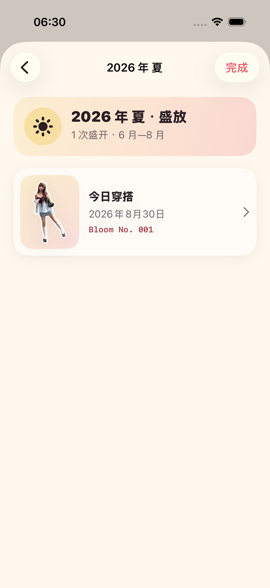

# 2026-08-30 四季花历验证

> 结论：Adonis 已完成 ADO-402 的季节聚合，第一版花历现在可按月份、日期和春夏秋冬回看真实 OOTD。有收藏时，月历卡零配置出现“穿过的四季”；只展示实际发生过的季节，不显示完成率、不要求补齐，也不增加新的持久化资产。

## 1. 用户体验契约

- 空花历不显示四季入口，不向第一次使用的用户展示空功能。
- 第一条 OOTD 收藏后，月历卡底部自动出现“穿过的四季”；用户无需选所在地、季节、模板或归档方式。
- 四季归档只展示真实有记录的季节，不展示连续天数、完成度或“还差一个季节”等压力文案。
- 季节按时间从近到远排列；季节内记录按日期从近到远，同一时间以较大的 Bloom 编号优先，最后用记录 ID 保证稳定顺序。
- 点进任一记录会打开原 OOTD，可继续查看收藏卡、透明贴纸、原图和衣物线索。
- 删除某季最后一条 OOTD 后，仍在打开的季节详情立即进入空态，不残留失效记录。

## 2. 季节边界

当前第一版使用设备本地公历和面向中国首发场景的月份季节，不请求位置权限，也不根据天气或节气猜测：

| 季节 | 月份 | 时间标签 |
| --- | --- | --- |
| 春 · 苏醒 | 3—5 月 | `2026 年 春` |
| 夏 · 盛放 | 6—8 月 | `2026 年 夏` |
| 秋 · 收藏 | 9—11 月 | `2026 年 秋` |
| 冬 · 休眠 | 12 月与次年 1—2 月 | `2025–2026 冬` |

12 月与次年 1 月、2 月必须属于同一个冬季。设备时区变化可能影响恰好落在午夜或季节边界的记录归属；当前行为与月历现有的设备本地日期口径一致，尚未加入旅行时区锁定。

## 3. 内容来源与数据边界

- 四季花历直接读取已收藏 `OutfitRecord`，不复制数据库记录，也不生成或保存新图片。
- 季节卡与详情使用已收藏透明贴纸；人物、衣物、姿势和纯白边不被重绘。
- 季节名、月份、计数、颜色和版式由 SwiftUI 程序呈现，来源类型为“程序排版”。
- 打开四季花历会记录 `seasonalBloomArchiveOpened`，处理版本为 `seasonal-bloom-v1`；事件只含类型、版本和时间，不含图片、日期、标题或其他用户内容。

## 4. 自动验证

专项命令：

```bash
make seasonal-regression
```

专项覆盖 5 个目录契约与 1 个真实 UI 流程：

- 空集合、春夏秋冬月份边界与每条记录只归入一个季节。
- 12 月与次年 1—2 月合并为跨年冬季。
- 季节和记录的稳定倒序，以及日期并列时的 Bloom 编号顺序。
- 空花历隐藏入口，收藏后无需设置自动出现。
- “只整理已收藏记录”和“不是打卡，也不用补齐四季”在真实界面可见。
- 季节卡回链真实 OOTD；删除唯一记录后详情立即进入空态。

TDD 与专项结果：

- RED：目录、事件和处理版本不存在时按预期编译失败；结果包为 `.derivedData/Logs/Test/Test-Adonis-2026.08.30_06-25-06-+0800.xcresult`。
- 目录契约转绿：5 项通过、0 失败；结果包为 `.derivedData/Logs/Test/Test-Adonis-2026.08.30_06-27-34-+0800.xcresult`。
- 首轮 UI 回归发现月历父容器覆盖了四季入口的可访问性 identifier；层级快照确认入口与文案实际存在，修正语义容器边界后再验证。失败结果包为 `.derivedData/Logs/Test/Test-Adonis-2026.08.30_06-27-55-+0800.xcresult`。
- 最终专项：5 个目录测试与 1 个 UI 流程，共 6 项通过、0 失败；结果包为 `.derivedData/Logs/Test/Test-Adonis-2026.08.30_06-29-39-+0800.xcresult`。
- 最大辅助字号与增强对比度：1 个颜色契约与 2 个 UI 流程，共 3 项通过、0 失败；四季入口、单列季节卡、季节记录和关闭按钮均可滚动触达。结果包为 `.derivedData/Logs/Test/Test-Adonis-2026.08.30_06-31-38-+0800.xcresult`，脚本退出后字号恢复为 `large`、增强对比度恢复为 `disabled`。

完整门禁也已通过：

- `make check` 通过，包括严格 Swift 格式检查与通用 iOS 静态分析。
- `make test` 共执行 108 项（86 个单元测试、22 个 UI 流程），108 项通过、0 失败、0 跳过；独立读取结果包得到同样统计。设备为 iPhone 17 Pro、iOS 26.5 模拟器，结果包为 `.derivedData/Logs/Test/Test-Adonis-2026.08.30_06-36-14-+0800.xcresult`。
- Release 配置的通用 iOS 构建通过，覆盖 Adonis 主 App 与 AdonisShareExtension；命令使用 `CODE_SIGNING_ALLOWED=NO`，因此只证明真机架构可编译链接，不等同于签名、安装或真实 iPhone 运行通过。

## 5. 视觉证据

下图来自 iPhone 17 Pro、iOS 26.5 模拟器的专项 UI 流程，不是设计稿。原始尺寸为 1206 × 2622；已目检夏季标题、“盛放”语义、时间范围、原透明贴纸、日期、Bloom 编号和 OOTD 回链均完整可见。



SHA-256：`f18b55b389087ae3a9ebd1c8db504622ca2934e23713a27e927d9dcb4c54fa7b`

## 6. 尚未证明

- 当前按固定月份聚合，不使用地理位置、实时天气、二十四节气或南半球季节；这些能力是否有价值尚未验证。
- 自动测试证明了跨年冬季和一条真实 UI 路径，但尚未用大量跨年记录、极长标题或多年数据做滚动性能与视觉回归。
- 没有在真实 iPhone 上验证 VoiceOver 朗读顺序、不同屏幕尺寸、旅行时区变化或真实设备长列表性能。
- 季节归档只是时间浏览，不等于 ADO-401“再次盛开”已经生成了可直接采用的新搭配。
- 没有证明用户会因为四季花历增加回访；仍需首批目标用户进行无讲解测试。

因此 ADO-402 的本机工程切片可以标记完成；真实设备、用户价值和“再次盛开”搭配建议继续单独验证。
