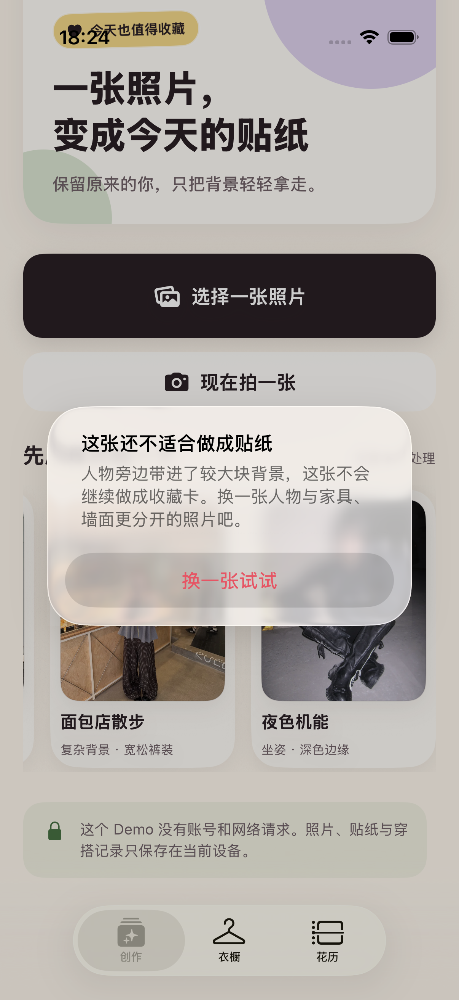

# 2026-08-30 贴纸低质量降级验证

> 结论：ADO-Q04 的“贴纸低质量”纵向切片已形成“原始蒙版 + 源像素保真 + 最终贴纸”三道本机闸门。正常结果不增加心智负担；可疑结果先让用户检查透明贴纸；大块背景粘连、处理链改写主体核心像素、空主体或严重碎裂不会继续生成收藏卡。sample-04 的像素基线没有修改或删除，但它不再作为成功样片出现。真实 iPhone、人物语义一致性与联网供应商边界仍未验证，因此 ADO-Q04 和 ADO-303 保持未完成。

## 1. 用户体验契约

质量检查发生在用户给出照片之后，不增加上传前问卷、模型选项或技术术语。

| 内部状态 | 用户看到什么 | 是否生成收藏卡 | 后续行为 |
| --- | --- | --- | --- |
| `acceptable` | 仍以“今天开了一朵花”进入收藏卡，不显示质量提示 | 是 | 正常保存 |
| `review_recommended` | 标题变为“先看看这张贴纸”，默认打开透明贴纸，显示不含分数的轻提示 | 是 | 可“这样也收藏”或直接再做一张；收藏后保留提示 |
| `rejected` | 按实际结构问题说明原因，例如“人物旁边带进了较大块背景”，并建议换一张人物与家具、墙面更分开的照片 | 否 | 不打开结果页、不提供收藏按钮、不创建花历记录 |

建议复查不是阻断式弹窗；明确失败才停止后续排版。失败提示持续说明原始照片不会被修改。

## 2. 三道质量闸门

当前统一版本为 `sticker-quality-raw-fidelity-delivery-v3`。内部阈值只用于稳定回归，不展示给普通用户。

### 2.1 RawMatteQualityGate：白边合成前

`RawMatteQualityAssessor` 直接读取 Vision 返回的灰度人像蒙版，并把检测副本长边限制为 256 像素。它检查：

- 前景覆盖是否足以构成人像；低于 0.015 视为空主体。
- 最大前景连通区域是否至少占前景的 0.80；否则视为严重碎裂或多个大块主体。
- 前景中的不确定灰度比例、单行最大横向跨度，以及异常宽行在主体高度中的比例。
- 当不确定前景至少为 0.25、最大横向跨度至少为画面宽度的 0.75、异常宽行至少占有效行的 0.12 时，判为疑似大块背景粘连并拒绝。
- 不确定前景达到 0.18、但没有同时满足大块粘连条件时，进入建议复查。

这是一组结构启发式，不是家具识别模型。它能稳定挡住受控的大块软垫形状，并保守提示模糊边缘；不能保证发现所有被高置信度并入的人、墙面或家具。

### 2.2 StickerSourceFidelityGate：白边合成前

`StickerSourceFidelityAssessor` 在 Alpha 细化完成后、平移、白边、裁切和放大之前运行。它把源图、抠图主体和最终细化蒙版转换到同一 sRGB 检测画布，最长边限制为 768 像素，只比较源图与蒙版都接近不透明的核心像素：

- 根据“源图 Alpha × 最终蒙版 Alpha”计算抠图主体应有的 Alpha，防止核心主体被处理链额外删除或改写。
- 对源图与抠图主体的 RGB 先解除预乘，再逐通道比较；允许颜色空间转换和量化带来的少量误差。
- 核心像素改写比例超过 0.005 时，以 `source_pixels_changed` 拒绝，不进入白边和收藏卡排版。
- 没有可比较核心像素时按主体缺失拒绝。

正常结果不会新增提示。拒绝时用户只看到“处理结果改变了人物或衣物的颜色或细节”、换图建议与“原始照片不会被修改”，看不到比例、阈值、模型或技术术语。

这道闸门证明的范围很窄但可执行：被最终蒙版保留下来的核心像素没有被当前本地处理链改色或改写。它不能发现蒙版已经漏掉的脸、手、衣物或配饰，也不判断人物是否像本人、身体比例、姿势、未经允许的美化、衣物款式或图案语义。内置贴纸是离线准备且已经裁切、描边和缩放的固定成品，不能直接按同坐标运行该比较；它们继续由哈希、像素结构与人工基线保护。

### 2.3 StickerDeliveryGate：白边与交付图完成后

`StickerQualityAssessor` 对最长边不超过 768 像素的检测副本检查：

- 透明区域和四角透明度，避免完整背景矩形进入结果。
- 不透明主体与非白主体占比，避免空图或只剩白边。
- 最大可见连通区域，避免人物严重碎裂。
- 与透明区相邻的可见边界是否为白色，避免纯白贴纸边破损。
- 半透明像素、四角、主体连通、白边和实时前景占比是否需要复查。

成品拒绝条件保持为：透明区域低于 0.08 或四角透明低于 0.75；不透明主体低于 0.025 或非白主体低于 0.012；最大可见连通区域低于 0.80。通过拒绝门槛后，半透明像素高于 0.10、四角透明低于 0.95、最大主体低于 0.97、白色边界低于 0.78，或实时前景低于 0.04 时进入建议复查。

原始蒙版或源像素保真一旦拒绝，最终贴纸即使具有透明通道和完整白边也不能覆盖这个结论；原始蒙版建议复查也会保留到最终结果。三道闸门共同证明当前本地处理链的结构与保留像素事实，但仍不能把“没有改写保留像素”外推为“人物和衣物语义完整且一致”。

## 3. 固定样片路由

四张授权原图与贴纸像素均未改动；仓库哈希和 macOS Vision 字节级重生成继续一致。`regression-baseline.json` schema v2 与 `SampleCatalog` 同时记录人工复核结论和是否进入普通展示入口，测试会强制两者一致。

| 样片 | 最终路由 | 普通入口 | 说明 |
| --- | --- | --- | --- |
| sample-01 | A：正常 | 显示 | 透明通道、主体连通与白边通过；不增加提示。 |
| sample-02 | A：正常 | 显示 | 透明通道、主体连通与白边通过；不增加提示。 |
| sample-03 | A：正常 | 显示 | 透明通道、主体连通与白边通过；不增加提示。 |
| sample-04 | C：拒绝 | 隐藏 | 浅色软垫被大块并入人物；保留原图与贴纸作为失败回归，不生成用户收藏卡。 |

sample-04 的准备结果没有可随 App 交付的原始 Vision 蒙版，因此固定目录使用人工目检结论 `background_adhesion_suspected`。实时照片则在白边合成前运行同一类原始蒙版结构检查。仅 Debug UI 测试可以临时显示该样本，以验证拒绝界面；Release 和普通 Debug 体验都只展示前三张可用样片。

## 4. 持久化、事件与导出

- 只有 A/B 结果可以形成 `GenerationDraft`；C 级拒绝不会生成收藏卡、保存按钮或 `OutfitRecord`。
- `OutfitRecord` 继续保存 A/B 质量级别、问题代码和检查版本；重新进入花历后不会丢失建议复查提示。
- 本地事件“贴纸建议复查”和“贴纸质量未通过”只记录级别与问题代码，不记录图片内容。
- 当前个人数据导出格式 `adonis-personal-data-v7` 继续为已保存结果写入 `stickerQualityLevel`、`stickerQualityIssues`、`stickerQualityRequiresReview` 和 `stickerQualityVersion`。
- 被拒绝结果没有可导出的视觉资产；其失败事件仍遵循不保存图片、路径或用户文本的事件边界。

## 5. 界面证据

证据来自 iPhone 17 Pro、iOS 26.5 模拟器中的真实 UI 测试附件，原始尺寸为 1206 × 2622，并已目检。

画面明确说明“这张还不适合做成贴纸”和具体换图建议；没有百分比、置信分数、Prompt、模型或 Skill。测试同时断言结果标题、收藏按钮和花历记录均不存在。

## 6. TDD 与自动验证

本切片先后观察到以下预期红灯：

- 固定样片缺少人工蒙版结论：`.derivedData/Logs/Test/Test-Adonis-2026.08.30_18-15-05-+0800.xcresult`。
- 实时处理结果尚未携带原始蒙版结论：`.derivedData/Logs/Test/Test-Adonis-2026.08.30_18-17-41-+0800.xcresult`。
- 项目尚无源像素保真评估器：`.derivedData/Logs/Test/Test-Adonis-2026.08.30_22-40-04-+0800.xcresult`。
- 质量链尚不能接收并阻断源像素拒绝：`.derivedData/Logs/Test/Test-Adonis-2026.08.30_22-43-44-+0800.xcresult`。
- 实时处理结果尚未携带源像素结论：`.derivedData/Logs/Test/Test-Adonis-2026.08.30_22-45-01-+0800.xcresult`。
- 处理来源清单尚未包含源像素保真版本：`.derivedData/Logs/Test/Test-Adonis-2026.08.30_23-15-42-+0800.xcresult`。
- 回归清单尚未记录质量与展示路由：`.derivedData/Logs/Test/Test-Adonis-2026.08.30_18-27-19-+0800.xcresult`。
- UI 仍把具体问题压扁为通用失败文案：XcodeBuildMCP 结果包 `test_sim_2026-08-30T10-22-25-237Z_pid77601_97469a21.xcresult`。
- 其余拒绝原因仍会引导用户检查一个没有交付的贴纸预览：`.derivedData/Logs/Test/Test-Adonis-2026.08.30_18-50-40-+0800.xcresult`。

转绿证据包括：

- 原始蒙版、处理接线、质量合并和版本契约共 23 项通过：`.derivedData/Logs/Test/Test-Adonis-2026.08.30_18-18-35-+0800.xcresult`。
- 仅 Alpha 抠图通过、核心 RGB 改写拒绝、大图降采样容差与质量链阻断共 13 项通过：`.derivedData/Logs/Test/Test-Adonis-2026.08.30_22-46-55-+0800.xcresult`。
- 源像素保真版本已进入处理来源清单，专项契约转绿：`.derivedData/Logs/Test/Test-Adonis-2026.08.30_23-16-45-+0800.xcresult`。
- schema v2 清单、三张展示卡和四张像素基线共 3 项通过：`.derivedData/Logs/Test/Test-Adonis-2026.08.30_18-28-36-+0800.xcresult`。
- 最终拒绝 UI 流程 1 项通过：XcodeBuildMCP 结果包 `test_sim_2026-08-30T10-24-04-016Z_pid77601_645b14ce.xcresult`。
- 六类拒绝文案契约与贴纸试穿成功 UI 共 7 项通过：`.derivedData/Logs/Test/Test-Adonis-2026.08.30_18-51-49-+0800.xcresult`。

完整门禁结果：

- `make sample-regression`：四张原图与四张贴纸哈希、macOS Vision 字节级重生成、原始蒙版、源像素保真、成品质量和样片路由共 27 项通过；结果包为 `.derivedData/Logs/Test/Test-Adonis-2026.08.30_23-17-11-+0800.xcresult`。
- `make check`：严格 `swift-format` 检查与 `generic/platform=iOS` 静态分析通过；执行时间为 2026-08-30 23:32。
- `make test`：163 个单元测试与 34 个真实模拟器 UI 流程，共 197 项通过、0 失败、0 跳过；`xcresulttool` 独立汇总一致，结果包为 `.derivedData/Logs/Test/Test-Adonis-2026.08.30_23-17-36-+0800.xcresult`。
- Release、`generic/platform=iOS`、关闭签名构建成功；`file` 独立确认主 App 与分享扩展均为 Mach-O 64-bit arm64，执行时间为 2026-08-30 23:32。这只证明无签名真机架构可编译链接，不证明已经在真实 iPhone 运行。

## 7. 尚未证明

- 真实 iPhone 上实时 Vision 蒙版、三道质量闸门、耗时与进程生命周期。
- 当前阈值对半身、多人、透明材质、蓬松头发、严重遮挡、手持物和不同家具形态的泛化能力。
- 高置信度、完全不透明的大块误粘连是否都能被结构启发式发现。
- 蒙版是否完整保留脸、手、衣物和配饰，以及身份、脸、身体比例、姿势、未经允许的美化、衣物款式与图案的语义保真；源像素闸门只覆盖最终蒙版核心区。
- 首轮用户是否理解拒绝提示，以及她们是否能自然选择更合适的照片。
- 真实云端或第三方供应商不可用、弱网、重试、幂等和成本降级；当前贴纸 Demo 没有联网供应商。

因此本切片可以作为当前低质量贴纸契约，但不能把 ADO-Q04、ADO-006、ADO-008、ADO-108 或 ADO-Q07 标记完成。
