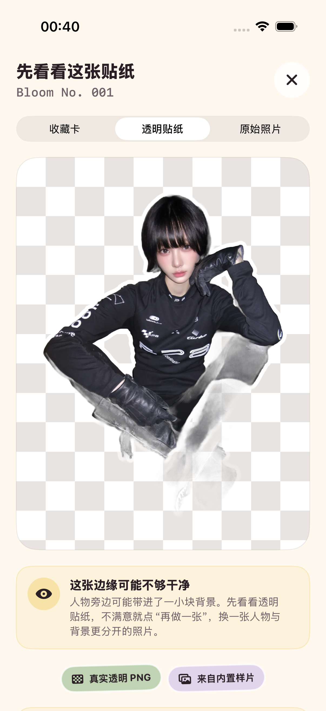
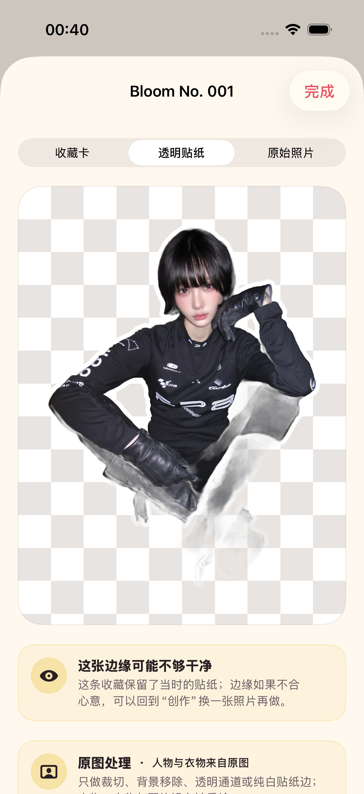

# 2026-08-30 贴纸低质量降级验证

> 结论：ADO-Q04 的“贴纸低质量”纵向切片已实现并通过固定样片、单元、UI、静态分析和视觉目检。正常结果不增加心智负担；可疑结果先让用户检查透明贴纸；明显破损结果不会继续生成收藏卡。硬超时与真实联网供应商不可用仍未解决，因此 ADO-Q04 保持未完成。

## 1. 用户体验契约

质量检查发生在用户已经给出照片之后，不新增选择、问卷或技术术语。

| 内部状态 | 用户看到什么 | 是否生成收藏卡 | 收藏后的行为 |
| --- | --- | --- | --- |
| `acceptable` | 仍以“今天开了一朵花”进入收藏卡，不显示质量提示 | 是 | 正常保存 |
| `review_recommended` | 标题变为“先看看这张贴纸”，默认打开透明贴纸，显示不含分数的轻提示 | 是 | 可“这样也收藏”；花历继续显示同一提示 |
| `rejected` | 明确说明人物轮廓没有分干净，建议换一张人物更完整、与背景更分开的照片 | 否 | 不创建记录 |

建议复查不是阻断式弹窗。用户可以直接查看真实 Alpha 结果，再决定收藏或点击已有的“再做一张”。原始照片不会被修改。

## 2. 检查范围与阈值

`StickerQualityAssessor` 在本机读取贴纸 RGBA 像素，只检查结构事实：

- 透明区域和四角透明度，避免完整背景矩形进入结果。
- 不透明主体与非白主体占比，避免空图或只剩白边。
- 最大可见连通区域，避免人物严重碎裂。
- 与透明区相邻的可见边界是否为白色，避免纯白贴纸边破损。
- 半透明像素占比，作为背景或边缘可能被带入的复查信号。
- 实时分割返回的前景占比，提示人物在原图中过小。

检测专用副本的长边最多为 768 像素，避免高分辨率手机照片为连通区域检查分配过大的像素队列；用户保存和分享的原图、透明贴纸与收藏卡不因此缩小。

当前版本为 `sticker-quality-structural-v1`。结构拒绝条件包括：透明区域低于 0.08 或四角透明低于 0.75；不透明主体低于 0.025 或非白主体低于 0.012；最大可见连通区域低于 0.80。通过拒绝门槛后，半透明像素高于 0.10、四角透明低于 0.95、最大主体低于 0.97、白色边界低于 0.78，或实时前景低于 0.04 时进入建议复查。

这些阈值不会展示给用户。它们不能判断脸是否像本人、衣服图案是否准确、沙发是不是人物的一部分，也不能替代逐图目检或人物/衣物保真测试。

## 3. 固定样片结果

四张授权样片的输出像素没有被改动；宿主机重生成仍与仓库贴纸逐字节一致。

| 样片 | 结构结果 | 说明 |
| --- | --- | --- |
| sample-01 | 正常 | 透明通道、主体连通与白边通过；不显示提示。 |
| sample-02 | 正常 | 透明通道、主体连通与白边通过；不显示提示。 |
| sample-03 | 正常 | 透明通道、主体连通与白边通过；不显示提示。 |
| sample-04 | 建议复查 | 半透明占比 0.133025，实际画面中浅色软垫与交叠腿部被并入主体。 |

sample-04 仍然是已知困难案例，没有为了测试变绿而删除或修改。它证明了“建议复查”路径会由真实缺陷触发，但也说明当前结构检查不能自动修复该缺陷。

## 4. 持久化、事件与导出

- `OutfitRecord` 保存质量级别、问题代码和检查版本；重新进入花历后不会丢失提示。
- 本地事件新增“贴纸建议复查”和“贴纸质量未通过”，只记录状态与问题代码，不记录图片内容。
- 个人数据导出格式升级为 `adonis-personal-data-v2`。
- `outfits` 保存 `stickerQualityLevel`、`stickerQualityIssues`、`stickerQualityRequiresReview` 和 `stickerQualityVersion`。
- 透明贴纸与收藏卡对应的 `visualAssets` 保存质量状态；原始照片不伪造贴纸质量字段。

## 5. 界面证据

两张证据均来自 iPhone 17 Pro、iOS 26.5 模拟器中的真实 UI 测试附件，原始尺寸为 1206 × 2622，并已逐像素目检。

### 首次结果



结果默认选择“透明贴纸”，标题、提示和实际被带入的浅色软垫同时可见；提示没有百分比、置信分数或技术术语。

### 花历记录



收藏后默认仍打开透明贴纸，并保留质量说明和原图处理来源说明。

## 6. 自动验证

专项质量、数据与事件测试：

```bash
xcodebuild -project Adonis.xcodeproj -scheme Adonis \
  -destination 'platform=iOS Simulator,name=iPhone 17 Pro,OS=latest' \
  -derivedDataPath .derivedData test \
  -only-testing:AdonisTests/StickerQualityAssessorTests \
  -only-testing:AdonisTests/PersonalDataControlTests \
  -only-testing:AdonisTests/ProcessingTraceTests
```

结果为 10 项通过、0 失败；结果包为 `.derivedData/Logs/Test/Test-Adonis-2026.08.30_00-39-02-+0800.xcresult`。

专项 UI 测试覆盖第 4 张样片默认模式、无分数提示、“这样也收藏”和花历持久化，1 项通过、0 失败；结果包为 `.derivedData/Logs/Test/Test-Adonis-2026.08.30_00-39-37-+0800.xcresult`。

完整门禁：

- `make sample-regression`：四张样片哈希与字节级重生成通过，11 个图片专项测试通过。
- `make check`：严格 `swift-format` 与通用 iOS 设备静态分析通过。
- `make test`：49 个单元测试与 12 个 UI 流程测试，共 61 项通过、0 失败。
- `xcresulttool` 独立汇总为 61 通过、0 失败、0 跳过。
- 完整结果包：`.derivedData/Logs/Test/Test-Adonis-2026.08.30_01-39-31-+0800.xcresult`。

## 7. 尚未证明

- 真实 iPhone 上的实时 Vision 输出、质量状态、SwiftData 迁移和重启持久化。
- 当前阈值对四张样片之外的半身、多人、透明材质、蓬松头发、严重遮挡和手持物是否具有足够泛化能力。
- 身份、脸、身体比例、衣物颜色与图案的语义保真；当前检查只覆盖结构。
- 处理超时已经被真正停止。现有取消可以忽略迟到结果，但底层 Vision 工作不保证立即结束。
- 真实云端或第三方供应商不可用、弱网、重试、幂等和成本降级；当前 Demo 没有联网供应商。
- 首轮用户是否理解这条提示，以及她们会选择收藏还是换图。

因此本切片可以作为低质量贴纸的当前契约，但不能把 ADO-Q04、ADO-006、ADO-008、ADO-108 或 ADO-Q07 标记完成。
