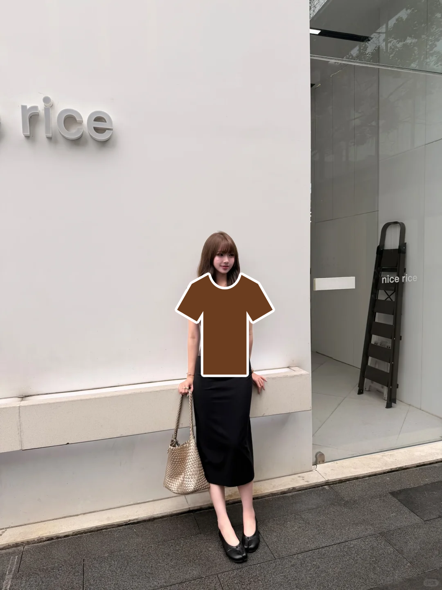
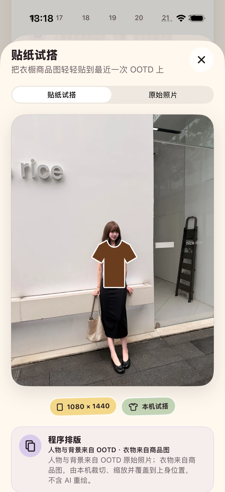

# 2026-08-30 贴纸试搭验证

> 结论：Adonis 已完成一个低心智、本机运行的“贴纸试搭”纵向探针。用户把干净商品图中的上装或外套收进衣橱后，可从衣物详情一次点击，把它以纯白边贴纸覆盖到最近一次已收藏 OOTD；处理中可停止，结果可与原始 OOTD 对照、收藏、分享，并在 App 终止重启后从花历回看。
>
> 这不是 AI 写实虚拟试穿。人物、脸、身体和背景来自 OOTD 原始照片，衣物来自商品图；程序只做近白背景裁切、缩放、纯白描边和覆盖。它不预测尺码、合身度、垂坠、褶皱、身体遮挡或真实购买效果。当前 iOS 26.5 模拟器的人体姿态请求没有可用计算设备，因此成功 UI 使用仅 Debug 的固定姿态夹具，只能证明姿态之后的产品链路，不能证明真实 iPhone Vision 或不同姿势的泛化质量。

## 1. 用户体验契约

- 用户不需要再次上传照片；系统自动使用最近一次已收藏 OOTD。
- 用户不需要填写身高、体重、三围、尺码、姿势、Prompt、Skill、模型、模板或参数。
- 入口只在衣物图片来源为商品图、背景干净度至少 0.72，且分类为上装或外套时出现。
- 没有已收藏 OOTD 时，只提示“先收藏一张 OOTD”；图片不够干净或类别不支持时直接说明，不提供必然失败的按钮。
- 处理中显示可取消状态；取消后留在衣物详情，不打开结果、不收藏作品，也不改变原 OOTD。
- 成品可在“贴纸试搭 / 原始照片”间对照。来源卡逐项写明“人物与背景来自 OOTD · 衣物来自商品图”，边界卡说明它不预测尺码、合身、垂坠、褶皱或真实遮挡。
- 只有用户明确点击“收藏这张作品”才持久化结果；系统分享仍由 iOS 面板决定目的地。

## 2. 像素与姿态处理

处理版本为 `sticker-try-on-v1`，生产路径如下：

1. 从商品图移除接近纯白的背景并裁切有效衣物区域。
2. 使用 Apple Vision 人体姿态请求获取肩、髋和膝等关键点。
3. 依据肩宽与肩髋距离计算上身目标区域；当前只支持上装和外套。
4. 在衣物外沿绘制连续纯白贴纸边，再按比例覆盖到 OOTD 原始画布。
5. 保留原始画布尺寸，不对 OOTD 的人物、脸、身体或背景执行 AI 重绘。

受控像素契约检查：

- 输出画布尺寸与 OOTD 输入完全一致；
- 画面角落像素保持不变；
- 授权站姿样片的脸部检查点保持不变；
- 上身检查点发生变化；
- 衣物边缘存在足量近纯白描边像素；
- 空输入、无法分离衣物、姿态不可用与姿态不清晰都返回可解释失败，不伪造成功。

这些结构检查不能证明衣物领口、袖型、长度、图案、材质和 SKU 语义在任意商品图上都准确，也不能把平面覆盖当作衣服真实穿到身体上的结果。

## 3. 来源、网络与费用口径

| 字段 | 当前事实 |
| --- | --- |
| 配方 | `sticker_try_on` |
| 版本 | `sticker-try-on-v1` |
| 来源 | `programmatic_composition` |
| AI 生成像素 | `false` |
| `provider` | `adonis_local_renderer` |
| `providerRequestCount` | `0` |
| `externalRequestCount` | `0` |
| `networkTransport` | `none` |
| `externalCost` | `not_applicable` |
| `quality` | `user_review_required` |

事件只记录固定配方、处理版本、耗时、终态和上述执行口径，不写入照片、文件路径、衣物名称、记录 ID 或用户文字。这里的 0 次外部请求与费用不适用来自实际本机实现，不代表未来供应商级写实试穿的网络或成本。

## 4. 收藏、历史与个人数据

- 未收藏结果只存在于内存，不建立后台草稿箱。
- 收藏事务把 PNG、配方、处理耗时和执行元数据作为 `CreativeWork` 关联来源 OOTD；保存失败会回滚新文件和模型。
- App 真实终止并重新启动后，花历中的来源 OOTD 可重新打开同一作品、对照原始照片并分享。
- 删除来源 OOTD 会级联删除作品模型和媒体；“清空所有本地数据”同样覆盖作品和临时导出。
- `adonis-personal-data-v7` 的 `creativeWorks` 会导出配方、版本、来源 OOTD、图片路径、来源类型、AI 像素标记、耗时、provider、请求、网络、费用和质量字段；PNG 作为独立媒体文件进入标准 TAR。

## 5. 模拟器与 Debug 夹具边界

当前 iPhone 17 Pro、iOS 26.5 模拟器执行真实人体姿态请求时，Vision 返回 `No available compute device for VNComputeStageMain`。生产生成器把它映射为明确的“本机暂时无法完成人体定位”失败，不使用固定坐标冒充真实推理。

专项 UI 通过 `#if DEBUG` 与显式 `-ui-testing-sticker-try-on` 启动参数启用固定姿态，并故意等待约 1.5 秒，让处理状态和取消入口可观察。夹具只用于验证：

- 商品图与最近 OOTD 的自动输入关系；
- 处理状态、取消和迟到结果隔离；
- 白底裁切、纯白边与画布合成；
- 来源说明、能力边界、原图对照；
- 收藏、系统分享、进程终止重启和花历回看；
- 执行元数据与个人数据导出。

固定姿态不能进入 Release，也不能作为真实 Vision、侧身、坐姿、多人、遮挡、不同身型、不同拍摄距离或泛化质量证据。

## 6. 自动验证

专项命令：

```bash
make tryon-regression
```

覆盖商品图准入、真实 Vision 或明确运行时边界、受控像素合成、纯白描边、配方文案、0 外部请求、作品持久化、v7 导出、取消、原图对照、收藏、系统分享和冷启动历史。

本轮专项完成 11 个单元测试与 2 个真实模拟器 UI 流程，共 13 项通过、0 失败、0 跳过。`xcresulttool` 独立汇总同样为 13/13，设备为 iPhone 17 Pro、iOS 26.5 模拟器；结果包为 `.derivedData/Logs/Test/Test-Adonis-2026.08.30_14-37-06-+0800.xcresult`。

整套 `make test` 通过 164/164，0 失败、0 跳过，并由 `xcresulttool` 在本轮独立汇总确认；当次结果包路径为 `.derivedData/Logs/Test/Test-Adonis-2026.08.30_14-24-02-+0800.xcresult`。后续专项测试复用同一 DerivedData 时，Xcode 已自动清理这份较早结果包，因此仓库当前不把该路径作为可重复打开的附件；可重复执行 `make test` 重新取得整套结果。

无障碍专项在最大辅助字号 `accessibility-extra-extra-extra-large` 与增强对比度开启时通过 7/7，包含贴纸试搭、原图对照、保存、系统分享和冷启动历史；结果包为 `.derivedData/Logs/Test/Test-Adonis-2026.08.30_14-39-16-+0800.xcresult`。脚本退出后已实测恢复为常规字号 `large` 和增强对比度关闭。这些是模拟器界面可达性证据，不等同于真实 VoiceOver 操作证据。

`make check` 已通过 Swift 格式严格检查和 generic iOS 静态分析。未签名 Release 的 generic iOS 构建成功；主 App 与分享扩展二进制均为 Mach-O arm64，`strings` 检查均未找到 `-ui-testing-sticker-try-on` 或 `StickerTryOnFixtureGenerator` 标记。

## 7. 真实像素与界面证据

受控渲染附件来自授权站姿样片，尺寸为 1080 × 1440：



SHA-256：`74cde97416b757e2e7e08e7b7b9e98dcec3ba685353ef02208b31de8bc052489`。

逐像素与人工目检确认棕色上装位于躯干，脸、原背景与画布边角未被覆盖，衣物外沿为清晰纯白贴纸边。它是故意直白的平面贴纸效果，不是写实换装案例。

以下附件来自 App 真实终止重启后的花历历史页，尺寸为 1206 × 2622：



SHA-256：`f89fd2e90bc31caa8ff35a7d4d263cd96d2a31b1e7ae1b45b861c9cffa1368e4`。

界面目检确认作品/原图切换、动态输出尺寸、本机试搭标签，以及“人物与背景来自 OOTD · 衣物来自商品图”“不含 AI 重绘”的来源说明均可见。该附件是自动化界面证据，不是面向用户宣传的真实试穿质量样片。

## 8. 尚未证明

- 尚未在真实 iPhone 上证明人体姿态请求可用、性能满足预期或取消能及时中断 Vision。`devicectl` 当前只列出一台 iPhone 11（`sunmozong的iPhone`），状态为 `unavailable`，本轮无法形成真机证据。
- 尚未覆盖更多授权商品图、颜色、复杂图案、领型、袖型、长度、外套、多层穿搭、侧身、坐姿、多人、严重遮挡和不同身型。
- 当前近白阈值裁切只适合干净白底商品图，没有语义级服装分割、袖口遮挡或前后层级恢复。
- 当前没有预测尺码、松紧、合身度、垂坠、褶皱、材质、真实遮挡、购买后的 SKU 一致性或物理效果。
- 没有供应商级生成模型、真实外部请求、弱网、费用、配额、重试、隐私告知或远程删除证据。
- 没有真实 VoiceOver、真实分享目的地、真机前后台/锁屏中断或首轮目标用户的保存与分享意愿证据。

因此，这份记录可以作为“低心智商品图入口 + 可追溯本机贴纸草图 + 完整收藏闭环”的工程契约，但不能作为 ADO-301 写实单件试穿、ADO-302 衣物语义保真或 ADO-303 人物一致性已经完成的证据。
