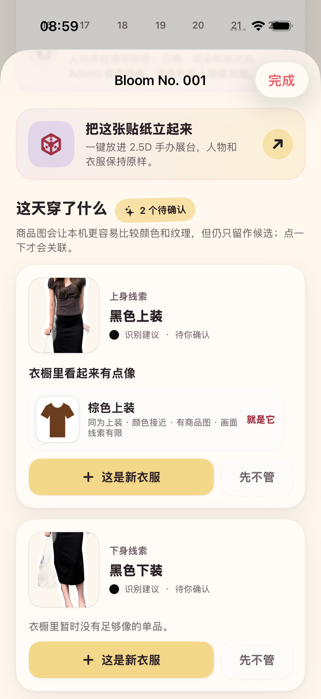

# 2026-08-30 衣橱视觉线索排序验证记录

> 结论：Adonis 已在不增加用户输入的前提下，为商品图、平铺图和 OOTD 局部线索生成本机视觉签名，并用它改善最多 3 个待确认候选的排序。受控图案样本中，同图案候选排在同色纯色干扰项之前；真实 UI 样片只得到“画面线索有限”，系统没有把弱证据包装成同款，也没有自动关联。尚未完成授权真实对照集，因此 ADO-205 继续保持未完成。

## 1. 产品契约

这次变化只发生在用户已经会看到的候选列表内部：

- 用户仍只需上传商品图、分享图片或保存 OOTD，不增加建档表单、扫描步骤或匹配任务。
- 候选仍最多 3 个；只有用户点击“就是它 / 是这件”才改变衣橱关系。
- 页面只说“画面线索更接近 / 接近 / 有限”，不显示分数、置信度、向量或“同款”。
- 视觉签名只重排原有类别、颜色与来源规则已经接纳的候选；即使视觉线索很弱，也不能让旧规则会展示的候选消失。
- “先不管”“不是它”、已有确认和人工分类继续被长期尊重；回填不能改写这些决定。
- 没有可用签名时，继续使用原有类别、颜色和图片来源排序，不阻塞旧记录。

## 2. 本机视觉签名

`garment-visual-signature-v1` 对 64 × 64 确定性采样计算颜色分布、明暗分布、纹理方向和边缘密度。透明区域与从图片边缘连通的近白背景会被排除，以减少透明 OOTD 裁图和干净白底商品图之间的背景差异；内部白色区域不会被全局删除。

候选是否进入列表仍由原有类别、颜色和来源门槛决定；双方同时拥有有效签名时，视觉相似度只参与入选后的排序，类别、颜色和来源仍保留权重。签名缺失或版本无效时不生成视觉结论。算法没有脸部识别、人物身份、品牌、SKU、联网请求或第三方上传，也不会把视觉相似度提升为自动关联条件。

实现中特意没有按“肤色范围”全局删除像素。首轮失败测试证明这种做法会同时删除米色和棕色衣物，造成真实服饰信息损失；当前只处理透明与边缘连通白背景。

## 3. 数据生命周期

- 新导入商品图、从 OOTD 生成的临时线索，以及原地补入的商品图都会同步保存签名。
- 旧数据在 App 活跃后静默回填；缺图、损坏图片或近乎空白的素材会跳过，不弹窗、不增加整理压力。
- 回填只写入派生签名，不改变关联、排除、暂放、名称、备注或人工分类。
- 事件只记录更新与跳过数量或通用存储失败原因，不记录衣物名、图片、路径或实体 ID。
- 用户主动导出的标准 TAR 当前为 `adonis-personal-data-v6`；衣橱单品与 OOTD 线索继续导出签名内容和 `garment-visual-signature-v1` 版本，便于解释和迁移。v6 新增的收藏创作结构不改变衣橱签名字段。

## 4. TDD 与自动回归证据

实现先由失败测试固定契约，再补生产代码：

- 初始编译失败：`.derivedData/Logs/Test/Test-Adonis-2026.08.30_08-44-50-+0800.xcresult`，模型和视觉签名尚不存在。
- 首轮实现暴露米色/棕色像素被误删：`.derivedData/Logs/Test/Test-Adonis-2026.08.30_08-46-53-+0800.xcresult`，18 项中 1 项失败。
- 移除不安全的肤色过滤后，核心视觉测试通过：`.derivedData/Logs/Test/Test-Adonis-2026.08.30_08-47-56-+0800.xcresult`。
- 旧数据回填先失败后通过：`.derivedData/Logs/Test/Test-Adonis-2026.08.30_08-49-08-+0800.xcresult` 与 `.derivedData/Logs/Test/Test-Adonis-2026.08.30_08-49-53-+0800.xcresult`。
- v5 导出字段先失败后通过：`.derivedData/Logs/Test/Test-Adonis-2026.08.30_08-50-55-+0800.xcresult` 与 `.derivedData/Logs/Test/Test-Adonis-2026.08.30_08-51-48-+0800.xcresult`。
- 第一轮 UI 测试因真实样片没有视觉理由而失败：`.derivedData/Logs/Test/Test-Adonis-2026.08.30_08-53-05-+0800.xcresult`。系统没有降低阈值伪造强匹配，而是增加诚实的“画面线索有限”。
- 收口审阅发现弱视觉分数可能压掉旧规则已接纳的边缘候选；兼容性测试先失败：`.derivedData/Logs/Test/Test-Adonis-2026.08.30_09-22-55-+0800.xcresult`，分离入选门槛与视觉排序后通过：`.derivedData/Logs/Test/Test-Adonis-2026.08.30_09-23-49-+0800.xcresult`。
- 最终 `make wardrobe-visual-regression` 通过 21 项（20 个单元测试与 1 条完整 UI 流程）：`.derivedData/Logs/Test/Test-Adonis-2026.08.30_09-24-22-+0800.xcresult`。

专项门禁覆盖视觉签名、受控同图案/干扰项排序、弱证据文案、商品图分析、OOTD 裁图、旧数据回填、v5 导出，以及“候选 → 明确确认 → 撤销 → 新建 → 原地补商品图”的真实 UI 流程。

最终收口还完成以下检查：

- `make test` 通过 134 项、0 失败、0 跳过；从结果包独立读取为 111 个单元测试与 23 个 UI 流程：`.derivedData/Logs/Test/Test-Adonis-2026.08.30_09-25-22-+0800.xcresult`。
- `make sample-regression` 重新生成 4 张授权贴纸并逐字节一致，11 项像素与结构回归通过：`.derivedData/Logs/Test/Test-Adonis-2026.08.30_09-19-23-+0800.xcresult`。
- `make persistence-regression` 通过 4 个存储策略测试与 1 条真实 App 进程终止后重启流程：`.derivedData/Logs/Test/Test-Adonis-2026.08.30_09-19-40-+0800.xcresult`。
- `make accessibility-regression` 通过 1 个对比度契约和 3 条最大辅助字号、增强对比度 UI 流程：`.derivedData/Logs/Test/Test-Adonis-2026.08.30_09-03-21-+0800.xcresult`。
- `make check` 的严格 Swift 格式检查与通用 iOS 静态分析通过；`Release`、`generic/platform=iOS`、`CODE_SIGNING_ALLOWED=NO` 构建通过。
- 所有本地 Markdown 链接可解析，`git diff --check` 无错误；启动回填事件只含更新/跳过数量和通用存储失败原因。

导出的 TAR 已由系统工具读取并确认：

```json
{
  "formatVersion": "adonis-personal-data-v6",
  "wardrobeVisualSignatureVersion": "garment-visual-signature-v1",
  "observationVisualSignatureVersion": "garment-visual-signature-v1"
}
```

## 5. 真实界面证据

下图来自 iPhone 17 Pro 模拟器的 UI 自动化附件，不是设计稿。候选理由完整显示“画面线索有限”，页面同时说明商品图只帮助本机比较，仍需用户点一下确认：



- 图片尺寸：1206 × 2622。
- SHA-256：`396790bf10779bee1d5beebe73db6c402bb9d47b823e8448a60e0e6e10a19fd7`。

## 6. 尚未证明

- 当前正例与干扰项是确定性合成素材，只证明算法和排序契约，不代表真实商品图召回率或误候选率。
- 真实 UI 样片中的棕色商品图与黑色 OOTD 上身只产生有限线索，这是正确降级，不是同款成功案例。
- 白色衣物与白底相连、严重遮挡、跨角度、调色、图案只露出很小区域，以及 OOTD 裁图夹带相邻衣物仍可能降低签名质量。
- 尚未使用获得授权的“商品图 + 同款 OOTD + 相似干扰衣物”固定集统计 Top-1、Top-3、误候选率和长期纠正效果。
- 尚未验证旧版本真实用户数据库升级、真实 iPhone 性能和大量衣橱启动回填耗时。

因此这次只完成 ADO-205 的本机视觉排序工程切片。建立授权对照集并达到可接受错误边界之前，继续禁止自动关联，也不把任务勾选为完成。
